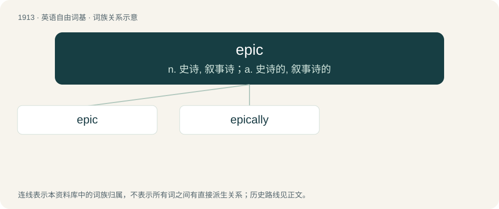

# 2026 · epic — n. 史诗, 叙事诗；a. 史诗的, 叙事诗的

[总目录](../00_总目录_按常用程度.md)

**类型**：英语自由词基　｜　**来源语言**：见词源记录

## 核心含义与来源

- 核心含义：n. 史诗, 叙事诗；a. 史诗的, 叙事诗的
- 英文含义：An extended narrative poem in elevated or dignified language, celebrating the feats of a deity, demigod (heroic epic), other legend or traditional hero.
- 词形：epic

**多个词源／构词路径**：同一拼写可能有不同来源；以下按词性和含义分别列出。

**来源记录 1**（名词；An extended narrative poem in elevated or dignified language, celebrating the feats of a deity, demigod (heroic epic), other legend or traditional hero.）

From Middle French épique, from Latin epicus, from Ancient Greek ἐπικός (epikós), from ἔπος (épos, “word, story”).

**来源记录 2**（形容词；That is an epimorphism.）

From epi-, from Ancient Greek ἐπί (epí, “on top of”).

## 词族图

## 单词速览（常用到不常用）

| 单词 | 音标 | 释义 |
|---|---|---|
| [epic](#w-1) | 英 /ˈɛp.ɪk/ | n. 史诗, 叙事诗；a. 史诗的, 叙事诗的 |
| [epically](#w-2) | /ˊepikəli/ | adv. 叙事诗式地 |

## 逐词详解

### 1. epic

**词性**：名词　｜　**音标**：英 /ˈɛp.ɪk/

**中文释义**：n. 史诗, 叙事诗；a. 史诗的, 叙事诗的

**英文义项**：An extended narrative poem in elevated or dignified language, celebrating the feats of a deity, demigod (heroic epic), other legend or traditional hero. / A series of events considered appropriate to an epic; any work of literature, film, etc. having heroic deeds and adventures as its subject matter.

**词源与演化**：

From Middle French épique, from Latin epicus, from Ancient Greek ἐπικός (epikós), from ἔπος (épos, “word, story”).

**例句**：

> The Icelandic epic took all night to recite.

该用例对应义项：An extended narrative poem in elevated or dignified language, celebrating the feats of a deity, demigod (heroic epic), other legend or traditional hero.

### 2. epically

**词性**：副词　｜　**音标**：/ˊepikəli/

**中文释义**：adv. 叙事诗式地

**英文义项**：In an epic manner; in the style of an epic / Extremely; very; significantly.

**构词拆分**：epic + -ally；epical + -ly

**词源与演化**：

From epic + -ally or epical + -ly.

**例句**：

> Yanni had an epically bad high school friend.
