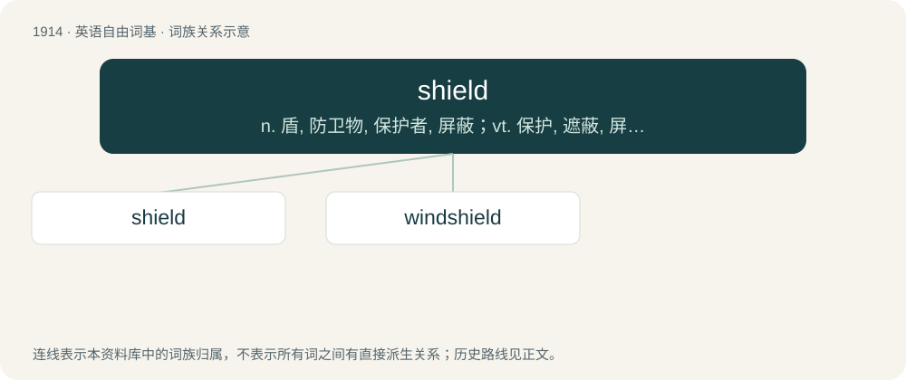

# 2027 · shield — n. 盾, 防卫物, 保护者, 屏蔽；vt. 保护, 遮蔽, 屏蔽, 庇护, 挡开, 避开；vi. 起保护作用

[总目录](../00_总目录_按常用程度.md)

**类型**：英语自由词基　｜　**来源语言**：见词源记录

## 核心含义与来源

- 核心含义：n. 盾, 防卫物, 保护者, 屏蔽；vt. 保护, 遮蔽, 屏蔽, 庇护, 挡开, 避开；vi. 起保护作用
- 英文含义：A broad piece of defensive armor, held in hand, formerly in general use in war, for the protection of the body.
- 词形：shield

**多个词源／构词路径**：同一拼写可能有不同来源；以下按词性和含义分别列出。

**来源记录 1**（名词；A broad piece of defensive armor, held in hand, formerly in general use in war, for the protection of the body.）

From Middle English scheld, shelde, from Old English scield (“shield”), from Proto-West Germanic \*skeldu, from Proto-Germanic \*skelduz (“shield”), from Proto-Indo-European \*(s)kelH- (“cut, split”). Cognates Cognate with West Frisian skyld (“shield”), Bavarian Schuid (“shield”), Dutch schild (“shield”), German and Low German Schild (“shield”), Luxembourgish Schëld (“shield”), Yiddish שילד (shild, “shield”), Danish, Norwegian Bokmål, and Norwegian Nynorsk skjold (“shield”), Elfdalian stjöld (“shield”), Faroese skjøldur (“shield”), Gutnish skiåld (“shield”), Icelandic skjöldur (“shield”), Swedish sköld (“shield”), Gothic 𐍃𐌺𐌹𐌻𐌳𐌿𐍃 (skildus, “shield”). Compare Breton skoed (“shield”), Irish sciath (“shield”), Scottish Gaelic sgiath (“shield”), Latin scūtum (“shield”), Latgalian škīda (“shield”), Lithuanian skydas (“shield”), Belarusian шчыт (ščyt, “shield”), Bulgarian, Russian, and Ukrainian щит (ščyt, “shield”), Czech and Slovak štít (“shield”), Macedonian штит (štit, “shield”), Polish szczyt (“shield”), Serbo-Croatian штит, štit, ščit (“shield”), Slovene ščit (“shield”), from Proto-Indo-European \*skey- (“to dissect, split”).

**来源记录 2**（动词；To protect, to defend.）

An alteration of Middle English schilden after Etymology 1, from Old English sċildan, from Proto-West Germanic \*skildijan, form Proto-Germanic \*skildijaną.

## 词族图

## 单词速览（常用到不常用）

| 单词 | 音标 | 释义 |
|---|---|---|
| [shield](#w-1) | 英 /ˈʃiːld/；美 /ˈʃild/ | n. 盾, 防卫物, 保护者, 屏蔽；vt. 保护, 遮蔽, 屏蔽, 庇护, 挡开, 避开；vi. 起保护作用 |
| [windshield](#w-2) | /wɪnˈʃiːld/ | n. 挡风玻璃；\[电\] 风遮蔽 |

## 逐词详解

### 1. shield

**词性**：名词　｜　**音标**：英 /ˈʃiːld/；美 /ˈʃild/

**中文释义**：n. 盾, 防卫物, 保护者, 屏蔽；vt. 保护, 遮蔽, 屏蔽, 庇护, 挡开, 避开；vi. 起保护作用

**英文义项**：A broad piece of defensive armor, held in hand, formerly in general use in war, for the protection of the body. / One who protects or defends.

**词源与演化**：

From Middle English scheld, shelde, from Old English scield (“shield”), from Proto-West Germanic \*skeldu, from Proto-Germanic \*skelduz (“shield”), from Proto-Indo-European \*(s)kelH- (“cut, split”). Cognates Cognate with West Frisian skyld (“shield”), Bavarian Schuid (“shield”), Dutch schild (“shield”), German and Low German Schild (“shield”), Luxembourgish Schëld (“shield”), Yiddish שילד (shild, “shield”), Danish, Norwegian Bokmål, and Norwegian Nynorsk skjold (“shield”), Elfdalian stjöld (“shield”), Faroese skjøldur (“shield”), Gutnish skiåld (“shield”), Icelandic skjöldur (“shield”), Swedish sköld (“shield”), Gothic 𐍃𐌺𐌹𐌻𐌳𐌿𐍃 (skildus, “shield”). Compare Breton skoed (“shield”), Irish sciath (“shield”), Scottish Gaelic sgiath (“shield”), Latin scūtum (“shield”), Latgalian škīda (“shield”), Lithuanian skydas (“shield”), Belarusian шчыт (ščyt, “shield”), Bulgarian, Russian, and Ukrainian щит (ščyt, “shield”), Czech and Slovak štít (“shield”), Macedonian штит (štit, “shield”), Polish szczyt (“shield”), Serbo-Croatian штит, štit, ščit (“shield”), Slovene ščit (“shield”), from Proto-Indo-European \*skey- (“to dissect, split”).

**例句**：

> To shield from space radiation, moon habitats may have to be underground.

### 2. windshield

**词性**：名词　｜　**音标**：/wɪnˈʃiːld/

**中文释义**：n. 挡风玻璃；\[电\] 风遮蔽

**英文义项**：A transparent screen made of glass, located at the front and back of a vehicle in front of its occupants to protect them from the wind force generated by the vehicle's speed and inclement weather. / A cover for a microphone to exclude airy noises such as wind and breathing.

**构词拆分**：wind + shield

**词源与演化**：

From wind + shield.

**例句**：

> The freezing rain covered our windshield with ice and we couldn't see a thing.

该用例对应义项：A transparent screen made of glass, located at the front and back of a vehicle in front of its occupants to protect them from the wind force generated by the vehicle's speed and inclement weather.
