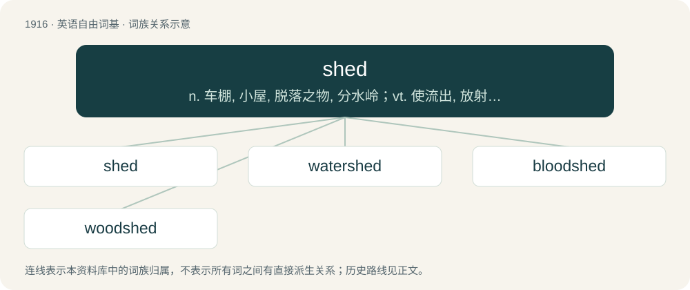

# 2029 · shed — n. 车棚, 小屋, 脱落之物, 分水岭；vt. 使流出, 放射, 脱落, 散发, 摆脱；vi. 流出, 散布, 脱落

[总目录](../00_总目录_按常用程度.md)

**类型**：英语自由词基　｜　**来源语言**：见词源记录

## 核心含义与来源

- 核心含义：n. 车棚, 小屋, 脱落之物, 分水岭；vt. 使流出, 放射, 脱落, 散发, 摆脱；vi. 流出, 散布, 脱落
- 英文含义：To part, separate or divide.
- 词形：shed

**多个词源／构词路径**：同一拼写可能有不同来源；以下按词性和含义分别列出。

**来源记录 1**（动词；To part, separate or divide.）

From Middle English scheden, schede, from Old English scēadan, scādan (“to separate, divide, part, make a line of separation between; remove from association or companionship; distinguish, discriminate, decide, determine, appoint; shatter, shed; expound; decree; write down; differ”), from Proto-West Germanic \*skaiþan, from Proto-Germanic \*skaiþaną (compare West Frisian skiede, Dutch and German scheiden), from Proto-Indo-European \*skeyt- (“to cut, part, divide, separate”), from \*skey-. See also Irish scian (“knife”), Lithuanian skėsti (“to spread”), ski̇́esti (“to separate”), Old Church Slavonic цѣдити (cěditi, “to filter, strain”), Ancient Greek σχίζω (skhízō, “to split”), Old Armenian ցտեմ (cʻtem, “to scratch”), Sanskrit च्यति (cyáti, “he cuts off”)). Related to shoad, shit, sheath.

**来源记录 2**（名词；An opening between upper and lower warp yarns through which the weft is woven.）

From Middle English sched, schede, schad, from a combination of Old English scēada (“a parting of the hair, top of the head”) and Old English ġesċēad (“distinction, reason”).

**来源记录 3**（名词；A slight or temporary structure built to shade or shelter something; a structure usually open in front; an outbuilding, especially a smallish one; a hut.）

Dialectal variant of a specialized use of shade.

## 词族图

## 单词速览（常用到不常用）

| 单词 | 音标 | 释义 |
|---|---|---|
| [shed](#w-1) | /ʃɛd/ | n. 车棚, 小屋, 脱落之物, 分水岭；vt. 使流出, 放射, 脱落, 散发, 摆脱；vi. 流出, 散布, 脱落 |
| [watershed](#w-2) | 英 /ˈwɔːtəʃɛd/；美 /ˈwɔtɚʃɛd/ | n. 流域, 分水岭；\[医\] 分水界, 分水岭 |
| [bloodshed](#w-3) | /ˈblʌdˌʃɛd/ | n. 流血 |
| [woodshed](#w-4) | 美 /ˈwʊdˌʃɛd/ | n. 柴间 |

## 逐词详解

### 1. shed

**词性**：动词　｜　**音标**：/ʃɛd/

**中文释义**：n. 车棚, 小屋, 脱落之物, 分水岭；vt. 使流出, 放射, 脱落, 散发, 摆脱；vi. 流出, 散布, 脱落

**英文义项**：To part, separate or divide. / To part with, separate from, leave off; cast off, cast, let fall, be divested of.

**词源与演化**：

From Middle English scheden, schede, from Old English scēadan, scādan (“to separate, divide, part, make a line of separation between; remove from association or companionship; distinguish, discriminate, decide, determine, appoint; shatter, shed; expound; decree; write down; differ”), from Proto-West Germanic \*skaiþan, from Proto-Germanic \*skaiþaną (compare West Frisian skiede, Dutch and German scheiden), from Proto-Indo-European \*skeyt- (“to cut, part, divide, separate”), from \*skey-. See also Irish scian (“knife”), Lithuanian skėsti (“to spread”), ski̇́esti (“to separate”), Old Church Slavonic цѣдити (cěditi, “to filter, strain”), Ancient Greek σχίζω (skhízō, “to split”), Old Armenian ցտեմ (cʻtem, “to scratch”), Sanskrit च्यति (cyáti, “he cuts off”)). Related to shoad, shit, sheath.

**例句**：

> You must shed your fear of the unknown before you can proceed.

该用例对应义项：To part with, separate from, leave off; cast off, cast, let fall, be divested of.

### 2. watershed

**词性**：名词　｜　**音标**：英 /ˈwɔːtəʃɛd/；美 /ˈwɔtɚʃɛd/

**中文释义**：n. 流域, 分水岭；\[医\] 分水界, 分水岭

**英文义项**：The topographical boundary dividing two adjacent catchment basins, such as a ridge or a crest. / A region of land within which water flows down into a specified body, such as a river, lake, sea, or ocean; a drainage basin.

**构词拆分**：water + shed

**词源与演化**：

From water + shed. A calque of German Wasserscheide.

**用法示例／搭配（非完整句）**：

> watershed moment — watershed event — watershed ruling

该用例对应义项：A critical point marking a change in course or development.

### 3. bloodshed

**词性**：名词　｜　**音标**：/ˈblʌdˌʃɛd/

**中文释义**：n. 流血

**英文义项**：The shedding or spilling of blood. / A slaughter; destruction of life, notably on a large scale.

**构词拆分**：blood + shed

**词源与演化**：

From attested early forms of such phrases as "there was much blood shed"; equivalent to blood + shed, past participle of shed.

**例句**：

> The revolution resulted in heavy bloodshed.

该用例对应义项：The shedding or spilling of blood.

### 4. woodshed

**词性**：名词　｜　**音标**：美 /ˈwʊdˌʃɛd/

**中文释义**：n. 柴间

**英文义项**：An enclosed, roofed structure, often an outbuilding, used primarily to store firewood. / A place where punishments or reprimands are administered.

**构词拆分**：wood + shed

**词源与演化**：

From wood + shed.

**例句**：

> Can I have those broken pieces of china that are out in the woodshed?
