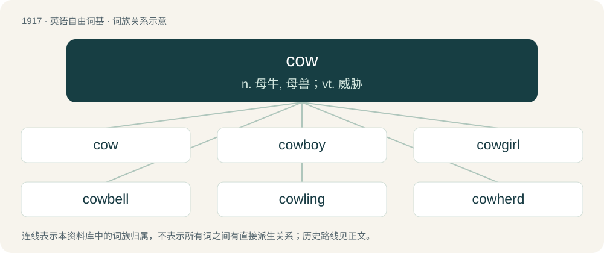

# 2030 · cow — n. 母牛, 母兽；vt. 威胁

[总目录](../00_总目录_按常用程度.md)

**类型**：英语自由词基　｜　**来源语言**：见词源记录

## 核心含义与来源

- 核心含义：n. 母牛, 母兽；vt. 威胁
- 英文含义：An adult female of the species Bos taurus, especially one that has calved.
- 词形：cow

**多个词源／构词路径**：同一拼写可能有不同来源；以下按词性和含义分别列出。

**来源记录 1**（名词；An adult female of the species Bos taurus, especially one that has calved.）

Inherited from Middle English cow, cou, from Old English cū (“cow”), from Proto-West Germanic \*kō, from Proto-Germanic \*kōz (“cow”), from Proto-Indo-European \*gʷṓws (“cow”). Cognate with Sanskrit गो (go), Ancient Greek βοῦς (boûs), Persian گاو (gâv)), Latvian govs (“cow”), Proto-Slavic \*govędo (Serbo-Croatian govedo, Russian говядина (govjadina, “beef”), Scots coo (“cow”), North Frisian ko, kø (“cow”), West Frisian ko (“cow”), Dutch koe (“cow”), Low German Koh, Koo, Kau (“cow”), German Kuh (“cow”), Danish and Swedish ko (“cow”), Norwegian Bokmål and Norwegian Nynorsk ku (“cow”), Faroese kúgv (“cow”), Icelandic kýr (“cow”), Latin bōs (“ox, bull, cow”) (whence English beef), Armenian կով (kov, “cow”). Doublet of beef. The plural kine is from Middle English kyne, kyn, kuin, kiin, kien (“cows”), either a double plural of Middle English ky, kye (“cows”), equivalent to modern kye + -en, or inherited from Old English cūna (“cows', of cows”), genitive plural of cū (“cow”).

**来源记录 2**（动词；To intimidate; to daunt the spirits or courage of.）

Probably from Old Norse kúga (“to oppress”) (whence also Norwegian and Danish kue, Swedish kuva); compare Icelandic kúfa (“to set on top”) and Faroese kúga (“to oppress”).

**来源记录 3**（名词；LFBOT: Synonym of luminous fast blue optical transient.）

Clipping of AT2018cow. From the name of the archetypal event, AT2018cow, an LFBOT. From being an astronomical transient (AT) occurring in 2018, with an automatically assigned code to distinguish it from other events in 2018.

## 词族图

## 单词速览（常用到不常用）

| 单词 | 音标 | 释义 |
|---|---|---|
| [cow](#w-1) | 美 /kaʊ/ | n. 母牛, 母兽；vt. 威胁 |
| [cowboy](#w-2) | /ˈkaʊˌbɔɪ/ | n. 牛仔, 牛郎, 牧童 |
| [cowgirl](#w-3) | 美 /ˈkaʊˌɡɝl/ | n. 女牛仔 |
| [cowbell](#w-4) | /ˈkaʊˌbɛl/ | n. 母牛的颈铃 |
| [cowling](#w-5) | /ˈkauliŋ/ | n. 飞机整流罩, 外壳 |
| [cowherd](#w-6) | /ˈkauhəːd/ | n. 牧牛者 |
| [cowhide](#w-7) | 美 /ˈkaʊˌhaɪd/ | n. 牛皮, 牛皮鞭；vt. 用牛皮鞭打 |

## 逐词详解

### 1. cow

**词性**：名词　｜　**音标**：美 /kaʊ/

**中文释义**：n. 母牛, 母兽；vt. 威胁

**英文义项**：An adult female of the species Bos taurus, especially one that has calved. / Any member of the species Bos taurus that is not of a bucking breed or fighting breed, regardless of sex or age, including steers and calves.

**构词拆分**：kye + -en

**词源与演化**：

Inherited from Middle English cow, cou, from Old English cū (“cow”), from Proto-West Germanic \*kō, from Proto-Germanic \*kōz (“cow”), from Proto-Indo-European \*gʷṓws (“cow”). Cognate with Sanskrit गो (go), Ancient Greek βοῦς (boûs), Persian گاو (gâv)), Latvian govs (“cow”), Proto-Slavic \*govędo (Serbo-Croatian govedo, Russian говядина (govjadina, “beef”), Scots coo (“cow”), North Frisian ko, kø (“cow”), West Frisian ko (“cow”), Dutch koe (“cow”), Low German Koh, Koo, Kau (“cow”), German Kuh (“cow”), Danish and Swedish ko (“cow”), Norwegian Bokmål and Norwegian Nynorsk ku (“cow”), Faroese kúgv (“cow”), Icelandic kýr (“cow”), Latin bōs (“ox, bull, cow”) (whence English beef), Armenian կով (kov, “cow”). Doublet of beef. The plural kine is from Middle English kyne, kyn, kuin, kiin, kien (“cows”), either a double plural of Middle English ky, kye (“cows”), equivalent to modern kye + -en, or inherited from Old English cūna (“cows', of cows”), genitive plural of cū (“cow”).

**例句**：

> We saw lots of cows at the farm show, including some surprisingly gigantic bulls.

该用例对应义项：Any member of the species Bos taurus that is not of a bucking breed or fighting breed, regardless of sex or age, including steers and calves.

### 2. cowboy

**词性**：名词　｜　**音标**：/ˈkaʊˌbɔɪ/

**中文释义**：n. 牛仔, 牛郎, 牧童

**英文义项**：A man who tends free-range cattle, especially in the American West. / A man who identifies with cowboy culture, including wearing a cowboy hat and being a fan of country and western music.

**构词拆分**：cow + boy

**词源与演化**：

From cow + boy. More on Wikipedia.

**例句**：

> Tom was wearing a cowboy hat the last time I saw him.

### 3. cowgirl

**词性**：名词　｜　**音标**：美 /ˈkaʊˌɡɝl/

**中文释义**：n. 女牛仔

**英文义项**：A woman who tends free-range cattle, especially in the American West. / A woman who identifies with cowboy culture, including clothing such as the cowboy hat.

**构词拆分**：cow + girl

**词源与演化**：

From cow + girl.

**例句**：

> This year, my sister is dressing up as a cowgirl.

### 4. cowbell

**词性**：名词　｜　**音标**：/ˈkaʊˌbɛl/

**中文释义**：n. 母牛的颈铃

**英文义项**：A bell worn by cows; sometimes with an ornate strap. / A musical instrument, typically found without a clapper.

**构词拆分**：cow + bell

**词源与演化**：

From cow + bell.

**例句**：

> This song would sound better with the addition of a cowbell.

该用例对应义项：A musical instrument, typically found without a clapper.

### 5. cowling

**词性**：名词　｜　**音标**：/ˈkauliŋ/

**中文释义**：n. 飞机整流罩, 外壳

**英文义项**：A young or little cow; calf.

**构词拆分**：cow + -ling

**词源与演化**：

From cow + -ling.

### 6. cowherd

**词性**：名词　｜　**音标**：/ˈkauhəːd/

**中文释义**：n. 牧牛者

**英文义项**：One who herds cattle; a cowboy.

**构词拆分**：cow + herd (“herder”)

**词源与演化**：

From Middle English couherde, from Old English cūhierde, equivalent to cow + herd (“herder”). Doublet of Coward (the surname). Cognate with German Kuhhirte (“cowherd”). Compare shepherd, goatherd, swineherd, etc.

**例句**：

> Without a cowherd, the cows wandered in a field where wheat was growing.

### 7. cowhide

**词性**：名词　｜　**音标**：美 /ˈkaʊˌhaɪd/

**中文释义**：n. 牛皮, 牛皮鞭；vt. 用牛皮鞭打

**英文义项**：A hide of a cow. / Any quantity of hides of cows.

**构词拆分**：cow + hide

**词源与演化**：

From cow + hide.
