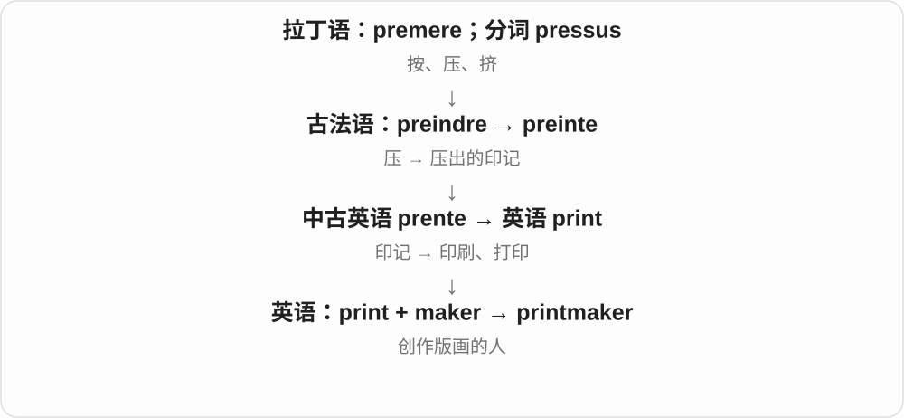

# 2030 · maker — 制作、造成某物的人、机构或器物

[逐词精讲目录](../00_逐词精讲目录.md) · [总目录](../00_总目录_按常用程度.md)

## 核心词根与来源

前半段指定制作什么：汽车、衣服、玩具是产品，电影、法律是作品和规则；配对、机会等还会借制作形成抽象角色名。

**MAKER：前面写做什么，后面标出制造角色**

maker 与前段结合，能说人、公司、设备；automaker 的 auto 是汽车，boilermaker 另有饮品借名。

- **基本角色与制造业**：maker · automaker · carmaker · dressmaker · shoemaker · toymaker · boilermaker
- **创造作品与产业**：filmmaker · winemaker · watchmaker · printmaker · hitmaker
- **规则、关系、机会与赛场**：lawmaker · playmaker · homemaker · matchmaker · bookmaker · rainmaker · kingmaker · moneymaker
- **器物与活动空间**：pacemaker · coffeemaker · makerspace

## 词形与演化规律

make 去 e + -er → maker；auto/dress/toy/boiler 等 + maker；已有组合的比喻、器物义分别看正文。

## 单词速览（按词族由简到繁）

同一基础词的相关扩展放在一起，先读基础形式，再读扩展；各组之间优先读常用的。具体词源关系见各词讲解。

| 单词 | 音标 | 核心意思 |
|---|---|---|
| [maker](#w-1) | 英 /ˈmeɪkə/；美 /ˈmeɪkər/ | 制造者；制作人；制造设备 |
| [makerspace](#w-21) | 英 /ˈmeɪkəspeɪs/；美 /ˈmeɪkərspeɪs/ | 创客空间；共享制作工坊 |
| [filmmaker](#w-2) | 英 /ˈfɪlmmeɪkə/；美 /ˈfɪlmmeɪkər/ | 电影创作者；电影制作人 |
| [lawmaker](#w-3) | 英 /ˈlɔːmeɪkə/；美 /ˈlɔːmeɪkər/ | 立法者；议员〔新闻常用〕 |
| [shoemaker](#w-4) | 英 /ˈʃuːmeɪkə/；美 /ˈʃuːmeɪkər/ | 鞋匠；制鞋者 |
| [pacemaker](#w-5) | 英 /ˈpeɪsmeɪkə/；美 /ˈpeɪsmeɪkər/ | 领跑者；心脏起搏点或起搏器 |
| [playmaker](#w-6) | 英 /ˈpleɪmeɪkə/；美 /ˈpleɪmeɪkər/ | 组织进攻的球员；策动者 |
| [homemaker](#w-7) | 英 /ˈhəʊmmeɪkə/；美 /ˈhoʊmmeɪkər/ | 料理家务、照顾家庭的人 |
| [matchmaker](#w-8) | 英 /ˈmætʃmeɪkə/；美 /ˈmætʃmeɪkər/ | 媒人；牵线搭桥者；配对安排者 |
| [winemaker](#w-9) | 英 /ˈwaɪnmeɪkə/；美 /ˈwaɪnmeɪkər/ | 葡萄酒酿造者、酿酒师 |
| [automaker](#w-10) | 英 /ˈɔːtəʊmeɪkə/；美 /ˈɔːtoʊmeɪkər/ | 汽车制造商 |
| [bookmaker](#w-11) | 英 /ˈbʊkmeɪkə/；美 /ˈbʊkmeɪkər/ | 博彩经营者；制书者〔历史或特定语境〕 |
| [watchmaker](#w-12) | 英 /ˈwɒtʃmeɪkə/；美 /ˈwɑːtʃmeɪkər/ | 制表匠；修表师；制表企业 |
| [dressmaker](#w-13) | 英 /ˈdresmeɪkə/；美 /ˈdresmeɪkər/ | 制衣师、女装裁缝 |
| [rainmaker](#w-14) | 英 /ˈreɪnmeɪkə/；美 /ˈreɪnmeɪkər/ | 求雨者；带来大量客户、业务或资金的人〔比喻〕 |
| [kingmaker](#w-15) | 英 /ˈkɪŋmeɪkə/；美 /ˈkɪŋmeɪkər/ | 拥立君王者；能左右领袖人选的人或力量 |
| [moneymaker](#w-16) | 英 /ˈmʌnimeɪkə/；美 /ˈmʌnimeɪkər/ | 赚钱的人或事物；盈利项目 |
| [carmaker](#w-17) | 英 /ˈkɑːmeɪkə/；美 /ˈkɑːrmeɪkər/ | 汽车制造商 |
| [coffeemaker](#w-18) | 英 /ˈkɒfimeɪkə/；美 /ˈkɔːfimeɪkər/ 或 /ˈkɑːfimeɪkər/ | 咖啡机、煮咖啡的器具 |
| [printmaker](#w-19) | 英 /ˈprɪntmeɪkə/；美 /ˈprɪntmeɪkər/ | 版画家；版画制作艺术家 |
| [hitmaker](#w-20) | 英 /ˈhɪtmeɪkə/；美 /ˈhɪtmeɪkər/ | 热门作品创作者；金曲制作人 |
| [toymaker](#w-22) | 英 /ˈtɔɪmeɪkə/；美 /ˈtɔɪmeɪkər/ | 玩具制作人、玩具制造商 |
| [boilermaker](#w-23) | 英 /ˈbɔɪləmeɪkə/；美 /ˈbɔɪlərmeɪkər/ | 锅炉制造、维修工；威士忌配啤酒〔饮品名〕 |

## 逐词讲解

### 1. maker — 制造者；制作人；制造设备

**音标**：英 /ˈmeɪkə/；美 /ˈmeɪkər/

**先抓住这个画面**

谁把东西做出来，谁就是 maker；换成一台专门做咖啡的机器，它也可以是 a coffee maker。-er 在这里不只指人。

**怎么拆**

make 去 e 加 -er，中古英语已有 maker／makere。早期可说创造者，后来广用于制造商、工匠及执行制作功能的器具。

**怎么变成今天的意思**

**英语 make；-er**  
制作；做事的人或器具

↓

**中古英语 maker／makere → 英语 maker**  
制造者、创作者；后来也说设备

car makers 是汽车制造商；a maker of violins 是制琴师。现代 maker 社群常指喜欢亲手设计、制作、改装东西的人。大写 the Maker 在宗教语境可指造物主。

**常见搭配与例句**

a furniture maker；a coffee maker；the maker of a product；maker culture。

> The maker’s name is engraved on the back of the watch.

制表者的名字刻在手表背面。

> Our old coffee maker still works perfectly.

我们的旧咖啡机仍然运转良好。

**别混淆**

maker 范围比 manufacturer 宽，个人手作、机器都能用；manufacturer 通常说生产商品的企业或生产者。

### 2. makerspace — 创客空间；共享制作工坊

**音标**：英 /ˈmeɪkəspeɪs/；美 /ˈmeɪkərspeɪs/

**先抓住这个画面**

大家带着想做的东西来，共用工具、设备和经验，把点子做成实物。

**怎么拆**

maker“动手制作的人” + space，形式也受到 workspace 等词影响。

**怎么变成今天的意思**

**英语 maker〔古英语 macian → make + -er〕；space〔拉丁 spatium → 法语 → 英语〕**  
动手制作的人；空间

↓

**现代英语 maker + space → makerspace**  
供人共同制作、学习与修理的场所

makerspace 可能提供木工、电子、缝纫或数字制造设备，不必只做高科技产品。图书馆、学校和社区都可能设这种空间。

**常见搭配与例句**

a community makerspace；a library makerspace；join a makerspace。

> The library opened a makerspace with sewing machines and basic tools.

图书馆开设了一个配有缝纫机和基础工具的创客空间。

> We repaired the broken lamp at the community makerspace.

我们在社区创客空间修好了那盏坏灯。

**别混淆**

workspace 泛指工作区；makerspace 特别强调动手制作和共享设备、知识。

### 3. filmmaker — 电影创作者；电影制作人

**音标**：英 /ˈfɪlmmeɪkə/；美 /ˈfɪlmmeɪkər/

**先抓住这个画面**

把画面、声音和故事组织成一部电影的人，可以称 filmmaker。这个称呼强调创作电影，不一定只对应片尾某一个职位。

**怎么拆**

film 与 maker 在英语中组合。19 世纪同形组合还曾用于与摄影胶片制作相关的人或物；20 世纪初明确用于电影创作者。现代拍数字电影的人同样可以叫 filmmaker。

**怎么变成今天的意思**

**英语 film；maker**  
薄膜、胶片，后来也指电影；制作人或物

↓

**较早胶片制作相关组合 → 电影创作义 filmmaker**  
随 film 的电影义发展，成为电影创作者称呼

独立电影报道常用 independent filmmaker；documentary filmmaker 是纪录片创作者。一个人可能同时编剧、导演、拍摄，因此这个词比单一工种名称更宽。

**常见搭配与例句**

an independent filmmaker；a documentary filmmaker；young filmmakers。

> The filmmaker spent two years following the same family.

这位电影创作者花了两年时间跟拍同一个家庭。

> The festival gives young filmmakers a place to show their work.

这个电影节为年轻电影人提供了展示作品的平台。

**别混淆**

director 是导演这一具体职位，filmmaker 更宽泛；不是所有 filmmakers 都只负责导演，也不表示制造塑料胶片的工人。

### 4. lawmaker — 立法者；议员〔新闻常用〕

**音标**：英 /ˈlɔːmeɪkə/；美 /ˈlɔːmeɪkər/

**先抓住这个画面**

新闻里说 lawmakers debated the proposal，通常就是议员们在讨论提案。maker 在这里是参与制定规则的人，不是用手制造某件物品。

**怎么拆**

law 加 maker；英语晚期中古时期已有这个组合。它与 lawmaking 共享构件，但不必把现代名词画成先由 lawmaking 再删去后缀而来。

**怎么变成今天的意思**

**英语 law；maker**  
法律；制定者

↓

**英语 lawmaker〔15 世纪已有记录〕**  
制定法律的人；常用于立法机关成员

新闻常用 lawmakers 概称参与立法的议员，不逐一写他们的正式职衔。具体制度中的权限和身份仍取决于文章所在国家与机构。

**常见搭配与例句**

lawmakers debated；a group of lawmakers；local lawmakers。

> Lawmakers debated the proposal late into the evening.

议员们讨论这项提案，一直持续到晚上很晚。

> Several lawmakers asked for clearer wording in the bill.

几位议员要求把法案的措辞写得更清楚。

**别混淆**

lawmaker 是立法者；lawyer 是律师。会研究或使用法律，不等于拥有制定法律的职位。

### 5. shoemaker — 鞋匠；制鞋者

**音标**：英 /ˈʃuːmeɪkə/；美 /ˈʃuːmeɪkər/

**先抓住这个画面**

量脚、裁皮、缝合鞋面，把材料做成一双鞋的人，就是 shoemaker。词里的 maker 对应实实在在的制作。

**怎么拆**

shoe 与 maker 组合，中古英语已有相关词形。更早古英语用过其他“鞋＋工匠”词，但现代 shoemaker 是这一组合自身的历史，不需要把那些旧词硬串成同一祖先链。

**怎么变成今天的意思**

**英语 shoe；maker**  
鞋；制作的人

↓

**中古英语 shoemaker 类组合 → 英语 shoemaker**  
制鞋者、鞋匠

可以指传统手工制鞋匠，也可泛指制鞋企业或生产者。上下文会说明说的是具体工匠还是品牌。

**常见搭配与例句**

a skilled shoemaker；a traditional shoemaker；a local shoemaker。

> The shoemaker measured both feet before cutting the leather.

鞋匠裁皮前量了双脚。

> A local shoemaker crafted the boots by hand.

当地一位鞋匠手工制作了这双靴子。

**别混淆**

cobbler 常侧重修鞋，shoemaker 首先说制作鞋；实际店铺和日常称呼有重叠，不用把两种工作绝对隔开。

### 6. pacemaker — 领跑者；心脏起搏点或起搏器

**音标**：英 /ˈpeɪsmeɪkə/；美 /ˈpeɪsmeɪkər/

**先抓住这个画面**

比赛中有人先按目标速度跑，让后面的选手跟上节奏；心脏中也需要产生节律的信号。pacemaker 把两者都抓在“定节奏”这个点上。

**怎么拆**

pace“步速、节奏”加 maker，19 世纪先用于带领速度的人或物；20 世纪用于心脏的自然节律来源，再用于人工心脏起搏器。pace 不是 peace“和平”。

**怎么变成今天的意思**

**英语 pace；maker**  
速度、节奏；设定或促成者

↓

**英语 pacemaker：比赛、训练中带节奏者**  
19 世纪已有

↓

**自然心脏起搏点；后来人工起搏器**  
20 世纪将“定节奏”用于生理结构及电刺激装置

日常医疗语境的 a pacemaker 常指用电脉冲帮助调节心跳的装置；natural pacemaker 则可说心脏自然产生节律的组织。体育语境依旧是领跑、领速的人。

**常见搭配与例句**

a race pacemaker；an artificial pacemaker；the heart’s natural pacemaker。

> The pacemaker kept a steady pace for the first few laps.

领跑者在前几圈保持了稳定速度。

> The diagram shows how a pacemaker sends electrical pulses to the heart.

图中展示了起搏器如何向心脏发送电脉冲。

**别混淆**

pacemaker 的核心是节奏，不是直接替代整个心脏泵血。peacemaker 多一个 e，意思是调解冲突、促成和平的人。

### 7. playmaker — 组织进攻的球员；策动者

**音标**：英 /ˈpleɪmeɪkə/；美 /ˈpleɪmeɪkər/

**先抓住这个画面**

不一定亲自完成最后一击，而是传球、跑位和判断让整次进攻成形。

**怎么拆**

play（战术、进攻配合）+ maker（促成者），以促成配合的作用命名球员。

**怎么变成今天的意思**

**英语 play；maker**  
并列的构词材料

↓

**play + maker → playmaker**  
策动比赛配合、组织进攻者

足球、篮球等不同运动都可用，但具体位置和任务依项目。比喻商业或政治中也可说推动布局的关键人。

**常见搭配与例句**

a creative playmaker；the team’s playmaker；a midfield playmaker。

> The playmaker created several chances with accurate passes.

这位组织进攻的球员用精准传球创造了几次机会。

> The team struggled after losing its main playmaker.

失去主要组织者后，球队打得很艰难。

**别混淆**

playmaker 强调组织机会，goalscorer 强调进球；同一个人可以两者兼有。

### 8. homemaker — 料理家务、照顾家庭的人

**音标**：英 /ˈhəʊmmeɪkə/；美 /ˈhoʊmmeɪkər/

**先抓住这个画面**

把房子维持成能让一家人生活的家，需要安排饮食、清洁、照护和日常事务。以这些家庭工作为主要职责的人，可以称 homemaker。

**怎么拆**

home 加 maker，19 世纪已有多个“营造、经营家园”的用法，后来常指主要负责家务和家庭照护的人。这里的 make a home 说经营家庭生活，不是施工盖房。

**怎么变成今天的意思**

**英语 home；maker**  
家、家庭生活；营造者

↓

**19 世纪 homemaker 的多种家庭相关用法 → 现代常用义**  
营造家园；主要负责家务和家庭生活的人

这个词不限定性别，也不要求已经结婚。常见于个人背景介绍或职业状况说明，强调所承担的家庭工作。

**常见搭配与例句**

a full-time homemaker；work as a homemaker；a parent and homemaker。

> After the move, he became the family’s main homemaker.

搬家后，他成为家里主要料理家务的人。

> Her years as a homemaker taught her to organize many tasks at once.

多年料理家务的经历让她学会同时安排多项事务。

**别混淆**

homemaker 不是 housebuilder“建房者”；也不同于受雇替另一家庭管理家务的 housekeeper。实际职责可能部分相似，身份关系不同。

### 9. matchmaker — 媒人；牵线搭桥者；配对安排者

**音标**：英 /ˈmætʃmeɪkə/；美 /ˈmætʃmeɪkər/

**先抓住这个画面**

把两个可能合得来的人介绍认识，希望他们成为伴侣，就是在做 matchmaker。现代也能把这种牵线用于工作或商业合作。

**怎么拆**

match“配对、婚配”加 maker；17 世纪已有婚姻牵线者的用法。match 与 maker 是并列构词材料，不是由一个词一路变出另一个。

**怎么变成今天的意思**

**英语 match；maker**  
合适的配对、婚配；促成者

↓

**英语 matchmaker**  
促成婚配的人；后来也用于安排其他相配关系者

play matchmaker 是充当红娘；商业文章也会说 someone acts as a matchmaker between investors and companies。这里的 match 选的是合适关系，不是火柴义。

**常见搭配与例句**

play matchmaker；a professional matchmaker；act as a matchmaker。

> Her friends kept trying to play matchmaker.

她的朋友们总想给她牵线介绍对象。

> The event acted as a matchmaker between small firms and potential partners.

这场活动为小企业和潜在合作伙伴牵线搭桥。

**别混淆**

matchmaker 是安排配对的人；partner 是配对关系中的一方。maker 不只说生产实体，也能说促成关系。

### 10. winemaker — 葡萄酒酿造者、酿酒师

**音标**：英 /ˈwaɪnmeɪkə/；美 /ˈwaɪnmeɪkər/

**先抓住这个画面**

把葡萄、发酵与后续处理变成一款酒的人或酿造方。不是只会倒酒、推荐酒的服务人员。

**怎么拆**

wine 葡萄酒 + maker 制作者；中古英语已有 wynmaker 等写法。可以说现代组合，也保留很早的复合词历史。

**怎么变成今天的意思**

**拉丁 vīnum → 早期日耳曼语借词 → 古英语 wīn → wine**  
葡萄酒；英语保留早期借入的酒名

↓

**wine + maker → 中古英语 wynmaker → winemaker**  
制作葡萄酒的人

a local winemaker 当地酿酒师，an experienced winemaker 有经验的酿酒师，meet the winemaker 见酿酒者。

**常见搭配与例句**

a local winemaker；an experienced winemaker；meet the winemaker。

> The winemaker explained how the grapes were selected.

酿酒师解释了怎样挑选葡萄。

> Several local winemakers took part in the festival.

几位当地酿酒师参加了节庆活动。

**别混淆**

winemaker 酿酒，winegrower 栽培酿酒葡萄，sommelier 侍酒师常负责选酒与服务；一个人可兼任，但名称侧重点不同。

### 11. automaker — 汽车制造商

**音标**：英 /ˈɔːtəʊmeɪkə/；美 /ˈɔːtoʊmeɪkər/

**先抓住这个画面**

前半段把做什么说清：汽车；后半段 maker 不一定是单个工人，新闻里通常是一家公司。

**怎么拆**

auto 是 automobile 汽车的短形式 + maker 制造者。这里 auto 不直接解释成自动，因此不是所有自动制作机器都叫 automaker。

**怎么变成今天的意思**

**古英语 macian → make**  
做、制作

↓

**make 去 e + -er → maker**  
制作的人、机构或器物；组合按做什么定角色

↓

**auto 汽车 + maker → automaker**  
汽车生产公司、制造商

a major automaker 大型汽车制造商，an electric-car automaker 电动汽车制造商，domestic automakers 本国汽车制造商。

**常见搭配与例句**

a major automaker；domestic automakers。

> The automaker announced a new factory.

汽车制造商宣布将建新工厂。

> Several automakers attended the exhibition.

几家汽车制造商参加了展览。

**别混淆**

automaker 和 carmaker 大量场合相同，manufacturer 更泛；auto 在这儿是汽车短词，不是现代自动化规则。

### 12. bookmaker — 博彩经营者；制书者〔历史或特定语境〕

**音标**：英 /ˈbʊkmeɪkə/；美 /ˈbʊkmeɪkər/

**先抓住这个画面**

现代常见义不是替你写小说，而是接受、记录赌注并经营相关业务的人。

**怎么拆**

book + maker，历史有制作、编书者义；博彩义接 make a book 等记赌注的旧表达，book 选记录册义。

**怎么变成今天的意思**

**英语 book〔记录册等义〕；maker**  
并列组合的两部分

↓

**book〔记录册等义〕 + maker → bookmaker**  
制书者；后来常指经营赌注业务者

a bookmaker’s shop 是博彩营业场所，a licensed bookmaker 是获许可经营者这一描述；具体许可制度随地区，不由词名保证。

**常见搭配与例句**

a bookmaker’s shop；a licensed bookmaker；local bookmakers。

> The article examines the history of bookmakers in Britain.

文章考察英国博彩经营者的历史。

> The character works in a bookmaker’s shop.

这个角色在一家博彩店工作。

**别混淆**

bookmaker 现代常是博彩经营者，bookbinder 装订，publisher 出版；看到 book 不要把三类职业混成书店。

### 13. watchmaker — 制表匠；修表师；制表企业

**音标**：英 /ˈwɒtʃmeɪkə/；美 /ˈwɑːtʃmeɪkər/

**先抓住这个画面**

小小表盘后有一套部件，有人专门制作、调校、维护它。

**怎么拆**

watch（表）+ maker，maker 是 make + -er，去 e；不把前半按观察动词解释成制造监看者。

**怎么变成今天的意思**

**watch；maker〔make + -er〕**  
并列构词部分

↓

**watchmaker**  
制作、维护表的工匠或企业

a skilled watchmaker 熟练制表师，an independent watchmaker 独立制表人、企业。职业实践可兼修表，具体分工按语境。

**常见搭配与例句**

a skilled watchmaker；an independent watchmaker；a watchmaker’s workshop。

> The watchmaker examined the tiny mechanism.

制表师查看了微小机芯。

> She took the old watch to a local watchmaker.

她把旧表送到当地制表修表师那里。

**别混淆**

watchmaker 造、修表，watchman 守卫；maker 和 man 不能因都指人就混用。

### 14. dressmaker — 制衣师、女装裁缝

**音标**：英 /ˈdresmeɪkə/；美 /ˈdresmeɪkər/

**先抓住这个画面**

量身、裁剪、缝制衣服的人，传统尤其侧重女装；不是简单服装店收银员。

**怎么拆**

dress 服装、连衣裙等 + maker 制作者。成词后指一类制衣职业，不把 dress 在所有语境都缩成单一种裙子。

**怎么变成今天的意思**

**古英语 macian → make**  
做、制作

↓

**make 去 e + -er → maker**  
制作的人、机构或器物；组合按做什么定角色

↓

**dress + maker → dressmaker**  
制作、定制衣服的从业者，尤女装

a skilled dressmaker 熟练制衣师，a dressmaker’s shop 裁缝店，work as a dressmaker 当制衣师。

**常见搭配与例句**

a skilled dressmaker；a dressmaker’s shop。

> The dressmaker altered the sleeves for a better fit.

制衣师修改了袖子，让衣服更合身。

> Her mother worked as a dressmaker.

她母亲曾做制衣师。

**别混淆**

dressmaker 侧重制衣、传统女装，tailor 更泛也可做男女服装；不能硬说两个词按从业者性别划分。

### 15. rainmaker — 求雨者；带来大量客户、业务或资金的人〔比喻〕

**音标**：英 /ˈreɪnmeɪkə/；美 /ˈreɪnmeɪkər/

**先抓住这个画面**

旱地盼雨，公司盼业务；能把客户和收益带进来的人，就被比作带来雨水的人。

**怎么拆**

rain + maker，旧用法指试图借仪式等带来雨的人，现代也用于催雨相关人或设备；商业比喻突出带来业务，不声称仪式实际必能控制天气。

**怎么变成今天的意思**

**古英语 reġn → 中古英语 reyn、rein → rain**  
雨；更远来源不确定

↓

**现代 rain**  
雨、下雨；大量落下或接连出现的比喻

↓

**rain + maker → rainmaker**  
试图造雨、求雨者；引申带来业务和资金的能人

the firm’s rainmaker 公司的业务能手，a rainmaker who attracts clients 能吸引客户的业务人物。

**常见搭配与例句**

the firm’s rainmaker；a successful rainmaker；a traditional rainmaker。

> She became the firm’s leading rainmaker by attracting major clients.

她通过吸引大客户，成了公司的头号业务能手。

> The story describes a rainmaker performing a ritual.

故事描写了一位求雨者举行仪式。

**别混淆**

rainmaker 商业里说客户、业务能力，weather forecaster 是预报天气的人；预报雨并不等于造雨。

### 16. kingmaker — 拥立君王者；能左右领袖人选的人或力量

**音标**：英 /ˈkɪŋmeɪkə/；美 /ˈkɪŋmeɪkər/

**先抓住这个画面**

自己不一定坐上最高位置，却能把别人推上去，关键的一票或支持掌握在他手里。

**怎么拆**

king 君王 + maker 促成者。历史称号里有著名用例，后来扩展到决定政治、组织领导人选的人或势力；不是制作一个国王玩偶的普通工匠。

**怎么变成今天的意思**

**king 君王；maker 促成者**  
并列构词部分

↓

**kingmaker**  
促成谁当君王、领袖的人或力量

a political kingmaker 左右领袖人选的政治人物、团体；a party can act as kingmaker 某党可能凭支持决定谁掌权。

**常见搭配与例句**

a political kingmaker；act as kingmaker；a potential kingmaker。

> The small party became a kingmaker after the close election.

选举结果接近，这个小党成了左右执政人选的关键力量。

> The novel portrays an adviser who acts as a kingmaker.

小说描绘了一位左右王位人选的顾问。

**别混淆**

kingmaker 影响谁成为领袖，kingpin 是群体中的关键人物、头目；一个人可能兼具两者，但词的焦点不同。

### 17. moneymaker — 赚钱的人或事物；盈利项目

**音标**：英 /ˈmʌnimeɪkə/；美 /ˈmʌnimeɪkər/

**先抓住这个画面**

店里有款产品长期卖得好、带来利润，老板可能说它是 a moneymaker。重点是能赚钱，不是产品里真的会吐出纸币。

**怎么拆**

money 与 maker 组合，早期也指铸造钱币的人。后来“make money 挣钱”的常用表达推动它用于善于赚钱的人、盈利商品或项目。

**怎么变成今天的意思**

**英语 money；maker**  
钱；制造或促成的人、物

↓

**较早 moneymaker：铸币者；后来挣钱者、盈利之物**  
从制作钱币的旧义扩展到获得收益的现代用法

a reliable moneymaker 是稳定带来收益的项目；a potential moneymaker 是被认为有赚钱潜力的东西。口语和商业报道较常见。

**常见搭配与例句**

a big moneymaker；a reliable moneymaker；a potential moneymaker。

> The small café became a steady moneymaker for the family.

这家小咖啡馆成了家庭稳定的收入来源。

> The sequel was a bigger moneymaker than the original film.

续集比原版电影更赚钱。

**别混淆**

moneymaker 描述赚钱能力，不自动保证投入、风险或质量如何。它通常不是指银行、提款机或印钞机器。

### 18. carmaker — 汽车制造商

**音标**：英 /ˈkɑːmeɪkə/；美 /ˈkɑːrmeɪkər/

**先抓住这个画面**

把汽车设计、生产出来的企业，而不是只负责开车、卖二手车的人。

**怎么拆**

car + maker，maker 是 make + -er，去 e 接后缀；常用于汽车制造企业。

**怎么变成今天的意思**

**car；maker〔make + -er〕**  
并列构词部分

↓

**carmaker**  
制造汽车的企业、制造者

a major carmaker 主要汽车制造商，an electric carmaker 电动汽车制造商。企业也可外包部分生产，词义重点是制造业务身份。

**常见搭配与例句**

a major carmaker；an electric carmaker；a domestic carmaker。

> The carmaker announced a new electric model.

汽车制造商宣布了一款新电动车型。

> Several carmakers displayed prototypes at the show.

几家汽车制造商在展会上展出了原型车。

**别混淆**

carmaker 制造商，car dealer 经销商，driver 驾驶者；同一产业链里的角色不同。

### 19. coffeemaker — 咖啡机、煮咖啡的器具

**音标**：英 /ˈkɒfimeɪkə/；美 /ˈkɔːfimeɪkər/ 或 /ˈkɑːfimeɪkər/

**先抓住这个画面**

负责把水和咖啡原料做成饮料的设备。maker 在这里叫机器，不一定叫一个人。

**怎么拆**

coffee + maker〔make + -er〕，合成器具名词。coffee maker 分开写也很常见。

**怎么变成今天的意思**

**阿拉伯语 qahwa → 奥斯曼土耳其语 kahve 等 → 欧洲语言相关形式**  
咖啡饮料名称的跨语言传播

↓

**荷兰语 koffie 等 → 英语 coffee**  
咖啡；一份咖啡、咖啡色等用途

↓

**coffee + maker → coffeemaker**  
制作咖啡饮料的器具

a drip coffeemaker 滴滤咖啡机，clean the coffeemaker 清洗咖啡机；具体机器类型依上下文。

**常见搭配与例句**

a drip coffeemaker；clean the coffeemaker；an electric coffeemaker。

> The coffeemaker is on the kitchen counter.

咖啡机放在厨房台面上。

> He cleaned the coffeemaker after breakfast.

他吃完早饭后清洗了咖啡机。

**别混淆**

coffeemaker 制作设备，coffee grinder 磨豆机；磨豆和冲泡是不同步骤，有的机器可把功能合在一起。

### 20. printmaker — 版画家；版画制作艺术家

**音标**：英 /ˈprɪntmeɪkə/；美 /ˈprɪntmeɪkər/

**先抓住这个画面**

通过制版和转印创作图像的人，而不是泛指开打印店的人。

**怎么拆**

print 版画 + maker 制作者，与 printmaking 成对。

**怎么变成今天的意思**

艺术职业名称，既可以设计图像，也可以探索材料与印制方式。

**常见搭配与例句**

an accomplished printmaker；a painter and printmaker。

> The exhibition features work by local printmakers.

展览展出了当地版画家的作品。

> She is both a painter and a printmaker.

她既是画家，也是版画家。

**别混淆**

printer 常指印刷工、印刷商或打印机；printmaker 强调艺术创作者。

### 21. hitmaker — 热门作品创作者；金曲制作人

**音标**：英 /ˈhɪtmeɪkə/；美 /ˈhɪtmeɪkər/

**先抓住这个画面**

做出来的作品常能大受欢迎，所以被称为制造 hit 的人。

**怎么拆**

hit 热门成功作品 + maker 制作者；hit 在这里是作品成功的名词义，不是打人。

**怎么变成今天的意思**

**hit 热门作品；maker 创作者、制作人**  
并列构词部分

↓

**hitmaker**  
制作热门作品的人

a pop hitmaker 流行金曲创作者；可能说歌手、词曲作者或制作人，具体角色由上下文决定。

**常见搭配与例句**

a pop hitmaker；a proven hitmaker；a successful hitmaker。

> The producer became known as a reliable hitmaker.

这位制作人以屡出热门作品而闻名。

> The show reunited several hitmakers from the same decade.

节目让同一个十年间的几位热门作品创作者重聚。

**别混淆**

hitmaker 不自动等于 singer 歌手；他也可能在幕后写歌、制作。

### 22. toymaker — 玩具制作人、玩具制造商

**音标**：英 /ˈtɔɪmeɪkə/；美 /ˈtɔɪmeɪkər/

**先抓住这个画面**

手工雕一匹木马的人可以是 toymaker，成批生产玩具的公司也可以；maker 按制造角色说，不限规模。

**怎么拆**

toy 玩具 + maker，清楚的名词组合。不是 toy 的玩家，而是把玩具做出来的人、机构。

**怎么变成今天的意思**

**古英语 macian → make**  
做、制作

↓

**make 去 e + -er → maker**  
制作的人、机构或器物；组合按做什么定角色

↓

**toy + maker → toymaker**  
制作玩具的人或公司

a maker of wooden toys 木制玩具匠，a traditional toymaker 传统玩具制作者，a large toymaker 大玩具公司。

**常见搭配与例句**

a traditional toymaker；a large toymaker；a maker of wooden toys。

> The toymaker carved a small wooden horse.

玩具匠雕了一匹小木马。

> The toymaker opened a new workshop.

玩具制作人开了一间新作坊。

**别混淆**

toymaker 制作者，toy collector 收藏者；两种身份可同在一个人身上，词却按活动不同分。

### 23. boilermaker — 锅炉制造、维修工；威士忌配啤酒〔饮品名〕

**音标**：英 /ˈbɔɪləmeɪkə/；美 /ˈbɔɪlərmeɪkər/

**先抓住这个画面**

职业上做锅炉、压力容器相关制造维修；酒吧里同样的词又可是一份威士忌配啤酒的组合名。

**怎么拆**

boiler 锅炉 + maker 制作者。饮品义是后来沿职业称呼的俚语借名，曾有 boilermaker’s delight 等表达；不把某个工人喝酒故事当唯一已证实来源。

**怎么变成今天的意思**

**古英语 macian → make**  
做、制作

↓

**make 去 e + -er → maker**  
制作的人、机构或器物；组合按做什么定角色

↓

**boiler + maker → boilermaker**  
锅炉制造、维修职业

↓

**俚语饮品名**  
威士忌与啤酒的组合

a trained boilermaker 受训锅炉工，work as a boilermaker 当锅炉工，order a boilermaker 点一份同名酒饮组合。

**常见搭配与例句**

a trained boilermaker；work as a boilermaker；a boilermaker〔饮品〕。

> He trained as a boilermaker before joining the shipyard.

他受过锅炉工培训，后来进入船厂。

> The menu lists a boilermaker as a whiskey-and-beer combination.

菜单把 boilermaker 列为威士忌配啤酒的组合。

**别混淆**

boilermaker 不是把人煮沸；boiler 和 maker 分工是产品、制作者。职业和酒饮按工作现场、菜单语境分。

## 这一组要分清什么

maker 不只个人；automaker 不是自动化机器；dressmaker 不按制衣者性别分；boilermaker 看职业还是菜单。

## 串起来练习

The toymaker and dressmaker shared a makerspace.

玩具制作人和制衣师共用一处创客空间。
