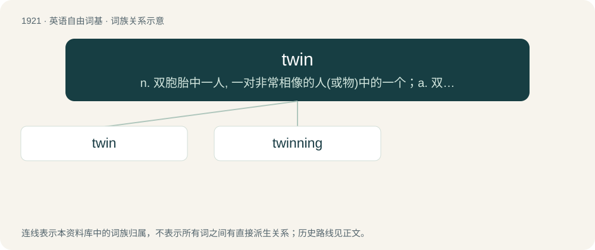

# 2031 · twin — n. 双胞胎中一人, 一对非常相像的人(或物)中的一个；a. 双胞胎的, 成对的, 孪生的；vi. 生双胞胎, 成对

[总目录](../00_总目录_按常用程度.md)

**类型**：英语自由词基　｜　**来源语言**：见词源记录

## 核心含义与来源

- 核心含义：n. 双胞胎中一人, 一对非常相像的人(或物)中的一个；a. 双胞胎的, 成对的, 孪生的；vi. 生双胞胎, 成对
- 英文含义：Either of two people (or, less commonly, animals) who shared the same uterus at the same time; one who was born at the same birth as a sibling.
- 词形：twin

**多个词源／构词路径**：同一拼写可能有不同来源；以下按词性和含义分别列出。

**来源记录 1**（名词；Either of two people (or, less commonly, animals) who shared the same uterus at the same time; one who was born at the same birth as a sibling.）

From Middle English twinne, twynne, from Old English ġetwin, ġetwinn (“twin, multiple”, noun) and twinn (“twin, two-fold, double, two by two”, adjective), from Proto-Germanic \*twinaz (“double/two each, twin”), Proto-Germanic \*twinjaz, \*twīhnaz (“two each”), from Proto-Indo-European \*dwino- (“twin”), from \*dwóh₁ (“two”). Cognate with Scots twyn (“twin”), Dutch tweeling (“twin”), German Zwilling (“twin”), Danish, Norwegian Bokmål, Norwegian Nynorsk, and Swedish tvilling (“twin”), Faroese tvinnur (“a double set”), Icelandic tvenna (“duo, pair”), Lithuanian dvynys (“twin”), Russian двойня (dvojnja, “twin”).

**来源记录 2**（形容词；Double; dual; occurring as a matching pair.）

From Middle English \*twin, \*twyn, from Old English twin, twinn (“twin; double”, adjective), from Proto-Germanic \*twīhnaz (“occurring in a pair; twofold; double”), from Proto-Indo-European \*dwóh₁ (“two”). Cognate with Icelandic tvennur (“double”), Gothic 𐍄𐍅𐌴𐌹𐌷𐌽𐌰𐌹 (tweihnai, “two each”).

## 词族图

## 单词速览（常用到不常用）

| 单词 | 音标 | 释义 |
|---|---|---|
| [twin](#w-1) | /twɪn/ | n. 双胞胎中一人, 一对非常相像的人(或物)中的一个；a. 双胞胎的, 成对的, 孪生的；vi. 生双胞胎, 成对 |
| [twinning](#w-2) | /ˈtwiniŋ/ | n. 孪生, 成对；\[医\] 对裂, 成对; 双生, 双胎生成 |

## 逐词详解

### 1. twin

**词性**：名词　｜　**音标**：/twɪn/

**中文释义**：n. 双胞胎中一人, 一对非常相像的人(或物)中的一个；a. 双胞胎的, 成对的, 孪生的；vi. 生双胞胎, 成对

**英文义项**：Either of two people (or, less commonly, animals) who shared the same uterus at the same time; one who was born at the same birth as a sibling. / Either of two similar or closely related objects, plans, institutions, people, etc.

**词源与演化**：

From Middle English twinne, twynne, from Old English ġetwin, ġetwinn (“twin, multiple”, noun) and twinn (“twin, two-fold, double, two by two”, adjective), from Proto-Germanic \*twinaz (“double/two each, twin”), Proto-Germanic \*twinjaz, \*twīhnaz (“two each”), from Proto-Indo-European \*dwino- (“twin”), from \*dwóh₁ (“two”). Cognate with Scots twyn (“twin”), Dutch tweeling (“twin”), German Zwilling (“twin”), Danish, Norwegian Bokmål, Norwegian Nynorsk, and Swedish tvilling (“twin”), Faroese tvinnur (“a double set”), Icelandic tvenna (“duo, pair”), Lithuanian dvynys (“twin”), Russian двойня (dvojnja, “twin”).

**例句**：

> He is my twin (wearing the same shirt, driving the same car, etc.).

该用例对应义项：Either of two or more things, people, etc. that share a single feature.

### 2. twinning

**词性**：名词　｜　**音标**：/ˈtwiniŋ/

**中文释义**：n. 孪生, 成对；\[医\] 对裂, 成对; 双生, 双胎生成

**英文义项**：The act of producing twins. / The act of giving birth to twins.

**构词拆分**：From twin + -ing.

**词源与演化**：

From twin + -ing.

**例句**：

> The town twinning committee organised this exhibition.
