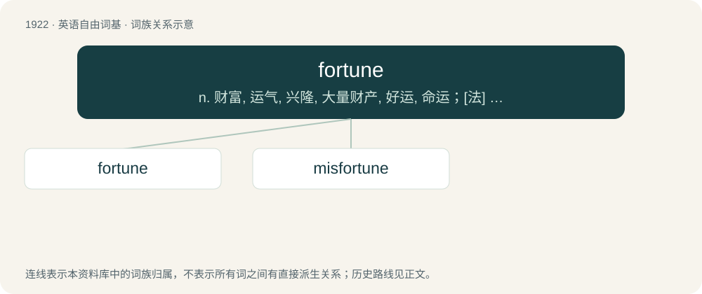

# 2032 · fortune — n. 财富, 运气, 兴隆, 大量财产, 好运, 命运；\[法\] 命运, 财产, 大量财产

[总目录](../00_总目录_按常用程度.md)

**类型**：英语自由词基　｜　**来源语言**：见词源记录

## 核心含义与来源

- 核心含义：n. 财富, 运气, 兴隆, 大量财产, 好运, 命运；\[法\] 命运, 财产, 大量财产
- 英文含义：Destiny, especially favorable.
- 词形：fortune

**来源记录 1**（名词；Destiny, especially favorable.）

From Middle English fortune, from Old French fortune, from Latin fortuna (“fate, luck”). The plural form fortunae meant “possessions”, which also gave fortune the meaning of “riches”.

## 词族图

## 单词速览（常用到不常用）

| 单词 | 音标 | 释义 |
|---|---|---|
| [fortune](#w-1) | 英 /ˈfɔːtjuːn/；美 /ˈfoɹt͡ʃən/ | n. 财富, 运气, 兴隆, 大量财产, 好运, 命运；\[法\] 命运, 财产, 大量财产 |
| [misfortune](#w-2) | 英 /mɪsˈfɔːtʃuːn/；美 /mɪsˈfɔɹt͡ʃən/ | n. 不幸, 灾祸, 坏运气；\[法\] 不幸事故, 不幸, 灾祸 |

## 逐词详解

### 1. fortune

**词性**：名词　｜　**音标**：英 /ˈfɔːtjuːn/；美 /ˈfoɹt͡ʃən/

**中文释义**：n. 财富, 运气, 兴隆, 大量财产, 好运, 命运；\[法\] 命运, 财产, 大量财产

**英文义项**：Destiny, especially favorable. / A prediction or set of predictions about a person's future provided by a fortune teller.

**词源与演化**：

From Middle English fortune, from Old French fortune, from Latin fortuna (“fate, luck”). The plural form fortunae meant “possessions”, which also gave fortune the meaning of “riches”.

**例句**：

> She read my fortune. Apparently I will have a good love life this week, but I will have a bad week for money.

该用例对应义项：Destiny, especially favorable.

### 2. misfortune

**词性**：名词　｜　**音标**：英 /mɪsˈfɔːtʃuːn/；美 /mɪsˈfɔɹt͡ʃən/

**中文释义**：n. 不幸, 灾祸, 坏运气；\[法\] 不幸事故, 不幸, 灾祸

**英文义项**：Synonym of bad luck. / An instance of bad luck, an undesirable event such as an accident.

**构词拆分**：mis- + fortune

**词源与演化**：

From mis- + fortune.

**例句**：

> The worst tour I have ever had the misfortune to experience.

该用例对应义项：Synonym of bad luck.
