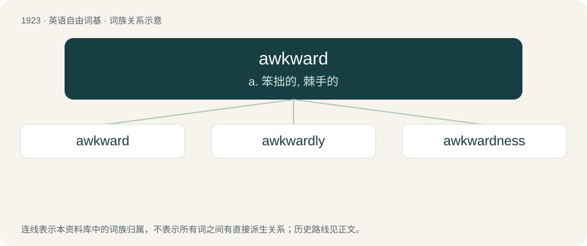

# 2033 · awkward — a. 笨拙的, 棘手的

[总目录](../00_总目录_按常用程度.md)

**类型**：英语自由词基　｜　**来源语言**：见词源记录

## 核心含义与来源

- 核心含义：a. 笨拙的, 棘手的
- 英文含义：Lacking dexterity in the use of the hands, or of instruments.
- 词形：awkward

**来源记录 1**（形容词；Lacking dexterity in the use of the hands, or of instruments.）

From awk (“odd, clumsy”) + -ward. Compare Middle English aukeward (“in the wrong direction”).

## 词族图

## 单词速览（常用到不常用）

| 单词 | 音标 | 释义 |
|---|---|---|
| [awkward](#w-1) | 英 /ˈɔːk.wəd/；美 /ˈɔk.wɚd/ | a. 笨拙的, 棘手的 |
| [awkwardly](#w-2) |  | adv. 笨拙地；无技巧地 |
| [awkwardness](#w-3) |  | n. 笨拙, 不熟练, 不灵活, 不好使, 麻烦, 使用不便, 难处理, 尴尬, 棘手, 难应付 |

## 逐词详解

### 1. awkward

**词性**：形容词　｜　**音标**：英 /ˈɔːk.wəd/；美 /ˈɔk.wɚd/

**中文释义**：a. 笨拙的, 棘手的

**英文义项**：Lacking dexterity in the use of the hands, or of instruments. / Not easily managed or effected; embarrassing.

**构词拆分**：awk + -ward；awk (“odd, clumsy”) + -ward

**词源与演化**：

From awk (“odd, clumsy”) + -ward. Compare Middle English aukeward (“in the wrong direction”).

**例句**：

> John was awkward at performing the trick. He'll have to practice to improve.

该用例对应义项：Lacking dexterity in the use of the hands, or of instruments.

### 2. awkwardly

**词性**：副词

**中文释义**：adv. 笨拙地；无技巧地

**英文义项**：In an awkward manner; with discomfort or lack of coordination.

**构词拆分**：awkward + -ly

**词源与演化**：

From awkward + -ly.

**例句**：

> Ziri awkwardly apologized to Rima for what happened the other day.

### 3. awkwardness

**词性**：名词

**中文释义**：n. 笨拙, 不熟练, 不灵活, 不好使, 麻烦, 使用不便, 难处理, 尴尬, 棘手, 难应付

**英文义项**：The state or quality of being awkward; clumsiness; unskillfulness. / The quality of an embarrassing situation.

**构词拆分**：awkward + -ness

**词源与演化**：

From awkward + -ness.

**例句**：

> He sensed the awkwardness of his proposal.

该用例对应义项：the quality of an embarrassing situation
