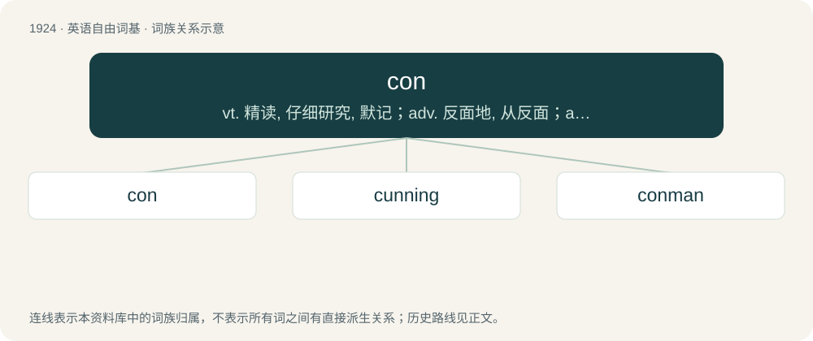

# 2034 · con — vt. 精读, 仔细研究, 默记；adv. 反面地, 从反面；a. 欺诈的

[总目录](../00_总目录_按常用程度.md)

**类型**：英语自由词基　｜　**来源语言**：见词源记录

## 核心含义与来源

- 核心含义：vt. 精读, 仔细研究, 默记；adv. 反面地, 从反面；a. 欺诈的
- 英文含义：To study or examine carefully, especially in order to gain knowledge of; to learn, or learn by heart.
- 词形：con

**多个词源／构词路径**：同一拼写可能有不同来源；以下按词性和含义分别列出。

**来源记录 1**（动词；To study or examine carefully, especially in order to gain knowledge of; to learn, or learn by heart.）

Inherited from Middle English connen, inherited from Old English cunnan (“to know, know how”), inherited from Proto-West Germanic \*kunnan (“recognize, know how”), inherited from Proto-Germanic \*kunnaną (“to know, know how”), inherited from Proto-Indo-European \*ǵneh₃- (“to know”) Doublet of can.

**来源记录 2**（名词；A disadvantage of something, especially when contrasted with its advantages (pros).）

Abbreviation of Latin contrā (“against”).

**来源记录 3**（名词；A convicted criminal, a convict.）

Clipping of convict.

**来源记录 4**（名词；A fraud; something carried out with the intention of deceiving, usually for personal, often illegal, gain.）

From con trick, shortened from confidence trick.

**来源记录 5**（名词；An organized gathering, such as a convention, conference, or congress.）

Clipping of convention or conference.

**来源记录 6**（名词；The conversion of part of a building.）

Clipping of conversion.

**来源记录 7**（名词；A political conservative.）

Clipping of conservative; compare lib.

## 词族图

## 单词速览（常用到不常用）

| 单词 | 音标 | 释义 |
|---|---|---|
| [con](#w-1) | 英 /kɒn/；美 /kɑn/ | vt. 精读, 仔细研究, 默记；adv. 反面地, 从反面；a. 欺诈的 |
| [cunning](#w-2) | /ˈkʌnɪŋ/ | a. 狡猾的, 巧妙的, 可爱的；\[法\] 狡猾的的, 狡诈的, 熟练的 |
| [conman](#w-3) |  | \[法\] 骗子 |

## 逐词详解

### 1. con

**词性**：动词　｜　**音标**：英 /kɒn/；美 /kɑn/

**中文释义**：vt. 精读, 仔细研究, 默记；adv. 反面地, 从反面；a. 欺诈的

**英文义项**：To study or examine carefully, especially in order to gain knowledge of; to learn, or learn by heart.

**词源与演化**：

Inherited from Middle English connen, inherited from Old English cunnan (“to know, know how”), inherited from Proto-West Germanic \*kunnan (“recognize, know how”), inherited from Proto-Germanic \*kunnaną (“to know, know how”), inherited from Proto-Indo-European \*ǵneh₃- (“to know”) Doublet of can.

**例句**：

> There were a lot of opinions, pro and con, on this question.

### 2. cunning

**词性**：形容词　｜　**音标**：/ˈkʌnɪŋ/

**中文释义**：a. 狡猾的, 巧妙的, 可爱的；\[法\] 狡猾的的, 狡诈的, 熟练的

**英文义项**：Sly; crafty; clever in surreptitious behaviour. / Cute, appealing.

**构词拆分**：con + -ing

**词源与演化**：

From Middle English cunning, kunning, konnyng, alteration of earlier Middle English cunninde, kunnende, cunnand, from Old English cunnende, present participle of cunnan (“to know how to, be able to”), equivalent to con + -ing. Cognate with Scots cunnand (“cunning”), German könnend (“able to do”), Icelandic kunnandi (“cunning”). More at con, can.

**例句**：

> He's as strong as an ox, and as cunning as a fox.

### 3. conman

**词性**：名词

**中文释义**：\[法\] 骗子

**英文义项**：A confidence trickster.

**构词拆分**：con + -man

**词源与演化**：

From con + -man.

**例句**：

> Tom is an international conman with a string of false identities.
