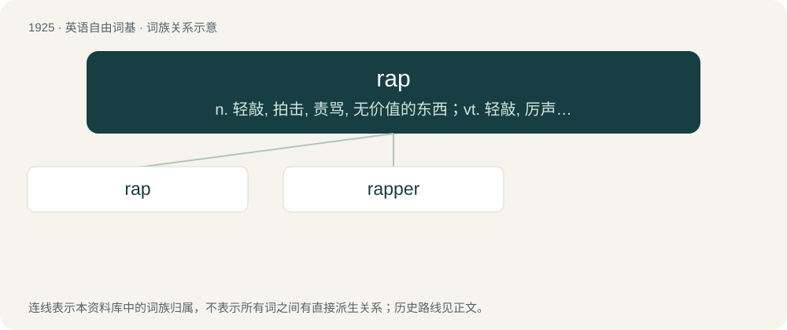

# 2035 · rap — n. 轻敲, 拍击, 责骂, 无价值的东西；vt. 轻敲, 厉声说出, 叱责, 抢走, 使着迷；vi. 敲击, 发敲击声, 交谈, 同情

[总目录](../00_总目录_按常用程度.md)

**类型**：英语自由词基　｜　**来源语言**：见词源记录

## 核心含义与来源

- 核心含义：n. 轻敲, 拍击, 责骂, 无价值的东西；vt. 轻敲, 厉声说出, 叱责, 抢走, 使着迷；vi. 敲击, 发敲击声, 交谈, 同情
- 英文含义：A sharp blow with something hard.
- 词形：rap

**多个词源／构词路径**：同一拼写可能有不同来源；以下按词性和含义分别列出。

**来源记录 1**（名词；A sharp blow with something hard.）

From Middle English rap, rappe, of North Germanic origin, related to Norwegian rapp (“a blow, strike, lash”), Swedish rapp (“a blow, lash, crack”), Danish rap (“a tap, smart, blow”). Compare Old English hreppan (“to touch, treat”). More at rape.

**来源记录 2**（动词；To strike something sharply with one's knuckles; knock.）

From Middle English rappen, of North Germanic origin, related to Swedish rappa (“to strike, beat, rap”), German rappeln (“to rattle”).

**来源记录 3**（名词；A lea or skein of yarn that forms the standard length taken from the reel, 80 yards of worsted or 120 yards of silk or cotton.）

Uncertain.

**来源记录 4**（名词；A whit; a jot.）

Perhaps contracted from rapparee.

**来源记录 5**（名词；A charge, whether or not it results in a conviction.）

From RAP (“record of arrest and prosecution”).

## 词族图

## 单词速览（常用到不常用）

| 单词 | 音标 | 释义 |
|---|---|---|
| [rap](#w-1) | /ɹæp/ | n. 轻敲, 拍击, 责骂, 无价值的东西；vt. 轻敲, 厉声说出, 叱责, 抢走, 使着迷；vi. 敲击, 发敲击声, 交谈, 同情 |
| [rapper](#w-2) | /ˈɹæpɚ/ | n. 敲门人, (美)(非正式)控告人, 证人, 检举人；\[机\] 敲杆 |

## 逐词详解

### 1. rap

**词性**：名词　｜　**音标**：/ɹæp/

**中文释义**：n. 轻敲, 拍击, 责骂, 无价值的东西；vt. 轻敲, 厉声说出, 叱责, 抢走, 使着迷；vi. 敲击, 发敲击声, 交谈, 同情

**英文义项**：A sharp blow with something hard. / The blame for something, a reprimand, censure, or a legal sentence to serve in prison

**词源与演化**：

From Middle English rap, rappe, of North Germanic origin, related to Norwegian rapp (“a blow, strike, lash”), Swedish rapp (“a blow, lash, crack”), Danish rap (“a tap, smart, blow”). Compare Old English hreppan (“to touch, treat”). More at rape.

**例句**：

> You can't act irresponsibly and then expect me to take the rap.

该用例对应义项：The blame for something, a reprimand, censure, or a legal sentence to serve in prison

### 2. rapper

**词性**：名词　｜　**音标**：/ˈɹæpɚ/

**中文释义**：n. 敲门人, (美)(非正式)控告人, 证人, 检举人；\[机\] 敲杆

**英文义项**：The knocker of a door. / A spiritualistic medium who claims to receive communications from spirits in the form of knocking sounds.

**构词拆分**：rap + -er

**词源与演化**：

From rap + -er.

**例句**：

> He rose from the ghetto to become a successful rapper.

该用例对应义项：A performer of rap music, or someone who raps in any form of music.
