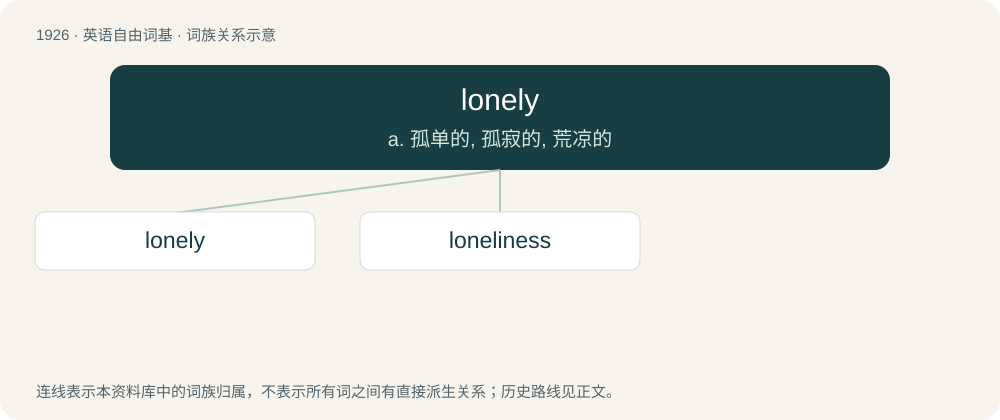

# 2037 · lonely — a. 孤单的, 孤寂的, 荒凉的

[总目录](../00_总目录_按常用程度.md)

**类型**：英语自由词基　｜　**来源语言**：见词源记录

## 核心含义与来源

- 核心含义：a. 孤单的, 孤寂的, 荒凉的
- 英文含义：Unhappy due to feeling isolated from contact with other people.
- 词形：lonely

**来源记录 1**（形容词；Unhappy due to feeling isolated from contact with other people.）

From lone + -ly, or from an apheretic shortening of alonely. See lone.

## 词族图

## 单词速览（常用到不常用）

| 单词 | 音标 | 释义 |
|---|---|---|
| [lonely](#w-1) | 英 /ˈləʊnli/；美 /ˈloʊnli/ | a. 孤单的, 孤寂的, 荒凉的 |
| [loneliness](#w-2) | 美 /ˈloʊnlinəs/ | n. 寂寞, 孤独, 清静 |

## 逐词详解

### 1. lonely

**词性**：形容词　｜　**音标**：英 /ˈləʊnli/；美 /ˈloʊnli/

**中文释义**：a. 孤单的, 孤寂的, 荒凉的

**英文义项**：Unhappy due to feeling isolated from contact with other people. / Unfrequented by people; desolate.

**构词拆分**：lone + -ly

**词源与演化**：

From lone + -ly, or from an apheretic shortening of alonely. See lone.

**例句**：

> Felt sad and lonely.

该用例对应义项：marked by dejection from being alone

### 2. loneliness

**词性**：名词　｜　**音标**：美 /ˈloʊnlinəs/

**中文释义**：n. 寂寞, 孤独, 清静

**英文义项**：A feeling of depression resulting from being alone or from having no companions. / The condition or state of being alone or having no companions.

**构词拆分**：lonely + -ness

**词源与演化**：

From lonely + -ness.

**例句**：

> The loneliness resulting from the loss of loved ones, lack of purpose in life, and social discrimination is a real inner hell.

该用例对应义项：A feeling of depression resulting from being alone or from having no companions.
