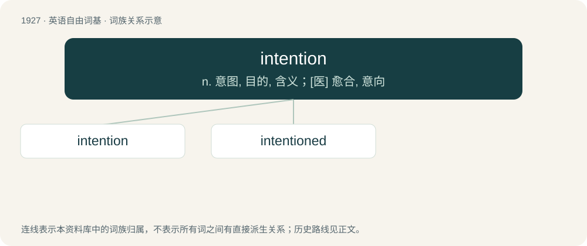

# 2038 · intention — n. 意图, 目的, 含义；\[医\] 愈合, 意向

[总目录](../00_总目录_按常用程度.md)

**类型**：英语自由词基　｜　**来源语言**：见词源记录

## 核心含义与来源

- 核心含义：n. 意图, 目的, 含义；\[医\] 愈合, 意向
- 英文含义：A course of action that a person intends to follow.
- 词形：intention

**来源记录 1**（名词；A course of action that a person intends to follow.）

From Middle English entencioun, intention, from Old French entencion, from Latin intentiō, intentiōnem. Compare intent. Equivalent to intent + -ion.

## 词族图

## 单词速览（常用到不常用）

| 单词 | 音标 | 释义 |
|---|---|---|
| [intention](#w-1) | /ɪnˈtɛnʃn̩/ | n. 意图, 目的, 含义；\[医\] 愈合, 意向 |
| [intentioned](#w-2) | /inˈtenʃənd/ | a. 有...企图的, 出于...意向的 |

## 逐词详解

### 1. intention

**词性**：名词　｜　**音标**：/ɪnˈtɛnʃn̩/

**中文释义**：n. 意图, 目的, 含义；\[医\] 愈合, 意向

**英文义项**：A course of action that a person intends to follow. / A goal or purpose.

**构词拆分**：intent + -ion

**词源与演化**：

From Middle English entencioun, intention, from Old French entencion, from Latin intentiō, intentiōnem. Compare intent. Equivalent to intent + -ion.

**例句**：

> The intention of this legislation is to boost the economy.

该用例对应义项：A goal or purpose.

### 2. intentioned

**词性**：形容词　｜　**音标**：/inˈtenʃənd/

**中文释义**：a. 有...企图的, 出于...意向的

**英文义项**：Having a certain intention

**构词拆分**：intention + -ed

**词源与演化**：

From intention + -ed.
