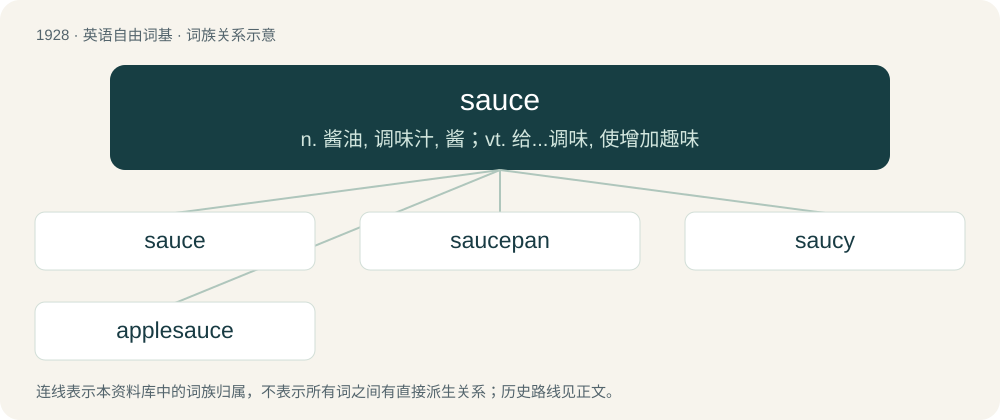

# 2039 · sauce — n. 酱油, 调味汁, 酱；vt. 给...调味, 使增加趣味

[总目录](../00_总目录_按常用程度.md)

**类型**：英语自由词基　｜　**来源语言**：见词源记录

## 核心含义与来源

- 核心含义：n. 酱油, 调味汁, 酱；vt. 给...调味, 使增加趣味
- 英文含义：A liquid (often thickened) condiment or accompaniment to food.
- 词形：sauce

**来源记录 1**（名词；A liquid (often thickened) condiment or accompaniment to food.）

From Middle English sauce, from Old French sause, from Vulgar Latin \*salsa, noun use of the feminine of Latin salsus (“salted”), past participle of saliō (“to salt”), from sal. Doublet of salsa. For the meaning development compare Ancient Greek ἥδυσμα (hḗdusma) ultimately from Proto-Indo-European \*swéh₂dus (whence also English sweet).

## 词族图

## 单词速览（常用到不常用）

| 单词 | 音标 | 释义 |
|---|---|---|
| [sauce](#w-1) | 英 /sɔːs/；/sɔs/ | n. 酱油, 调味汁, 酱；vt. 给...调味, 使增加趣味 |
| [saucepan](#w-2) | 英 /ˈsɔːs.pən/；美 /ˈsɔsˌpæn/ | n. (长柄有盖)深平底锅, 炖锅 |
| [saucy](#w-3) | 英 /ˈsɔːsi/；/ˈsɔ.si/ | a. 莽撞的, 活泼的, 漂亮的 |
| [applesauce](#w-4) | /.æplˈsɒːs/ | n. 苹果沙司, 胡说 |

## 逐词详解

### 1. sauce

**词性**：名词　｜　**音标**：英 /sɔːs/；/sɔs/

**中文释义**：n. 酱油, 调味汁, 酱；vt. 给...调味, 使增加趣味

**英文义项**：A liquid (often thickened) condiment or accompaniment to food. / Tomato sauce (similar to US tomato ketchup), as in

**词源与演化**：

From Middle English sauce, from Old French sause, from Vulgar Latin \*salsa, noun use of the feminine of Latin salsus (“salted”), past participle of saliō (“to salt”), from sal. Doublet of salsa. For the meaning development compare Ancient Greek ἥδυσμα (hḗdusma) ultimately from Proto-Indo-European \*swéh₂dus (whence also English sweet).

**例句**：

> It's over for that guy. He lost the sauce.

该用例对应义项：Vitality; capability or talent.

### 2. saucepan

**词性**：名词　｜　**音标**：英 /ˈsɔːs.pən/；美 /ˈsɔsˌpæn/

**中文释义**：n. (长柄有盖)深平底锅, 炖锅

**英文义项**：A deep cooking vessel with a long protruding handle and sometimes a lid; used for boiling, stewing and making sauces.

**构词拆分**：sauce + pan

**词源与演化**：

From sauce + pan.

**例句**：

> Tom opened a can of soup and emptied it into a saucepan.

### 3. saucy

**词性**：形容词　｜　**音标**：英 /ˈsɔːsi/；/ˈsɔ.si/

**中文释义**：a. 莽撞的, 活泼的, 漂亮的

**英文义项**：Similar to sauce; having the consistency or texture of sauce. / Impertinent or disrespectful, often in a manner that is regarded as entertaining or amusing; smart.

**构词拆分**：sauce + -y

**词源与演化**：

From sauce + -y.

**例句**：

> Bring the tomatoes to a boil and then simmer until they reach a saucy consistency.

该用例对应义项：Similar to sauce; having the consistency or texture of sauce.

### 4. applesauce

**词性**：名词　｜　**音标**：/.æplˈsɒːs/

**中文释义**：n. 苹果沙司, 胡说

**英文义项**：Nonsense, balderdash, bunk, piffle.

**构词拆分**：apple + sauce

**词源与演化**：

From apple + sauce.

**例句**：

> Bletted medlars taste like applesauce with a cinnamon flavor to it.
