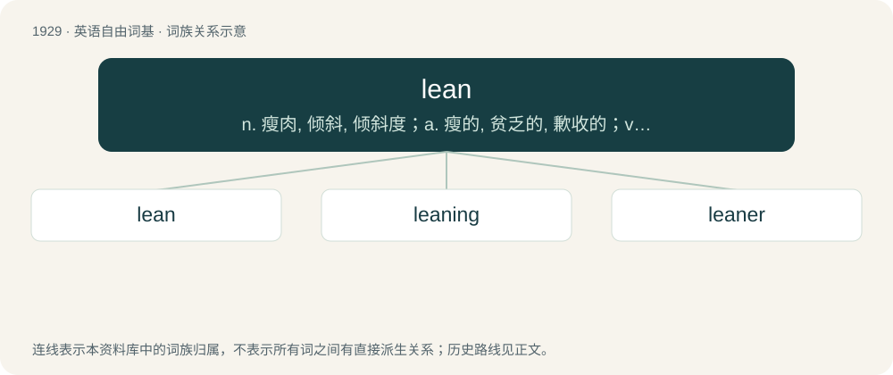

# 2041 · lean — n. 瘦肉, 倾斜, 倾斜度；a. 瘦的, 贫乏的, 歉收的；vi. 倚靠, 倾斜, 依赖

[总目录](../00_总目录_按常用程度.md)

**类型**：英语自由词基　｜　**来源语言**：见词源记录

## 核心含义与来源

- 核心含义：n. 瘦肉, 倾斜, 倾斜度；a. 瘦的, 贫乏的, 歉收的；vi. 倚靠, 倾斜, 依赖
- 英文含义：To incline, deviate, or bend, from a vertical position; to be in a position thus inclining or deviating.
- 词形：lean

**多个词源／构词路径**：同一拼写可能有不同来源；以下按词性和含义分别列出。

**来源记录 1**（动词；To incline, deviate, or bend, from a vertical position; to be in a position thus inclining or deviating.）

From Middle English lenen (“to lean”), from Old English hleonian, hlinian (“to lean, recline, lie down, rest”), from Proto-West Germanic \*hlinēn, from Proto-Germanic \*hlināną (“to lean, incline”), from Proto-Indo-European \*ḱley-. Cognate via Proto-Germanic with Middle Dutch leunen (“to lean”), German lehnen (“to lean”); via Proto-Indo-European with climate, cline.

**来源记录 2**（形容词；Slim; not fleshy.）

From Middle English lene (“lean”), from Old English hlǣne (“lean”), (cognate with Low German leen), perhaps from hlǣnan (“to cause to lean (due to hunger or lack of food)”), from Proto-Germanic \*hlainijaną (“to cause to lean”). If so, then related to Old English hlinian, hleonian (“to lean”). Compare Old Norse linr (“mild; soft, limp; weak”), Old High German len (“mild”).

**来源记录 3**（名词；A recreational drug composed of codeine-promethazine cough syrup mixed with usually soda and associated with the hip-hop culture of the Southern United States.）

Probably from the verb to lean (see Etymology 1 above), supposedly because consumption of the intoxicating beverage causes one to lean or sway. Alternatively, from a clipping of gasoline (“an alcoholic beverage made of vodka and energy drink”).

## 词族图

## 单词速览（常用到不常用）

| 单词 | 音标 | 释义 |
|---|---|---|
| [lean](#w-1) | /ˈliːn/ | n. 瘦肉, 倾斜, 倾斜度；a. 瘦的, 贫乏的, 歉收的；vi. 倚靠, 倾斜, 依赖 |
| [leaning](#w-2) | /ˈliːnɪŋ/ | n. 倾斜, 倾向, 爱好 |
| [leaner](#w-3) |  | n. 清洗液；斜身倾前的射球 |

## 逐词详解

### 1. lean

**词性**：动词　｜　**音标**：/ˈliːn/

**中文释义**：n. 瘦肉, 倾斜, 倾斜度；a. 瘦的, 贫乏的, 歉收的；vi. 倚靠, 倾斜, 依赖

**英文义项**：To incline, deviate, or bend, from a vertical position; to be in a position thus inclining or deviating. / To incline in opinion or desire; to conform in conduct; often with to, toward, etc.

**词源与演化**：

From Middle English lenen (“to lean”), from Old English hleonian, hlinian (“to lean, recline, lie down, rest”), from Proto-West Germanic \*hlinēn, from Proto-Germanic \*hlināną (“to lean, incline”), from Proto-Indo-European \*ḱley-. Cognate via Proto-Germanic with Middle Dutch leunen (“to lean”), German lehnen (“to lean”); via Proto-Indo-European with climate, cline.

**例句**：

> I’m leaning towards voting Conservative in the next election.

该用例对应义项：To incline in opinion or desire; to conform in conduct; often with to, toward, etc.

### 2. leaning

**词性**：名词　｜　**音标**：/ˈliːnɪŋ/

**中文释义**：n. 倾斜, 倾向, 爱好

**英文义项**：A tendency or propensity.

**构词拆分**：lean + -ing

**词源与演化**：

From Middle English lening, leninge, from Old English hlinung (“leaning; resting; place of rest”), equivalent to lean + -ing.

**用法示例／搭配（非完整句）**：

> a man of socialist leanings

该用例对应义项：A tendency or propensity.

### 3. leaner

**词性**：名词

**中文释义**：n. 清洗液；斜身倾前的射球

**英文义项**：One who leans, or inclines toward something. / A vertical sign, usually leaned on a porch and made from repurposed wood.

**构词拆分**：From lean + -er.

**词源与演化**：

From lean + -er.

**例句**：

> Please take off your thick adjective glasses and start writing leaner prose.
