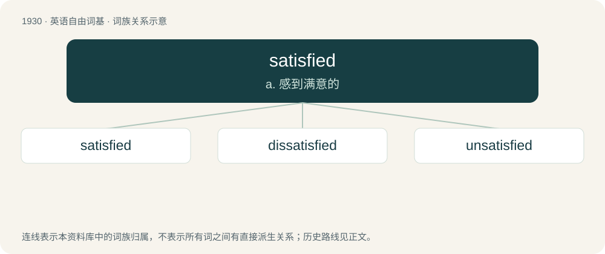

# 2042 · satisfied — a. 感到满意的

[总目录](../00_总目录_按常用程度.md)

**类型**：英语自由词基　｜　**来源语言**：见词源记录

## 核心含义与来源

- 核心含义：a. 感到满意的
- 英文含义：In a state of satisfaction.
- 词形：satisfied

**来源记录 1**（形容词；In a state of satisfaction.）

From Middle English satisfyed, i-satisfyed, i-satisfied, past participle of Middle English satisfien, equivalent to satisfy + -ed.

## 词族图

## 单词速览（常用到不常用）

| 单词 | 音标 | 释义 |
|---|---|---|
| [satisfied](#w-1) | /ˈsætɪsfaɪd/ | a. 感到满意的 |
| [dissatisfied](#w-2) | /dɪsˈsætɪsˌfaɪd/ | a. 不满的, 显出不满的 |
| [unsatisfied](#w-3) | /ˈʌnˈsætisfaid/ | a. 未得到满足的, 不满意的 |

## 逐词详解

### 1. satisfied

**词性**：形容词　｜　**音标**：/ˈsætɪsfaɪd/

**中文释义**：a. 感到满意的

**英文义项**：In a state of satisfaction. / Convinced based on the available evidence.

**构词拆分**：satisfy + -ed

**词源与演化**：

From Middle English satisfyed, i-satisfyed, i-satisfied, past participle of Middle English satisfien, equivalent to satisfy + -ed.

**例句**：

> The judge was satisfied that the defendant did not go out with the intent to start a riot.

该用例对应义项：Convinced based on the available evidence.

### 2. dissatisfied

**词性**：形容词　｜　**音标**：/dɪsˈsætɪsˌfaɪd/

**中文释义**：a. 不满的, 显出不满的

**英文义项**：Feeling or displaying disappointment or a lack of contentment. / Not satisfied (e.g. with the quality of something).

**构词拆分**：dis- + satisfied

**词源与演化**：

From dis- + satisfied.

**例句**：

> We offer refunds to dissatisfied customers.

该用例对应义项：Not satisfied (e.g. with the quality of something).

### 3. unsatisfied

**词性**：形容词　｜　**音标**：/ˈʌnˈsætisfaid/

**中文释义**：a. 未得到满足的, 不满意的

**英文义项**：Not satisfied, especially with the quantity of something; dissatisfied; uncontented. / Not gratified; not having been fulfilled or met.

**构词拆分**：un- + satisfied

**词源与演化**：

From un- + satisfied.

**例句**：

> Hunger, when unsatisfied, becomes a burden that the mind cannot ignore.
