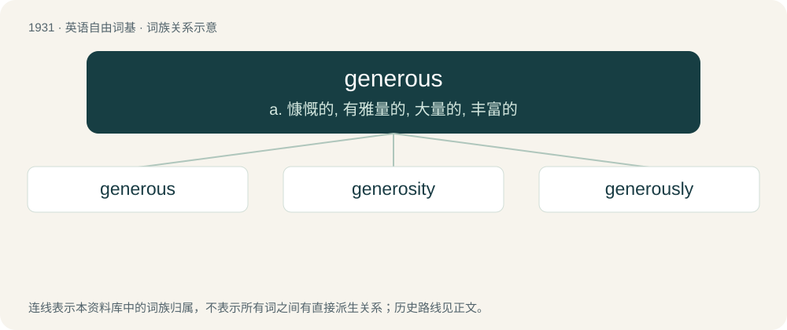

# 2043 · generous — a. 慷慨的, 有雅量的, 大量的, 丰富的

[总目录](../00_总目录_按常用程度.md)

**类型**：英语自由词基　｜　**来源语言**：见词源记录

## 核心含义与来源

- 核心含义：a. 慷慨的, 有雅量的, 大量的, 丰富的
- 英文含义：Noble in behaviour or actions; principled, not petty; kind, magnanimous.
- 词形：generous

**来源记录 1**（形容词；Noble in behaviour or actions; principled, not petty; kind, magnanimous.）

From Middle French genereux, and its source, Latin generōsus (“of noble birth”), from genus (“race, stock”).

## 词族图

## 单词速览（常用到不常用）

| 单词 | 音标 | 释义 |
|---|---|---|
| [generous](#w-1) | 英 /ˈd͡ʒɛn(ə)ɹəs/ | a. 慷慨的, 有雅量的, 大量的, 丰富的 |
| [generosity](#w-2) | 英 /ˌd͡ʒɛn.əˈɹɒs.ɪ.ti/；美 /ˌd͡ʒɛn.əˈɹɑ.sə.ti/ | n. 慷慨, 宽大 |
| [generously](#w-3) |  | adv. 宽大地；慷慨地；丰盛地 |

## 逐词详解

### 1. generous

**词性**：形容词　｜　**音标**：英 /ˈd͡ʒɛn(ə)ɹəs/

**中文释义**：a. 慷慨的, 有雅量的, 大量的, 丰富的

**英文义项**：Noble in behaviour or actions; principled, not petty; kind, magnanimous. / Willing to give and share unsparingly; showing a readiness to give more (especially money) than is expected or needed.

**词源与演化**：

From Middle French genereux, and its source, Latin generōsus (“of noble birth”), from genus (“race, stock”).

**例句**：

> She's been extremely generous with her winnings.

该用例对应义项：Willing to give and share unsparingly; showing a readiness to give more (especially money) than is expected or needed.

### 2. generosity

**词性**：名词　｜　**音标**：英 /ˌd͡ʒɛn.əˈɹɒs.ɪ.ti/；美 /ˌd͡ʒɛn.əˈɹɑ.sə.ti/

**中文释义**：n. 慷慨, 宽大

**英文义项**：The trait of being willing to donate money, resources, or time. / A desire to give or share without expecting payment; charity; an eager willingness to demonstrate openness and empathy or to provide a charitable outlook on something; a desire to share either emotionally or in resources, time, etc.

**构词拆分**：generous + -ity

**词源与演化**：

From Middle English generosite, from Latin generōsitās, equivalent to generous + -ity.

**例句**：

> He ate everything, despite the generosity of the portions.

该用例对应义项：The trait of being abundant, more than adequate.

### 3. generously

**词性**：副词

**中文释义**：adv. 宽大地；慷慨地；丰盛地

**英文义项**：In a generous manner, in a way that is giving or ample.

**构词拆分**：generous + -ly

**词源与演化**：

From generous + -ly.

**例句**：

> The dessert generously filled a large plate.

该用例对应义项：In a generous manner, in a way that is giving or ample.
