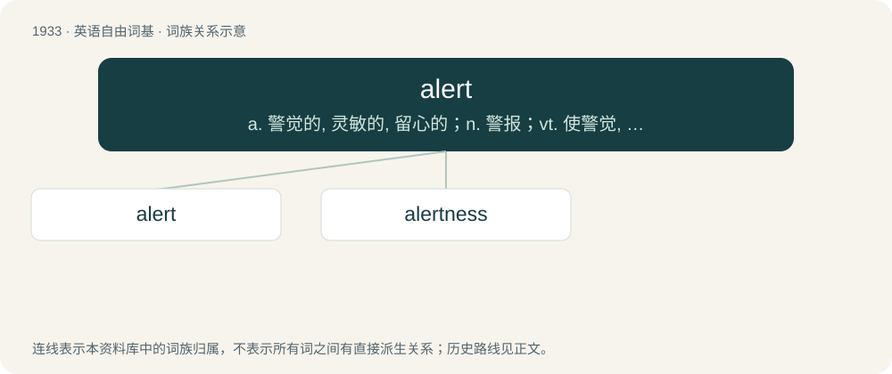

# 2045 · alert — a. 警觉的, 灵敏的, 留心的；n. 警报；vt. 使警觉, 通知, 使意识到

[总目录](../00_总目录_按常用程度.md)

**类型**：英语自由词基　｜　**来源语言**：见词源记录

## 核心含义与来源

- 核心含义：a. 警觉的, 灵敏的, 留心的；n. 警报；vt. 使警觉, 通知, 使意识到
- 英文含义：Attentive; awake; on guard.
- 词形：alert

**多个词源／构词路径**：同一拼写可能有不同来源；以下按词性和含义分别列出。

**来源记录 1**（形容词；Attentive; awake; on guard.）

From French alerte (“alert”), from the phrase à l'erte (“on the watch”), from Italian all'erta (“to the height”), from erta (“lookout, tower”).

**来源记录 2**（动词；To give warning to.）

Formed within English by conversion, from alert (adjective). Compare French alerter.

## 词族图

## 单词速览（常用到不常用）

| 单词 | 音标 | 释义 |
|---|---|---|
| [alert](#w-1) | 英 /əˈlɜːt/；美 /əˈlɝt/ | a. 警觉的, 灵敏的, 留心的；n. 警报；vt. 使警觉, 通知, 使意识到 |
| [alertness](#w-2) | 美 /əˈlɝt.nəs/ | n. 警戒, 机敏 |

## 逐词详解

### 1. alert

**词性**：名词　｜　**音标**：英 /əˈlɜːt/；美 /əˈlɝt/

**中文释义**：a. 警觉的, 灵敏的, 留心的；n. 警报；vt. 使警觉, 通知, 使意识到

**英文义项**：An alarm. / A notification of higher importance than an advisory.

**词源与演化**：

From French alerte (“alert”), from the phrase à l'erte (“on the watch”), from Italian all'erta (“to the height”), from erta (“lookout, tower”).

**用法示例／搭配（非完整句）**：

> an airborne alert; ground alert

该用例对应义项：A state of readiness for potential combat.

### 2. alertness

**词性**：名词　｜　**音标**：美 /əˈlɝt.nəs/

**中文释义**：n. 警戒, 机敏

**英文义项**：The quality of being alert or on the alert.

**构词拆分**：alert + -ness

**词源与演化**：

From alert + -ness.

**例句**：

> His thin, hawk-like nose gave his whole expression an air of alertness and decision.
