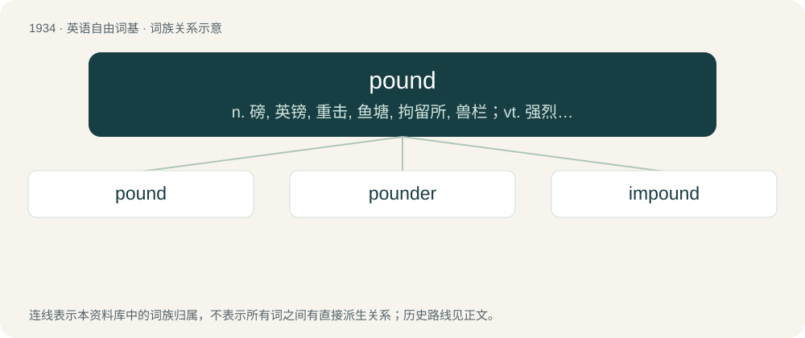

# 2047 · pound — n. 磅, 英镑, 重击, 鱼塘, 拘留所, 兽栏；vt. 强烈打击, 捣烂, 监禁, 关入栏内；vi. 连续重击, 苦干

[总目录](../00_总目录_按常用程度.md)

**类型**：英语自由词基　｜　**来源语言**：见词源记录

## 核心含义与来源

- 核心含义：n. 磅, 英镑, 重击, 鱼塘, 拘留所, 兽栏；vt. 强烈打击, 捣烂, 监禁, 关入栏内；vi. 连续重击, 苦干
- 英文含义：A unit of weight in various measurement systems.
- 词形：pound

**多个词源／构词路径**：同一拼写可能有不同来源；以下按词性和含义分别列出。

**来源记录 1**（名词；A unit of weight in various measurement systems.）

From Middle English pound, from Old English pund (“a pound, weight”), from Proto-West Germanic \*pund, from Proto-Germanic \*pundą (“pound, weight”), an early borrowing from Latin pondō (“by weight”), ablative form of pondus (“weight”), from Proto-Indo-European \*(s)pend- (“to pull, stretch”). Cognate with Dutch pond, German Pfund, Danish, Faroese, Icelandic, Norwegian Bokmål, Norwegian Nynorsk, and Swedish pund. Doublet of funt, pfund, pood, and punt.

**来源记录 2**（名词；A place for the detention of stray or wandering animals.）

From Middle English pounde, ponde, pund, from Old English \*pund (“an enclosure”). Related to Old English pyndan (“to enclose, shut up, dam, impound”). Compare also Old English pynd (“a cistern, lake”).

**来源记录 3**（动词；To strike hard, usually repeatedly.）

From an alteration of earlier poun, pown, from Middle English pounen, from Old English pūnian (“to pound, beat, bray, bruise, crush”), from Proto-West Germanic \*pūn- (“broken pieces, rubble”). Related to Saterland Frisian Pün (“debris, fragments”), West Frisian pún (“debris, rubble”), Dutch puin (“debris, fragments, rubbish”), Low German pun (“fragments”).

## 词族图

## 单词速览（常用到不常用）

| 单词 | 音标 | 释义 |
|---|---|---|
| [pound](#w-1) | 英 /ˈpaʊ̯nd/；/ˈpæʊ̯nd/ | n. 磅, 英镑, 重击, 鱼塘, 拘留所, 兽栏；vt. 强烈打击, 捣烂, 监禁, 关入栏内；vi. 连续重击, 苦干 |
| [pounder](#w-2) | 英 /ˈpaʊndə/；美 /ˈpaʊndɚ/ | n. 一磅重的东西, 捣碎者, 杵, 捣具, 重...磅的东西 |
| [impound](#w-3) | /ɪmˈpaʊ̯nd/ | vt. 关在栏中, 拘留, 充公；\[经\] 扣押 |

## 逐词详解

### 1. pound

**词性**：名词　｜　**音标**：英 /ˈpaʊ̯nd/；/ˈpæʊ̯nd/

**中文释义**：n. 磅, 英镑, 重击, 鱼塘, 拘留所, 兽栏；vt. 强烈打击, 捣烂, 监禁, 关入栏内；vi. 连续重击, 苦干

**英文义项**：A unit of weight in various measurement systems. / Various non-English units of measure.

**词源与演化**：

From Middle English pound, from Old English pund (“a pound, weight”), from Proto-West Germanic \*pund, from Proto-Germanic \*pundą (“pound, weight”), an early borrowing from Latin pondō (“by weight”), ablative form of pondus (“weight”), from Proto-Indo-European \*(s)pend- (“to pull, stretch”). Cognate with Dutch pond, German Pfund, Danish, Faroese, Icelandic, Norwegian Bokmål, Norwegian Nynorsk, and Swedish pund. Doublet of funt, pfund, pood, and punt.

**例句**：

> To be connected, press pound.

该用例对应义项：The symbol #.

### 2. pounder

**词性**：名词　｜　**音标**：英 /ˈpaʊndə/；美 /ˈpaʊndɚ/

**中文释义**：n. 一磅重的东西, 捣碎者, 杵, 捣具, 重...磅的东西

**英文义项**：A vessel in which something is pounded, or an implement used in pounding. / One who pounds.

**构词拆分**：pound + -er

**词源与演化**：

From pound (“verb”) + -er (“agent suffix”).

**例句**：

> The fisherman caught a 10-pounder.

该用例对应义项：(used only in combination) something weighing a given number of pounds

### 3. impound

**词性**：动词　｜　**音标**：/ɪmˈpaʊ̯nd/

**中文释义**：vt. 关在栏中, 拘留, 充公；\[经\] 扣押

**英文义项**：To shut up or place in an enclosure called a pound. / To hold back.

**构词拆分**：in- + pound

**词源与演化**：

From im- + pound.

**例句**：

> His car was impounded after he parked it illegally.

该用例对应义项：To shut up or place in an enclosure called a pound.
