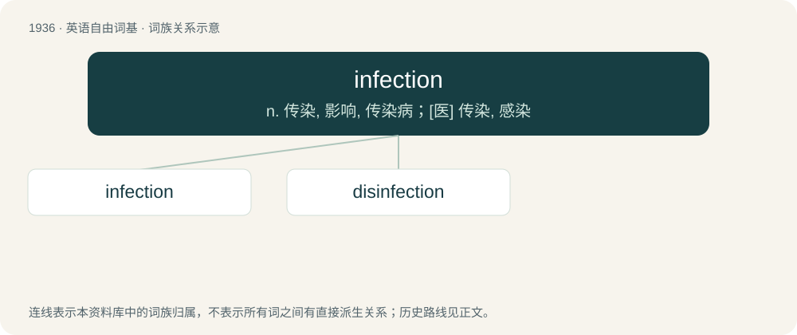

# 2050 · infection — n. 传染, 影响, 传染病；\[医\] 传染, 感染

[总目录](../00_总目录_按常用程度.md)

**类型**：英语自由词基　｜　**来源语言**：见词源记录

## 核心含义与来源

- 核心含义：n. 传染, 影响, 传染病；\[医\] 传染, 感染
- 英文含义：The act or process of infecting.
- 词形：infection

**来源记录 1**（名词；The act or process of infecting.）

From Old French infection, from Late Latin īnfectiō. Equivalent to infect + -ion.

## 词族图

## 单词速览（常用到不常用）

| 单词 | 音标 | 释义 |
|---|---|---|
| [infection](#w-1) | /ɪnˈfɛkʃən/ | n. 传染, 影响, 传染病；\[医\] 传染, 感染 |
| [disinfection](#w-2) | /dɪsɪnˈfɛkʃən/ | n. 消毒；\[医\] 消毒 |

## 逐词详解

### 1. infection

**词性**：名词　｜　**音标**：/ɪnˈfɛkʃən/

**中文释义**：n. 传染, 影响, 传染病；\[医\] 传染, 感染

**英文义项**：The act or process of infecting. / An uncontrolled growth of harmful microorganisms in a host.

**构词拆分**：infect + -ion

**词源与演化**：

From Old French infection, from Late Latin īnfectiō. Equivalent to infect + -ion.

**例句**：

> The government didn't take appropriate measures to prevent the infection from spreading.

### 2. disinfection

**词性**：名词　｜　**音标**：/dɪsɪnˈfɛkʃən/

**中文释义**：n. 消毒；\[医\] 消毒

**英文义项**：Treatment with disinfectant materials in order to destroy harmful microorganisms.

**构词拆分**：dis- + infection

**词源与演化**：

From dis- + infection.
