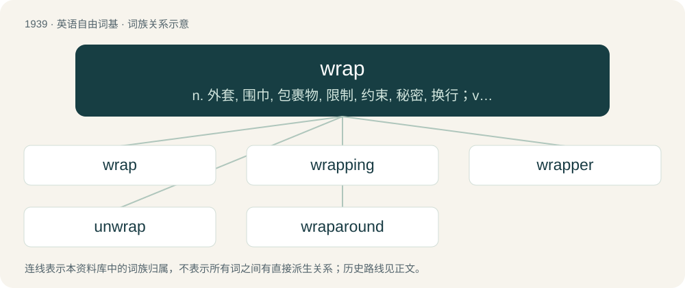

# 2052 · wrap — n. 外套, 围巾, 包裹物, 限制, 约束, 秘密, 换行；vt. 包装, 卷, 缠绕, 包, 裹, 覆盖, 遮蔽, 隐藏, 掩护；vi. 缠绕, 穿外衣, 包起来

[总目录](../00_总目录_按常用程度.md)

**类型**：英语自由词基　｜　**来源语言**：见词源记录

## 核心含义与来源

- 核心含义：n. 外套, 围巾, 包裹物, 限制, 约束, 秘密, 换行；vt. 包装, 卷, 缠绕, 包, 裹, 覆盖, 遮蔽, 隐藏, 掩护；vi. 缠绕, 穿外衣, 包起来
- 英文含义：To enclose (an object) completely in any flexible, thin material such as fabric or paper.
- 词形：wrap

**多个词源／构词路径**：同一拼写可能有不同来源；以下按词性和含义分别列出。

**来源记录 1**（动词；To enclose (an object) completely in any flexible, thin material such as fabric or paper.）

From Middle English wrappen (“to wrap, fold”), of uncertain origin. Perhaps related to North Frisian wrappe (“to press into; stop up”), dialectal Danish vrappe (“to stuff, cram”), Middle Low German rincworpen (“to envelop, wrap”), Middle Low German wrempen (“to wrinkle, scrunch the face”), all perhaps tied to Proto-Indo-European \*werp-, \*werb- (“to turn, twist, bend”). Compare also similar-sounding and similar-meaning Middle English wlappen (“to wrap, lap, envelop, fold”), Middle Dutch lappen (“to wrap up”), Old Italian goluppare (“to wrap”) (from Germanic). Doublet of lap; related to envelop, develop. Also compare Latin verber (“whip, lash”).

**来源记录 2**（名词；Paper or sheeting that is wrapped around something to protect, contain, or conceal it.）

From Middle English wrappe, from the verb (see above).

## 词族图

## 单词速览（常用到不常用）

| 单词 | 音标 | 释义 |
|---|---|---|
| [wrap](#w-1) | 英 /ɹæp/ | n. 外套, 围巾, 包裹物, 限制, 约束, 秘密, 换行；vt. 包装, 卷, 缠绕, 包, 裹, 覆盖, 遮蔽, 隐藏, 掩护；vi. 缠绕, 穿外衣, 包起来 |
| [wrapping](#w-2) | /ˈɹæp.ɪŋ/ | n. 用于包裹的材料；\[计\] 绕接 |
| [wrapper](#w-3) | /ˈɹæpɚ/ | n. 包装者, 包裹者, 包装物, 覆盖物, 外包烟叶, 包纸, 书的封皮, 妇女晨衣；\[医\] 包裹料 |
| [unwrap](#w-4) | /ʌnˈɹæp/ | vt. 打开 |
| [wraparound](#w-5) | /ˈɹæp.ə.ɹaʊnd/ | a. 裹身的, 卷上的, 全景的；n. 缠在身上的衣服 |

## 逐词详解

### 1. wrap

**词性**：动词　｜　**音标**：英 /ɹæp/

**中文释义**：n. 外套, 围巾, 包裹物, 限制, 约束, 秘密, 换行；vt. 包装, 卷, 缠绕, 包, 裹, 覆盖, 遮蔽, 隐藏, 掩护；vi. 缠绕, 穿外衣, 包起来

**英文义项**：To enclose (an object) completely in any flexible, thin material such as fabric or paper. / To enclose or coil around an object or organism, as a form of grasping.

**词源与演化**：

From Middle English wrappen (“to wrap, fold”), of uncertain origin. Perhaps related to North Frisian wrappe (“to press into; stop up”), dialectal Danish vrappe (“to stuff, cram”), Middle Low German rincworpen (“to envelop, wrap”), Middle Low German wrempen (“to wrinkle, scrunch the face”), all perhaps tied to Proto-Indo-European \*werp-, \*werb- (“to turn, twist, bend”). Compare also similar-sounding and similar-meaning Middle English wlappen (“to wrap, lap, envelop, fold”), Middle Dutch lappen (“to wrap up”), Old Italian goluppare (“to wrap”) (from Germanic). Doublet of lap; related to envelop, develop. Also compare Latin verber (“whip, lash”).

**例句**：

> The row counter wraps back to zero when no more rows can be inserted.

该用例对应义项：To (cause to) reset to an original value after passing a maximum.

### 2. wrapping

**词性**：名词　｜　**音标**：/ˈɹæp.ɪŋ/

**中文释义**：n. 用于包裹的材料；\[计\] 绕接

**英文义项**：The material in which something is wrapped. / The breaking of a section of text into lines so that it will fit into the available width of a display area.

**构词拆分**：wrap + -ing

**词源与演化**：

From Middle English wrappinge, wrappynge, equivalent to wrap + -ing.

**例句**：

> Ziri was wrapping up the watch to send it to Rima anonymously.

### 3. wrapper

**词性**：名词　｜　**音标**：/ˈɹæpɚ/

**中文释义**：n. 包装者, 包裹者, 包装物, 覆盖物, 外包烟叶, 包纸, 书的封皮, 妇女晨衣；\[医\] 包裹料

**英文义项**：Something that is wrapped around something else as a cover or protection: a wrapping. / An outer garment; a loose robe or dressing gown.

**构词拆分**：wrap + -er

**词源与演化**：

From Middle English wrappere, equivalent to wrap + -er.

**例句**：

> He proved to be a remarkably efficient wrapper of parcels.

该用例对应义项：One who, or that which, wraps.

### 4. unwrap

**词性**：动词　｜　**音标**：/ʌnˈɹæp/

**中文释义**：vt. 打开

**英文义项**：To open or undo, as what is wrapped or folded. / To become unwrapped.

**构词拆分**：un- + wrap

**词源与演化**：

From Middle English unwrappen, equivalent to un- + wrap.

**例句**：

> Let's unwrap the gifts!

该用例对应义项：remove the outer cover or wrapping of

### 5. wraparound

**词性**：名词　｜　**音标**：/ˈɹæp.ə.ɹaʊnd/

**中文释义**：a. 裹身的, 卷上的, 全景的；n. 缠在身上的衣服

**英文义项**：A garment that is wrapped around the body and tied. / A label or advertising display that wraps around a container.

**构词拆分**：wrap + around

**词源与演化**：

From wrap + around.

**例句**：

> The addition of integers is unchecked, so wraparound occurs if the resulting value is beyond the representable range.

该用例对应义项：The wrapping of numerical values in case of underflow or overflow.
