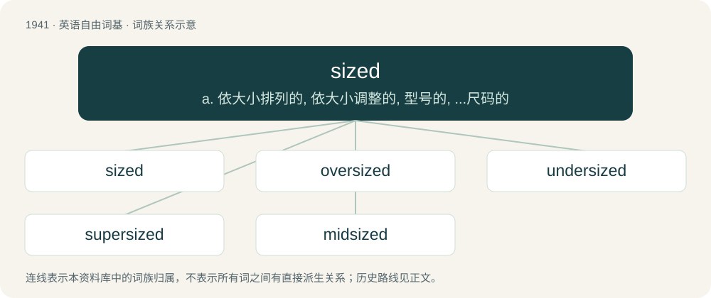

# 2055 · sized — a. 依大小排列的, 依大小调整的, 型号的, ...尺码的

[总目录](../00_总目录_按常用程度.md)

**类型**：英语自由词基　｜　**来源语言**：见词源记录

## 核心含义与来源

- 核心含义：a. 依大小排列的, 依大小调整的, 型号的, ...尺码的
- 英文含义：Having a certain size. Usually used in combination with an adverb or a noun.
- 词形：sized

**来源记录 1**（形容词；Having a certain size. Usually used in combination with an adverb or a noun.）

From size + -ed.

## 词族图

## 单词速览（常用到不常用）

| 单词 | 音标 | 释义 |
|---|---|---|
| [sized](#w-1) | /ˈsaizd/ | a. 依大小排列的, 依大小调整的, 型号的, ...尺码的 |
| [oversized](#w-2) | /ˈəuvəˈsaizd/ | a. 过大的, 极大的 |
| [undersized](#w-3) | /ˈʌndəˈsaizd/ | a. 小于一般尺寸的, 不够大的, 小型的；\[化\] 尺寸过小的 |
| [supersized](#w-4) | /ˈsjuːpəsaizd/ | a. 超大型的 |
| [midsized](#w-5) | /ˈmɪdsaɪzd/ | a. 中等大小的；中型的；中号的 |

## 逐词详解

### 1. sized

**词性**：形容词　｜　**音标**：/ˈsaizd/

**中文释义**：a. 依大小排列的, 依大小调整的, 型号的, ...尺码的

**英文义项**：Having a certain size. Usually used in combination with an adverb or a noun.

**构词拆分**：From size + -ed.

**词源与演化**：

From size + -ed.

**例句**：

> A badly-sized pair of shoes.

该用例对应义项：Having a certain size. Usually used in combination with an adverb or a noun.

### 2. oversized

**词性**：形容词　｜　**音标**：/ˈəuvəˈsaizd/

**中文释义**：a. 过大的, 极大的

**英文义项**：Very large; especially of something larger than normal for its type.

**构词拆分**：over- + sized

**词源与演化**：

From over- + sized.

**例句**：

> Elasmosaurs generally have the look of oversized, shellless turtles with long necks.

### 3. undersized

**词性**：形容词　｜　**音标**：/ˈʌndəˈsaizd/

**中文释义**：a. 小于一般尺寸的, 不够大的, 小型的；\[化\] 尺寸过小的

**英文义项**：below the usual or expected size

**构词拆分**：under- + sized

**词源与演化**：

From under- + sized.

### 4. supersized

**词性**：形容词　｜　**音标**：/ˈsjuːpəsaizd/

**中文释义**：a. 超大型的

**英文义项**：Very large; supersize.

**构词拆分**：super- + sized

**词源与演化**：

From super- + sized.

### 5. midsized

**词性**：形容词　｜　**音标**：/ˈmɪdsaɪzd/

**中文释义**：a. 中等大小的；中型的；中号的

**英文义项**：Of medium size, not particularly large or small

**构词拆分**：mid- + sized

**词源与演化**：

From mid- + sized.
