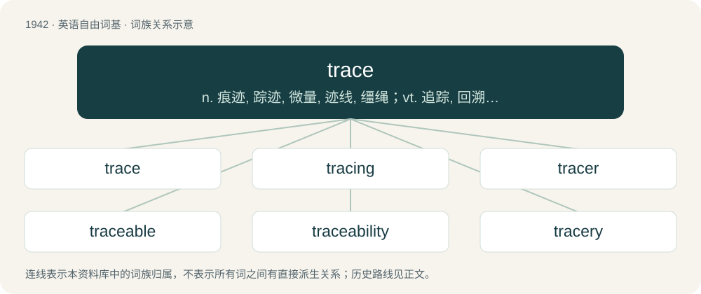

# 2056 · trace — n. 痕迹, 踪迹, 微量, 迹线, 缰绳；vt. 追踪, 回溯, 描绘；vi. 追溯, 沿路走

[总目录](../00_总目录_按常用程度.md)

**类型**：英语自由词基　｜　**来源语言**：见词源记录

## 核心含义与来源

- 核心含义：n. 痕迹, 踪迹, 微量, 迹线, 缰绳；vt. 追踪, 回溯, 描绘；vi. 追溯, 沿路走
- 英文含义：An act of tracing.
- 词形：trace

**多个词源／构词路径**：同一拼写可能有不同来源；以下按词性和含义分别列出。

**来源记录 1**（名词；An act of tracing.）

From Middle English trace, traas, from Old French trace (“an outline, track, trace”), from the verb (see below).

**来源记录 2**（动词；To follow the trail of.）

From Middle English tracen, from Old French tracer, trasser (“to delineate, score, trace", also, "to follow, pursue”), probably a conflation of Vulgar Latin \*tractiō (“to delineate, score, trace”), from Latin trahere (“to draw”); and Old French traquer (“to chase, hunt, pursue”), from trac (“a track, trace”), from Middle Dutch treck, treke (“a drawing, draft, delineation, feature, expedition”). More at track.

## 词族图

## 单词速览（常用到不常用）

| 单词 | 音标 | 释义 |
|---|---|---|
| [trace](#w-1) | /tɹeɪs/ | n. 痕迹, 踪迹, 微量, 迹线, 缰绳；vt. 追踪, 回溯, 描绘；vi. 追溯, 沿路走 |
| [tracing](#w-2) | /ˈtɹeɪsɪŋ/ | n. 描摹, 描图, 追踪；\[计\] 跟踪 |
| [tracer](#w-3) | 英 /ˈtɹeɪsə(ɹ)/；美 /ˈtɹeɪsɚ/ | n. 追踪者, 描图者, 描绘工具；\[计\] 跟踪程序 |
| [traceable](#w-4) | 美 /ˈtɹeɪsəbəl/ | a. 可追踪的, 可描绘的；\[经\] 可追溯的, 可追踪的 |
| [traceability](#w-5) | /ˌtɹeɪsəˈbɪlɪti/ | n. 可描绘, 可描写,可追溯 |
| [tracery](#w-6) | /ˈtɹeɪsəɹi/ | n. 窗花格, 装饰线条 |

## 逐词详解

### 1. trace

**词性**：名词　｜　**音标**：/tɹeɪs/

**中文释义**：n. 痕迹, 踪迹, 微量, 迹线, 缰绳；vt. 追踪, 回溯, 描绘；vi. 追溯, 沿路走

**英文义项**：An act of tracing. / An enquiry sent out for a missing article, such as a letter or an express package.

**词源与演化**：

From Middle English trace, traas, from Old French trace (“an outline, track, trace”), from the verb (see below).

**例句**：

> Your cell phone company can put a trace on your line.

该用例对应义项：An act of tracing.

### 2. tracing

**词性**：名词　｜　**音标**：/ˈtɹeɪsɪŋ/

**中文释义**：n. 描摹, 描图, 追踪；\[计\] 跟踪

**英文义项**：The reproduction of an image made by copying it through translucent paper. / A record in the form of a graph made by a device such as a seismograph.

**构词拆分**：trace + -ing

**词源与演化**：

From Middle English tracyng; equivalent to trace + -ing.

**例句**：

> Scientists have developed apps that can be used for contact tracing.

### 3. tracer

**词性**：名词　｜　**音标**：英 /ˈtɹeɪsə(ɹ)/；美 /ˈtɹeɪsɚ/

**中文释义**：n. 追踪者, 描图者, 描绘工具；\[计\] 跟踪程序

**英文义项**：A compound, element, or isotope used to track the progress or history of a natural process. / A round of ammunition for a firearm that contains magnesium or another flammable substance arranged such that it will burn and produce a visible trail when fired in the dark.

**构词拆分**：From trace + -er.

**词源与演化**：

From trace + -er.

**例句**：

> Positron Emission Tomography uses a radioactive tracer to visualize metabolic activity within the human body.

### 4. traceable

**词性**：形容词　｜　**音标**：美 /ˈtɹeɪsəbəl/

**中文释义**：a. 可追踪的, 可描绘的；\[经\] 可追溯的, 可追踪的

**英文义项**：Capable of being traced; possible to track down. / Containing a Hamiltonian path.

**构词拆分**：trace + -able

**词源与演化**：

From trace + -able.

**例句**：

> There was no traceable evidence left when the detectives arrived.

该用例对应义项：Capable of being traced; possible to track down.

### 5. traceability

**词性**：名词　｜　**音标**：/ˌtɹeɪsəˈbɪlɪti/

**中文释义**：n. 可描绘, 可描写,可追溯

**英文义项**：The ability to trace (identify and measure) all the stages that led to a particular point in a process that consists of a chain of interrelated events

**构词拆分**：trace + -ability；traceable + -ity

**词源与演化**：

From trace + -ability, also analyzable as traceable + -ity.

**例句**：

> The products are subject to stringent traceability rules.

### 6. tracery

**词性**：名词　｜　**音标**：/ˈtɹeɪsəɹi/

**中文释义**：n. 窗花格, 装饰线条

**英文义项**：Bars or ribs, usually of stone or wood, or other material, that subdivide an opening or stand in relief against a door or wall as an ornamental feature. / A delicate interlacing of lines reminiscent of the architectural ornament.

**构词拆分**：trace + -ery

**词源与演化**：

From trace + -ery.

**例句**：

> To all of this new, strange music, Liszt and Chopin added the wonderful tracery of orientalism.
