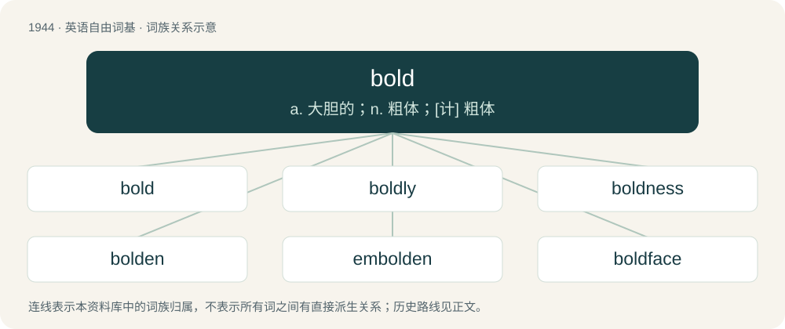

# 2058 · bold — a. 大胆的；n. 粗体；\[计\] 粗体

[总目录](../00_总目录_按常用程度.md)

**类型**：英语自由词基　｜　**来源语言**：见词源记录

## 核心含义与来源

- 核心含义：a. 大胆的；n. 粗体；\[计\] 粗体
- 英文含义：Courageous, daring.
- 词形：bold

**多个词源／构词路径**：同一拼写可能有不同来源；以下按词性和含义分别列出。

**来源记录 1**（形容词；Courageous, daring.）

From Middle English bold, bolde, bald, beald, from Old English bald, beald (“bold, brave, confident, strong, of good courage, presumptuous, impudent”), from Proto-West Germanic \*balþ, from Proto-Germanic \*balþaz (“strong, bold”), from Proto-Indo-European \*bʰel-, \*bʰlē- (“to bloat, swell, bubble”). Cognate with Dutch boud (“bold, courageous, fearless”), Middle High German balt (“bold”) (whence German bald (“soon”)), Swedish båld (“bold, dauntless”). Perhaps related to Albanian ballë (“forehead”) and Old Prussian balo (“forehead”). Compare typologically Italian affrontare (“to face, to deal with”), sfrontato (“bold, daring, insolent”), both from Latin frons (“forehead”).

**来源记录 2**（动词；To make (a font or some text) bold.）

From Middle English bolden, balden, from Old English baldian, bealdian, from Proto-Germanic \*balþōną, related to \*balþaz (see above). Cognate with Old High German irbaldōn (“to become bold, dare”).

## 词族图

## 单词速览（常用到不常用）

| 单词 | 音标 | 释义 |
|---|---|---|
| [bold](#w-1) | 英 /ˈbəʊld/；美 /boʊld/ | a. 大胆的；n. 粗体；\[计\] 粗体 |
| [boldly](#w-2) | 英 /ˈbəʊldli/；美 /ˈboʊldli/ | adv. 大胆地, 显眼地 |
| [boldness](#w-3) | 英 /ˈbəʊldnəs/；美 /ˈboʊldnəs/ | n. 大胆, 勇敢, 冒失；\[计\] 醒目程度; 鲜明度 |
| [bolden](#w-4) | 英 /ˈbəʊld(ə)n/；美 /ˈboʊld(ə)n/ | \[人名\] 博尔登 |
| [embolden](#w-5) | 英 /ɛmˈbəʊld(ə)n/；美 /ɛmˈboʊld(ə)n/ | vt. 使大胆, 使有胆量 |
| [boldface](#w-6) | /ˈbəuldfeis/ | n. 黑体字, 粗体铅字 |

## 逐词详解

### 1. bold

**词性**：形容词　｜　**音标**：英 /ˈbəʊld/；美 /boʊld/

**中文释义**：a. 大胆的；n. 粗体；\[计\] 粗体

**英文义项**：Courageous, daring. / Visually striking; conspicuous.

**词源与演化**：

From Middle English bold, bolde, bald, beald, from Old English bald, beald (“bold, brave, confident, strong, of good courage, presumptuous, impudent”), from Proto-West Germanic \*balþ, from Proto-Germanic \*balþaz (“strong, bold”), from Proto-Indo-European \*bʰel-, \*bʰlē- (“to bloat, swell, bubble”). Cognate with Dutch boud (“bold, courageous, fearless”), Middle High German balt (“bold”) (whence German bald (“soon”)), Swedish båld (“bold, dauntless”). Perhaps related to Albanian ballë (“forehead”) and Old Prussian balo (“forehead”). Compare typologically Italian affrontare (“to face, to deal with”), sfrontato (“bold, daring, insolent”), both from Latin frons (“forehead”).

**例句**：

> The government warned bus operators against continuing to show bold content on buses.

该用例对应义项：Pornographic; depicting nudity.

### 2. boldly

**词性**：副词　｜　**音标**：英 /ˈbəʊldli/；美 /ˈboʊldli/

**中文释义**：adv. 大胆地, 显眼地

**英文义项**：In a bold manner; with confidence.

**构词拆分**：bold + -ly

**词源与演化**：

From Middle English boldely, boldeliche, baldeliche, from Old English bealdlīċe (“boldly, earnestly”), equivalent to bold + -ly.

**用法示例／搭配（非完整句）**：

> to boldly go where no man has gone before

该用例对应义项：In a bold manner; with confidence.

### 3. boldness

**词性**：名词　｜　**音标**：英 /ˈbəʊldnəs/；美 /ˈboʊldnəs/

**中文释义**：n. 大胆, 勇敢, 冒失；\[计\] 醒目程度; 鲜明度

**英文义项**：The state of being bold; courage. / presumptuousness

**构词拆分**：bold + -ness

**词源与演化**：

From Middle English boldnesse, equivalent to bold + -ness. Cognate with Scots baldness, bauldness (“boldness”).

**例句**：

> The proposal required great boldness.

该用例对应义项：the trait of being willing to undertake things that involve risk or danger

### 4. bolden

**词性**：动词　｜　**音标**：英 /ˈbəʊld(ə)n/；美 /ˈboʊld(ə)n/

**中文释义**：\[人名\] 博尔登

**英文义项**：Synonym of embolden (“To render (someone) bolder or more courageous”).

**构词拆分**：From bold + -en.

**词源与演化**：

From bold + -en.

### 5. embolden

**词性**：动词　｜　**音标**：英 /ɛmˈbəʊld(ə)n/；美 /ɛmˈboʊld(ə)n/

**中文释义**：vt. 使大胆, 使有胆量

**英文义项**：To render (someone) bolder or more courageous; to encourage, to hearten. / To format (text) in boldface.

**构词拆分**：bold (adjective) + em- -en

**词源与演化**：

From bold (adjective) + em- -en (variant of en- -en (circumfix forming transitive verbs denoting an increase in, or intensification of, the quality denoted by the enclosed word)). Compare Middle English embolden, enbolden (“to make bold, encourage”) (modern English embold, enbold, imbold (obsolete)), and inboldysshen (“to embolden, encourage”).

### 6. boldface

**词性**：动词　｜　**音标**：/ˈbəuldfeis/

**中文释义**：n. 黑体字, 粗体铅字

**英文义项**：To print or write in a boldfaced font.

**构词拆分**：bold + face

**词源与演化**：

From bold + face.

**例句**：

> Boldface the due date so they are sure to see it.

该用例对应义项：To print or write in a boldfaced font.
