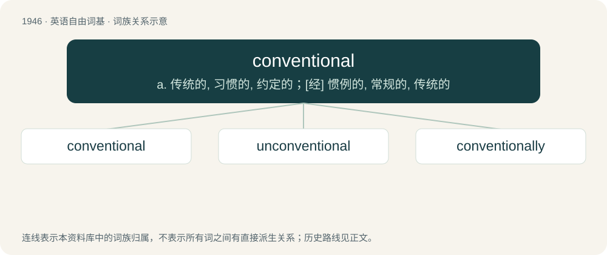

# 2059 · conventional — a. 传统的, 习惯的, 约定的；\[经\] 惯例的, 常规的, 传统的

[总目录](../00_总目录_按常用程度.md)

**类型**：英语自由词基　｜　**来源语言**：见词源记录

## 核心含义与来源

- 核心含义：a. 传统的, 习惯的, 约定的；\[经\] 惯例的, 常规的, 传统的
- 英文含义：Pertaining to a convention, as in following generally accepted principles, methods and behaviour.
- 词形：conventional

**来源记录 1**（形容词；Pertaining to a convention, as in following generally accepted principles, methods and behaviour.）

From convention + -al.

## 词族图

## 单词速览（常用到不常用）

| 单词 | 音标 | 释义 |
|---|---|---|
| [conventional](#w-1) | /kənˈvɛnʃənl̩/ | a. 传统的, 习惯的, 约定的；\[经\] 惯例的, 常规的, 传统的 |
| [unconventional](#w-2) | /.ʌnkənˈvenʃənl/ | a. 不依惯例的, 非传统的, 非常规的 |
| [conventionally](#w-3) | /kənˈvɛnʃənəli/ | adv. 照惯例, 照常套, 照老例 |

## 逐词详解

### 1. conventional

**词性**：形容词　｜　**音标**：/kənˈvɛnʃənl̩/

**中文释义**：a. 传统的, 习惯的, 约定的；\[经\] 惯例的, 常规的, 传统的

**英文义项**：Pertaining to a convention, as in following generally accepted principles, methods and behaviour. / Ordinary, commonplace.

**构词拆分**：From convention + -al.

**词源与演化**：

From convention + -al.

**例句**：

> They wear conventional clothes, eat conventional food, and keep conventional hours.

该用例对应义项：Ordinary, commonplace.

### 2. unconventional

**词性**：形容词　｜　**音标**：/.ʌnkənˈvenʃənl/

**中文释义**：a. 不依惯例的, 非传统的, 非常规的

**英文义项**：Not adhering to custom, convention, or accepted standards. / Out of the ordinary.

**构词拆分**：un- + conventional

**词源与演化**：

From un- + conventional.

**例句**：

> Her unconventional dress and hair style.

该用例对应义项：not conforming to accepted rules or standards

### 3. conventionally

**词性**：副词　｜　**音标**：/kənˈvɛnʃənəli/

**中文释义**：adv. 照惯例, 照常套, 照老例

**英文义项**：Ordinarily, by convention.

**构词拆分**：conventional + -ly

**词源与演化**：

From conventional + -ly.

**例句**：

> Layla wasn't conventionally beautiful, but she possessed a certain kind of intense sexual allure.
