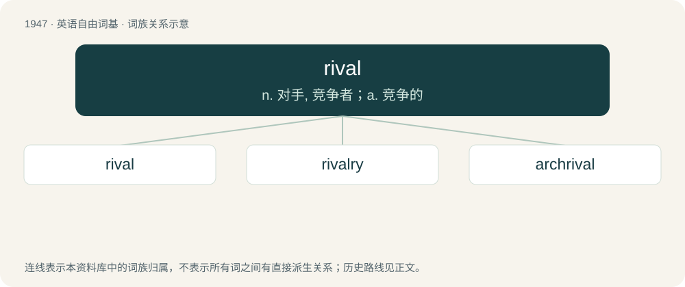

# 2060 · rival — n. 对手, 竞争者；a. 竞争的

[总目录](../00_总目录_按常用程度.md)

**类型**：英语自由词基　｜　**来源语言**：见词源记录

## 核心含义与来源

- 核心含义：n. 对手, 竞争者；a. 竞争的
- 英文含义：A competitor (person, team, company, etc.) with the same goal as another, or striving to attain the same thing. Defeating a rival may be a primary or necessary goal of a competitor.
- 词形：rival

**来源记录 1**（名词；A competitor (person, team, company, etc.) with the same goal as another, or striving to attain the same thing. Defeating a rival may be a primary or necessary goal of a competitor.）

Learned borrowing from Latin rīvālis (literally “person using the same stream as another”). By surface analysis, Latin rīvus + -al.

## 词族图

## 单词速览（常用到不常用）

| 单词 | 音标 | 释义 |
|---|---|---|
| [rival](#w-1) | /ˈɹaɪvəl/ | n. 对手, 竞争者；a. 竞争的 |
| [rivalry](#w-2) | 英 /ˈɹaɪ.vəl.ɹi/ | n. 竞争, 对抗；\[医\] 拮抗 |
| [archrival](#w-3) | /ɑː(ɹ)t͡ʃˈɹaɪvəl/ | n. 主要竞争对手 |

## 逐词详解

### 1. rival

**词性**：名词　｜　**音标**：/ˈɹaɪvəl/

**中文释义**：n. 对手, 竞争者；a. 竞争的

**英文义项**：A competitor (person, team, company, etc.) with the same goal as another, or striving to attain the same thing. Defeating a rival may be a primary or necessary goal of a competitor. / Someone or something with similar claims of quality or distinction as another.

**词源与演化**：

Learned borrowing from Latin rīvālis (literally “person using the same stream as another”). By surface analysis, Latin rīvus + -al.

**例句**：

> Chris is my biggest rival in the 400-metre race.

该用例对应义项：A competitor (person, team, company, etc.) with the same goal as another, or striving to attain the same thing. Defeating a rival may be a primary or necessary goal of a competitor.

### 2. rivalry

**词性**：名词　｜　**音标**：英 /ˈɹaɪ.vəl.ɹi/

**中文释义**：n. 竞争, 对抗；\[医\] 拮抗

**英文义项**：An ongoing relationship between (usually two) rivals who compete for superiority. / The characteristic of being a rivalrous good, such that it can be consumed or used by only one person at a time.

**构词拆分**：rival + -ry

**词源与演化**：

From rival + -ry.

**例句**：

> James and Polly have a bitter rivalry due to the latter's inclusion in the Tea Time Teaser.

该用例对应义项：An ongoing relationship between (usually two) rivals who compete for superiority.

### 3. archrival

**词性**：名词　｜　**音标**：/ɑː(ɹ)t͡ʃˈɹaɪvəl/

**中文释义**：n. 主要竞争对手

**英文义项**：A chief rival.

**构词拆分**：arch- + rival

**词源与演化**：

From arch- + rival.

**例句**：

> The New York Yankees are playing their archrival the Boston Red Sox tonight.

该用例对应义项：A chief rival.
