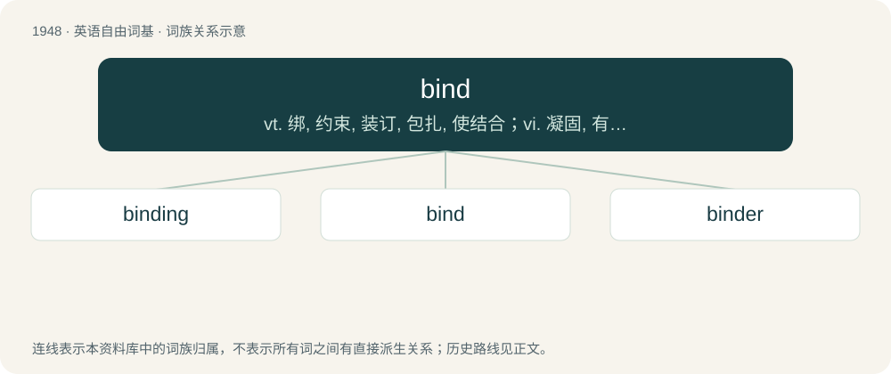

# 2061 · bind — vt. 绑, 约束, 装订, 包扎, 使结合；vi. 凝固, 有约束力；\[计\] 赋值, 绑定

[总目录](../00_总目录_按常用程度.md)

**类型**：英语自由词基　｜　**来源语言**：见词源记录

## 核心含义与来源

- 核心含义：vt. 绑, 约束, 装订, 包扎, 使结合；vi. 凝固, 有约束力；\[计\] 赋值, 绑定
- 英文含义：To tie; to confine by any ligature.
- 词形：bind

**来源记录 1**（动词；To tie; to confine by any ligature.）

From Middle English binden, from Old English bindan, from Proto-West Germanic \*bindan, from Proto-Germanic \*bindaną, from Proto-Indo-European \*bʰéndʰ-e-ti, from \*bʰendʰ- (“to tie”). See also West Frisian bine, Dutch binden, Low German binnen, binden, German binden, Danish, Norwegian Bokmål, and Norwegian Nynorsk binde, Faroese, Icelandic, and Swedish binda; also Welsh ben (“cart”), Latin offendīx (“knot, band”), Lithuanian beñdras (“partner”), Albanian bind (“to convince, to awe, to spell”), Ancient Greek πεῖσμα (peîsma, “cable, rope”), Persian بستن (bastan, “to bind”), Sanskrit बन्धति (bándhati). Doublet of bandana.

## 词族图

## 单词速览（常用到不常用）

| 单词 | 音标 | 释义 |
|---|---|---|
| [binding](#w-1) | /ˈbaɪndɪŋ/ | n. 装订；\[计\] 联编; 汇集; 绑定, 捆绑 |
| [bind](#w-2) | /ˈbaɪ̯nd/ | vt. 绑, 约束, 装订, 包扎, 使结合；vi. 凝固, 有约束力；\[计\] 赋值, 绑定 |
| [binder](#w-3) | 英 /ˈbaɪndə/；美 /ˈbaɪndɚ/ | n. 捆缚者, 用以绑缚之物, 活页夹；\[化\] 粘结剂 |

## 逐词详解

### 1. binding

**词性**：形容词　｜　**音标**：/ˈbaɪndɪŋ/

**中文释义**：n. 装订；\[计\] 联编; 汇集; 绑定, 捆绑

**英文义项**：Imposing stipulations or requirements that must be honoured. / Having the effect of counteracting diarrhea.

**构词拆分**：bind + -ing

**词源与演化**：

From Middle English byndynge; equivalent to bind + -ing.

**例句**：

> A sworn statement (i.e., "made under oath)"is legally binding.

该用例对应义项：Imposing stipulations or requirements that must be honoured.

### 2. bind

**词性**：动词　｜　**音标**：/ˈbaɪ̯nd/

**中文释义**：vt. 绑, 约束, 装订, 包扎, 使结合；vi. 凝固, 有约束力；\[计\] 赋值, 绑定

**英文义项**：To tie; to confine by any ligature. / To cohere or stick together in a mass.

**词源与演化**：

From Middle English binden, from Old English bindan, from Proto-West Germanic \*bindan, from Proto-Germanic \*bindaną, from Proto-Indo-European \*bʰéndʰ-e-ti, from \*bʰendʰ- (“to tie”). See also West Frisian bine, Dutch binden, Low German binnen, binden, German binden, Danish, Norwegian Bokmål, and Norwegian Nynorsk binde, Faroese, Icelandic, and Swedish binda; also Welsh ben (“cart”), Latin offendīx (“knot, band”), Lithuanian beñdras (“partner”), Albanian bind (“to convince, to awe, to spell”), Ancient Greek πεῖσμα (peîsma, “cable, rope”), Persian بستن (bastan, “to bind”), Sanskrit बन्धति (bándhati). Doublet of bandana.

**例句**：

> I wish I knew why the sewing machine binds up after I use it for a while.

该用例对应义项：To be restrained from motion, or from customary or natural action, as by friction.

### 3. binder

**词性**：名词　｜　**音标**：英 /ˈbaɪndə/；美 /ˈbaɪndɚ/

**中文释义**：n. 捆缚者, 用以绑缚之物, 活页夹；\[化\] 粘结剂

**英文义项**：Someone who binds. / Someone who binds books; a bookbinder.

**构词拆分**：bind + -er

**词源与演化**：

From Middle English byndere; equivalent to bind + -er.

**例句**：

> I use a three-ring binder for all my subjects instead of a notebook for each one.
