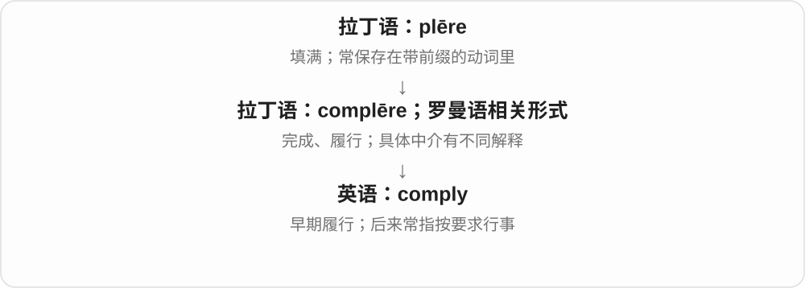
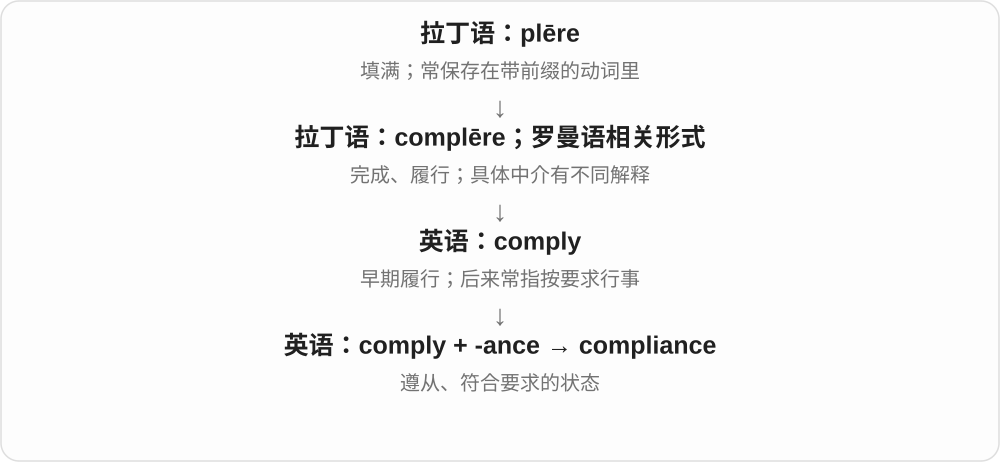

# 2061 · comply — 遵守；顺从；符合要求

[逐词精讲目录](../00_逐词精讲目录.md) · [总目录](../00_总目录_按常用程度.md)

## 核心词根与来源

comply 的传承和词义历史联系法语、意大利语及拉丁完成、满足一类材料。现代核心是按规则、请求或标准行事；compliance 为名词，compliant 为形容词。

**COMPLY：按要求把行为对齐**

规定已经给出，下一步看实际做法是否符合。

- **动作与状态**：comply · compliant
- **符合要求这一性质**：compliance

## 词形与演化规律

comply with、compliance with、compliant with；不能说 comply the rules。compliant 也可能在材料技术中说柔顺、容易变形。

## 单词速览（按词族由简到繁）

同一基础词的相关扩展放在一起，先读基础形式，再读扩展；各组之间优先读常用的。具体词源关系见各词讲解。

| 单词 | 音标 | 核心意思 |
|---|---|---|
| [comply](#w-2) | 英、美 /kəmˈplaɪ/ | 遵守；按要求做；服从 |
| [compliance](#w-1) | 英、美 /kəmˈplaɪəns/ | 遵从；合规；顺从；顺应性〔技术〕 |
| [compliant](#w-3) | 英、美 /kəmˈplaɪənt/ | 符合规定的；顺从的；易变形的〔技术〕 |

## 逐词讲解

### 1. comply — 遵守；按要求做；服从

**音标**：英、美 /kəmˈplaɪ/

**先抓住这个画面**

别人给了一条要求，你照着做到位：不只是点头，而是行动符合要求。

**怎么拆**

最终联系拉丁语 complēre“完成、履行”；中间可联系古法语 compli / complir，也有意大利语等罗曼语影响的解释。现代“遵从”义的发展不能凭拼写硬拆成 com- + ply“弯”。

**怎么变成今天的意思**

常用 comply with a rule / request。它是不及物动词，通常不能直接说 comply the rule。历史上的“履行”可以帮助理解今天的“把要求做到”。

**常见搭配与例句**

comply with regulations；comply with a request；refuse to comply。

> All entries must comply with the competition rules.

所有参赛作品都必须符合比赛规则。

> He was asked to lower his voice and immediately complied.

别人请他放低声音，他立刻照做了。

**别混淆**

agree 是同意；comply 是照办。心里不同意，也可能为了满足要求而 comply。

### 2. compliance — 遵从；合规；顺从；顺应性〔技术〕

**音标**：英、美 /kəmˈplaɪəns/

**先抓住这个画面**

把“有没有照着要求做”作为一种状态来看；在工作中，常指流程和行为符合规定。

**怎么拆**

comply + -ance；英语派生。

**怎么变成今天的意思**

in compliance with 是按照、符合；a compliance check 是合规检查。工程等领域也用 compliance 表示受力时容易变形的程度，这不是说材料在心理上服从。

**常见搭配与例句**

in compliance with；ensure compliance；a compliance check。

> The team checked the design for compliance with the new standard.

团队检查了设计是否符合新标准。

> Her quiet compliance surprised everyone who had expected an argument.

她安静地照做了，这让原本以为会有争论的人都很意外。

**别混淆**

obedience 偏服从某人；compliance 也可以说设备、流程符合标准，不只用于人。

### 3. compliant — 符合规定的；顺从的；易变形的〔技术〕

**音标**：英、美 /kəmˈplaɪənt/

**先抓住这个画面**

对要求能配合、对标准能达到。用在人身上可以是听话；用在产品上就是合乎规定。

**怎么拆**

comply + -ant，形成形容词。

**怎么变成今天的意思**

compliant with a standard 是符合标准。形容人时，有时带“太容易顺从”的评价；描述材料时还可指受力后较易变形。

**常见搭配与例句**

compliant with standards；a compliant child；a compliant material。

> The new equipment is compliant with the published safety standard.

新设备符合公布的安全标准。

> She was cooperative without being blindly compliant.

她愿意配合，但不会盲目顺从。

**别混淆**

compatible 是能相容、能一起使用；compliant 是满足某项要求。能兼容不等于已经合规。

## 这一组要分清什么

compliant 可是符合标准，也可能带容易顺从的语气；不能每次都译成合规。

## 串起来练习

The system complies with the standard, and the report documents its compliance.

系统符合标准，报告记录了其符合情况。
