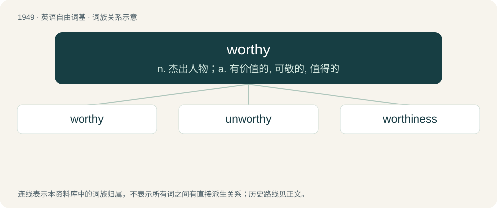

# 2062 · worthy — n. 杰出人物；a. 有价值的, 可敬的, 值得的

[总目录](../00_总目录_按常用程度.md)

**类型**：英语自由词基　｜　**来源语言**：见词源记录

## 核心含义与来源

- 核心含义：n. 杰出人物；a. 有价值的, 可敬的, 值得的
- 英文含义：Having worth, merit, or value.
- 词形：worthy

**多个词源／构词路径**：同一拼写可能有不同来源；以下按词性和含义分别列出。

**来源记录 1**（形容词；Having worth, merit, or value.）

From Middle English worthy, wurthi, from Old English \*weorþiġ (“worthy”), equivalent to worth + -y. Cognate with Dutch waardig (“worthy”), Middle Low German werdig (“worthy”), German würdig (“worthy”), Swedish värdig (“worthy”), Icelandic verðugur (“worthy”).

**来源记录 2**（动词；To render or treat as worthy.）

From Middle English worthien, wurthien, from Old English weorþian (“to esteem, honor, worship, distinguish, celebrate, exalt, praise, adorn, deck, enrich, reward”), from Proto-Germanic \*werþōną (“to be worthy, estimate, appreciate, appraise”), from Proto-Indo-European \*wert- (“to turn, wind”). Cognate with German werten (“to rate, judge, grade, score”), Swedish värdera (“to evaluate, rate, size up, assess, estimate”), Icelandic virða (“to respect, esteem”).

## 词族图

## 单词速览（常用到不常用）

| 单词 | 音标 | 释义 |
|---|---|---|
| [worthy](#w-1) | 英 /ˈwɜː.ði/；美 /ˈwɝ.ði/ | n. 杰出人物；a. 有价值的, 可敬的, 值得的 |
| [unworthy](#w-2) | /ʌnˈwɝði/ | a. 不值得的, 不相称的 |
| [worthiness](#w-3) | /ˈwɜː(ɹ)ðɪnəs/ | n. 价值, 相当, 值得 |

## 逐词详解

### 1. worthy

**词性**：名词　｜　**音标**：英 /ˈwɜː.ði/；美 /ˈwɝ.ði/

**中文释义**：n. 杰出人物；a. 有价值的, 可敬的, 值得的

**英文义项**：A distinguished or eminent person. / a good, wise and virtuous person.

**构词拆分**：worth + -y

**词源与演化**：

From Middle English worthy, wurthi, from Old English \*weorþiġ (“worthy”), equivalent to worth + -y. Cognate with Dutch waardig (“worthy”), Middle Low German werdig (“worthy”), German würdig (“worthy”), Swedish värdig (“worthy”), Icelandic verðugur (“worthy”).

**例句**：

> Never tell the truth to people who are not worthy of it.

### 2. unworthy

**词性**：形容词　｜　**音标**：/ʌnˈwɝði/

**中文释义**：a. 不值得的, 不相称的

**英文义项**：Not worthy; lacking value or merit; worthless.

**构词拆分**：un- + worthy

**词源与演化**：

From Middle English unworthy, equivalent to un- + worthy.

**例句**：

> Dispel a student whose conduct is deemed unworthy.

该用例对应义项：lacking in value or merit

### 3. worthiness

**词性**：名词　｜　**音标**：/ˈwɜː(ɹ)ðɪnəs/

**中文释义**：n. 价值, 相当, 值得

**英文义项**：The state or quality of having value or merit. / The result or product of having value or merit.

**构词拆分**：worthy + -ness

**词源与演化**：

From Middle English worthynesse, equivalent to worthy + -ness.
