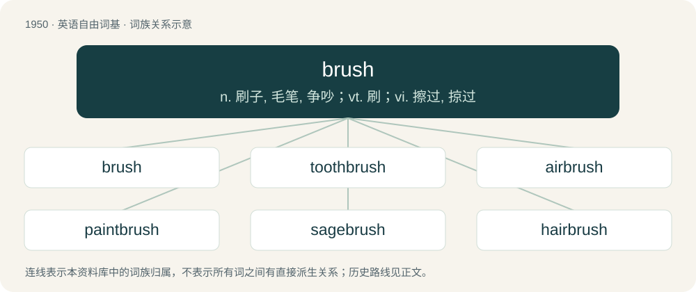

# 2064 · brush — n. 刷子, 毛笔, 争吵；vt. 刷；vi. 擦过, 掠过

[总目录](../00_总目录_按常用程度.md)

**类型**：英语自由词基　｜　**来源语言**：见词源记录

## 核心含义与来源

- 核心含义：n. 刷子, 毛笔, 争吵；vt. 刷；vi. 擦过, 掠过
- 英文含义：An implement consisting of multiple more or less flexible bristles or other filaments attached to a handle, used for any of various purposes including cleaning, painting, and arranging hair.
- 词形：brush

**来源记录 1**（名词；An implement consisting of multiple more or less flexible bristles or other filaments attached to a handle, used for any of various purposes including cleaning, painting, and arranging hair.）

From Middle English brusshe, from Old French broisse (Modern French brosse), from Vulgar Latin \*brustia, from Frankish \*bursti, from Proto-Germanic \*burstiz (“bristle”), or also Vulgar Latin \*bruscia, from Proto-Germanic \*bruskaz (“tuft, thicket, underbrush”), which could be from Proto-Indo-European \*bʰrusgo-.

## 词族图

## 单词速览（常用到不常用）

| 单词 | 音标 | 释义 |
|---|---|---|
| [brush](#w-1) | 英 /bɹʌʃ/ | n. 刷子, 毛笔, 争吵；vt. 刷；vi. 擦过, 掠过 |
| [toothbrush](#w-2) | 英 /ˈtuːθ.bɹʌʃ/；美 /ˈtuθ.bɹʌʃ/ | n. 牙刷 |
| [airbrush](#w-3) | /ˈєəbrʌʃ/ | n. 喷枪 |
| [paintbrush](#w-4) | /ˈpeɪntˌbɹʌʃ/ | n. 画笔, 漆刷；\[计\] 画笔 |
| [sagebrush](#w-5) | 英 /ˈseɪd͡ʒˌbɹʌʃ/ | \[医\] 三齿嵩 |
| [hairbrush](#w-6) | /ˈhєəbrʌʃ/ | n. 发刷 |
| [brushless](#w-7) | /bˈrʌʃlɪs/ | a. 无需用刷子的; 无刷 |
| [underbrush](#w-8) | 美 /ˈʌndɚˌbɹʌʃ/ | n. 林下灌丛 |
| [brushy](#w-9) | /ˈbɹʌʃi/ | a. 如毛刷的, 毛茸茸的, 矮林多的 |
| [brushwork](#w-10) | /ˈbrʌʃwəːk/ | n. 笔法, 绘画 |

## 逐词详解

### 1. brush

**词性**：名词　｜　**音标**：英 /bɹʌʃ/

**中文释义**：n. 刷子, 毛笔, 争吵；vt. 刷；vi. 擦过, 掠过

**英文义项**：An implement consisting of multiple more or less flexible bristles or other filaments attached to a handle, used for any of various purposes including cleaning, painting, and arranging hair. / The act of brushing something.

**词源与演化**：

From Middle English brusshe, from Old French broisse (Modern French brosse), from Vulgar Latin \*brustia, from Frankish \*bursti, from Proto-Germanic \*burstiz (“bristle”), or also Vulgar Latin \*bruscia, from Proto-Germanic \*bruskaz (“tuft, thicket, underbrush”), which could be from Proto-Indo-European \*bʰrusgo-.

**例句**：

> He has had brushes with communism from time to time.

该用例对应义项：A short, possibly recurrent encounter or experience.

### 2. toothbrush

**词性**：名词　｜　**音标**：英 /ˈtuːθ.bɹʌʃ/；美 /ˈtuθ.bɹʌʃ/

**中文释义**：n. 牙刷

**英文义项**：A brush, used with toothpaste, for cleaning the teeth.

**构词拆分**：tooth + brush

**词源与演化**：

From tooth + brush. Compare Saterland Frisian Tuskebäärsel (“toothbrush”), West Frisian toskboarstel (“toothbrush”), Dutch tandenborstel (“toothbrush”), German Zahnbürste (“toothbrush”), Danish tandbørste (“toothbrush”), Swedish tandborste (“toothbrush”), Icelandic tannbursti (“toothbrush”).

**例句**：

> My toothbrush fell to the floor while I was brushing my teeth.

### 3. airbrush

**词性**：动词　｜　**音标**：/ˈєəbrʌʃ/

**中文释义**：n. 喷枪

**英文义项**：To paint using an airbrush. / To touch up or enhance a photograph or person, often with intent to mislead.

**构词拆分**：air + brush

**词源与演化**：

From air + brush.

**例句**：

> This photo has definitely been airbrushed; no one has skin this smooth.

该用例对应义项：To touch up or enhance a photograph or person, often with intent to mislead.

### 4. paintbrush

**词性**：名词　｜　**音标**：/ˈpeɪntˌbɹʌʃ/

**中文释义**：n. 画笔, 漆刷；\[计\] 画笔

**英文义项**：A thin brush for applying paint.

**构词拆分**：paint + brush

**词源与演化**：

From paint + brush.

**例句**：

> Tom picked up a paintbrush and started helping Mary paint the fence.

### 5. sagebrush

**词性**：名词　｜　**音标**：英 /ˈseɪd͡ʒˌbɹʌʃ/

**中文释义**：\[医\] 三齿嵩

**英文义项**：Any of several North American aromatic shrubs of the genus Artemisia, having silvery-grey, green leaves.

**构词拆分**：sage + brush

**词源与演化**：

From sage + brush, from resemblance in odor and appearance to Salvia officinalis.

### 6. hairbrush

**词性**：名词　｜　**音标**：/ˈhєəbrʌʃ/

**中文释义**：n. 发刷

**英文义项**：A brush used in hair care for brushing, tidying, and detangling hair

**构词拆分**：hair + brush

**词源与演化**：

From hair + brush.

**例句**：

> Mistakes happen said the hedgehog and stepped off the hairbrush.

### 7. brushless

**词性**：形容词　｜　**音标**：/bˈrʌʃlɪs/

**中文释义**：a. 无需用刷子的; 无刷

**英文义项**：Of an electric motor: that does not use brushes, physical contacts for the commutator. / Not requiring the use of a hairbrush, scrubbing brush, or other brush.

**构词拆分**：brush + -less

**词源与演化**：

From brush + -less.

**用法示例／搭配（非完整句）**：

> a brushless finish on the concrete

该用例对应义项：Not requiring the use of a hairbrush, scrubbing brush, or other brush.

### 8. underbrush

**词性**：名词　｜　**音标**：美 /ˈʌndɚˌbɹʌʃ/

**中文释义**：n. 林下灌丛

**英文义项**：The small trees and other plants that clutter the floor of a forest.

**构词拆分**：under- + brush

**词源与演化**：

From under- + brush.

**例句**：

> Fyodor heard the hyena moving through the underbrush.

### 9. brushy

**词性**：形容词　｜　**音标**：/ˈbɹʌʃi/

**中文释义**：a. 如毛刷的, 毛茸茸的, 矮林多的

**英文义项**：Having a similar texture to a fox’s tail; brushlike, bushy. / Of the countryside: having thick vegetation, taller than grass but shorter than trees; having abundant brush; shrubby.

**构词拆分**：brush + -y

**词源与演化**：

From brush + -y.

### 10. brushwork

**词性**：名词　｜　**音标**：/ˈbrʌʃwəːk/

**中文释义**：n. 笔法, 绘画

**英文义项**：The technique or practice of applying and manipulating paint (usually oil or gouache) in a painting.

**构词拆分**：brush + work

**词源与演化**：

From brush + work.

**例句**：

> The fake was easy to spot because of its inferior brushwork.

该用例对应义项：The technique or practice of applying and manipulating paint (usually oil or gouache) in a painting.
