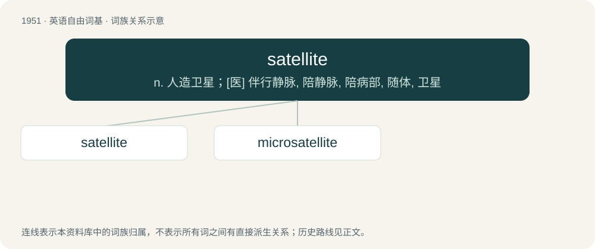

# 2065 · satellite — n. 人造卫星；\[医\] 伴行静脉, 陪静脉, 陪病部, 随体, 卫星

[总目录](../00_总目录_按常用程度.md)

**类型**：英语自由词基　｜　**来源语言**：见词源记录

## 核心含义与来源

- 核心含义：n. 人造卫星；\[医\] 伴行静脉, 陪静脉, 陪病部, 随体, 卫星
- 英文含义：A moon or other smaller body orbiting a larger one.
- 词形：satellite

**来源记录 1**（名词；A moon or other smaller body orbiting a larger one.）

From Middle French satellite, from Latin satelles (“attendant”). Ultimately perhaps of Etruscan origin.

## 词族图

## 单词速览（常用到不常用）

| 单词 | 音标 | 释义 |
|---|---|---|
| [satellite](#w-1) | /ˈsætəlaɪ̯t/ | n. 人造卫星；\[医\] 伴行静脉, 陪静脉, 陪病部, 随体, 卫星 |
| [microsatellite](#w-2) | /maɪkrəʊzəˈtelaɪt/ | 微卫星 |

## 逐词详解

### 1. satellite

**词性**：名词　｜　**音标**：/ˈsætəlaɪ̯t/

**中文释义**：n. 人造卫星；\[医\] 伴行静脉, 陪静脉, 陪病部, 随体, 卫星

**英文义项**：A moon or other smaller body orbiting a larger one. / A man-made apparatus designed to be placed in orbit around a celestial body, generally to relay information, data, etc. to Earth.

**词源与演化**：

From Middle French satellite, from Latin satelles (“attendant”). Ultimately perhaps of Etruscan origin.

**例句**：

> Many telecommunication satellites orbit at 36000km above the equator.

该用例对应义项：A man-made apparatus designed to be placed in orbit around a celestial body, generally to relay information, data, etc. to Earth.

### 2. microsatellite

**词性**：名词　｜　**音标**：/maɪkrəʊzəˈtelaɪt/

**中文释义**：微卫星

**英文义项**：A miniature satellite. / Any of a group of polymorphic loci in DNA that consist of repeat units of just a few base pairs.

**构词拆分**：micro- + satellite

**词源与演化**：

From micro- + satellite.
