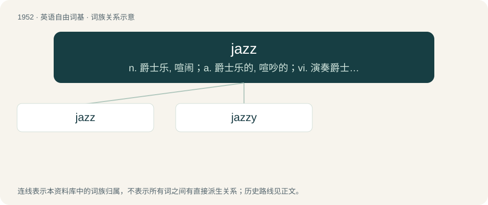

# 2066 · jazz — n. 爵士乐, 喧闹；a. 爵士乐的, 喧吵的；vi. 演奏爵士乐, 跳爵士舞, 游荡

[总目录](../00_总目录_按常用程度.md)

**类型**：英语自由词基　｜　**来源语言**：见词源记录

## 核心含义与来源

- 核心含义：n. 爵士乐, 喧闹；a. 爵士乐的, 喧吵的；vi. 演奏爵士乐, 跳爵士舞, 游荡
- 英文含义：A musical art form rooted in West African cultural and musical expression and in the African American blues tradition, with diverse influences over time, commonly characterized by blue notes, syncopation, swing, call and response, polyrhythms and improvisation.
- 词形：jazz

**来源记录 1**（名词；A musical art form rooted in West African cultural and musical expression and in the African American blues tradition, with diverse influences over time, commonly characterized by blue notes, syncopation, swing, call and response, polyrhythms and improvisation.）

Unknown. First attested around 1912 in a discussion of baseball; attested in reference to music around 1915. Numerous references suggest that the term may be connected to jasm and jism.

## 词族图

## 单词速览（常用到不常用）

| 单词 | 音标 | 释义 |
|---|---|---|
| [jazz](#w-1) | /d͡ʒæz/ | n. 爵士乐, 喧闹；a. 爵士乐的, 喧吵的；vi. 演奏爵士乐, 跳爵士舞, 游荡 |
| [jazzy](#w-2) | /ˈd͡ʒæzi/ | a. 爵士的, 奔放的, 激烈的 |

## 逐词详解

### 1. jazz

**词性**：名词　｜　**音标**：/d͡ʒæz/

**中文释义**：n. 爵士乐, 喧闹；a. 爵士乐的, 喧吵的；vi. 演奏爵士乐, 跳爵士舞, 游荡

**英文义项**：A musical art form rooted in West African cultural and musical expression and in the African American blues tradition, with diverse influences over time, commonly characterized by blue notes, syncopation, swing, call and response, polyrhythms and improvisation. / Energy, excitement, excitability.

**词源与演化**：

Unknown. First attested around 1912 in a discussion of baseball; attested in reference to music around 1915. Numerous references suggest that the term may be connected to jasm and jism.

**例句**：

> I'm just going down to the shops and jazz.

该用例对应义项：The substance or makeup of a thing; unspecified thing(s).

### 2. jazzy

**词性**：形容词　｜　**音标**：/ˈd͡ʒæzi/

**中文释义**：a. 爵士的, 奔放的, 激烈的

**英文义项**：In the style of jazz. / Flashy or showy.

**构词拆分**：jazz + -y

**词源与演化**：

From jazz + -y.

**例句**：

> If you add sevenths to these chords, the piece suddenly sounds very jazzy.
