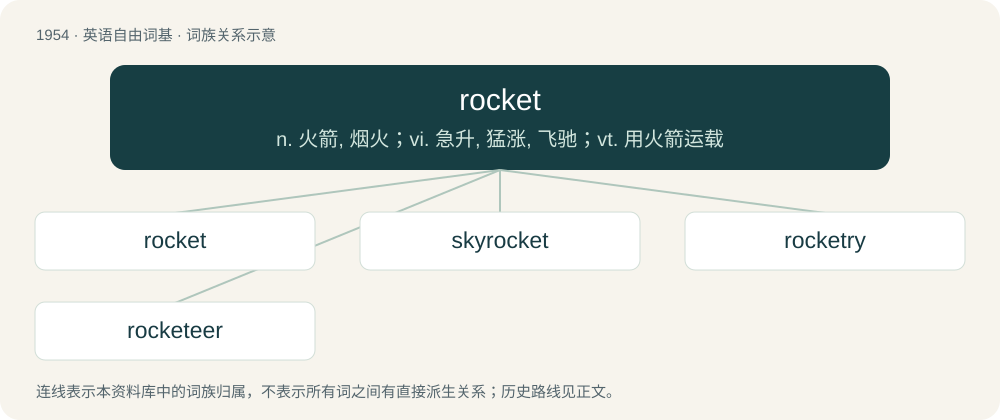

# 2069 · rocket — n. 火箭, 烟火；vi. 急升, 猛涨, 飞驰；vt. 用火箭运载

[总目录](../00_总目录_按常用程度.md)

**类型**：英语自由词基　｜　**来源语言**：见词源记录

## 核心含义与来源

- 核心含义：n. 火箭, 烟火；vi. 急升, 猛涨, 飞驰；vt. 用火箭运载
- 英文含义：A cylindrical projectile that can be fired to a great height through combustion, (specifically) a type of firework of this form, typically exploding with light and colour; a skyrocket.
- 词形：rocket

**多个词源／构词路径**：同一拼写可能有不同来源；以下按词性和含义分别列出。

**来源记录 1**（名词；A cylindrical projectile that can be fired to a great height through combustion, (specifically) a type of firework of this form, typically exploding with light and colour; a skyrocket.）

From Italian rocchetta, from Old Italian rocchetto (“rocket”, literally “a bobbin”), diminutive of rocca (“a distaff”), from Lombardic rocko (“spinning wheel”), from Proto-West Germanic \*rokkō, from Proto-Germanic \*rukkô (“a distaff, a staff with flax fibres tied loosely to it, used in spinning thread”). Cognate with Old High German rocco, rocko, roccho, rocho ("a distaff"; &gt; German Rocken (“a distaff”)), Swedish rock (“a distaff”), Icelandic rokkur (“a distaff”), Middle English rocke (“a distaff”). More at rock⁴. For the meaning development, compare fuselage, ultimately from Latin fūsus (“spindle, spinning wheel”).

**来源记录 2**（名词；A leaf vegetable of species Eruca sativa or Eruca vesicaria.）

Borrowed from French roquette, from Italian ruchetta, diminutive of ruca, from Latin eruca. Cognate to arugula, rucola, eruca, roquette.

## 词族图

## 单词速览（常用到不常用）

| 单词 | 音标 | 释义 |
|---|---|---|
| [rocket](#w-1) | 英 /ˈɹɒk.ɪt/；美 /ˈɹɑk.ɪt/ | n. 火箭, 烟火；vi. 急升, 猛涨, 飞驰；vt. 用火箭运载 |
| [skyrocket](#w-2) | 英 /ˈskaɪˌɹɒk.ɪt/ | vi. 飞涨, 突升；n. 焰火 |
| [rocketry](#w-3) | /ˈrɒkətri/ | n. 火箭研究 |
| [rocketeer](#w-4) | /,rɔkiˈtiə/ | n. 火箭专家, 火箭设计者 |

## 逐词详解

### 1. rocket

**词性**：动词　｜　**音标**：英 /ˈɹɒk.ɪt/；美 /ˈɹɑk.ɪt/

**中文释义**：n. 火箭, 烟火；vi. 急升, 猛涨, 飞驰；vt. 用火箭运载

**英文义项**：To accelerate swiftly and powerfully. / To fly vertically.

**词源与演化**：

From Italian rocchetta, from Old Italian rocchetto (“rocket”, literally “a bobbin”), diminutive of rocca (“a distaff”), from Lombardic rocko (“spinning wheel”), from Proto-West Germanic \*rokkō, from Proto-Germanic \*rukkô (“a distaff, a staff with flax fibres tied loosely to it, used in spinning thread”). Cognate with Old High German rocco, rocko, roccho, rocho ("a distaff"; &gt; German Rocken (“a distaff”)), Swedish rock (“a distaff”), Icelandic rokkur (“a distaff”), Middle English rocke (“a distaff”). More at rock⁴. For the meaning development, compare fuselage, ultimately from Latin fūsus (“spindle, spinning wheel”).

**例句**：

> After spending years in obscurity, the band finally rocketed last week.

该用例对应义项：To experience sudden fame, popularity, or success.

### 2. skyrocket

**词性**：动词　｜　**音标**：英 /ˈskaɪˌɹɒk.ɪt/

**中文释义**：vi. 飞涨, 突升；n. 焰火

**英文义项**：To rise or increase suddenly and extremely; to shoot up; to surge or spike. / To cause to increase suddenly and extremely.

**构词拆分**：sky + rocket

**词源与演化**：

From sky + rocket.

**例句**：

> The shortage caused prices to skyrocket.

该用例对应义项：To rise or increase suddenly and extremely; to shoot up; to surge or spike.

### 3. rocketry

**词性**：名词　｜　**音标**：/ˈrɒkətri/

**中文释义**：n. 火箭研究

**英文义项**：The making and launching of rockets, its science and practice.

**构词拆分**：From rocket + -ry.

**词源与演化**：

From rocket + -ry.

### 4. rocketeer

**词性**：名词　｜　**音标**：/,rɔkiˈtiə/

**中文释义**：n. 火箭专家, 火箭设计者

**英文义项**：Somebody who designs, launches, operates, or travels in a rocket.

**构词拆分**：rocket + -eer

**词源与演化**：

From rocket + -eer.
