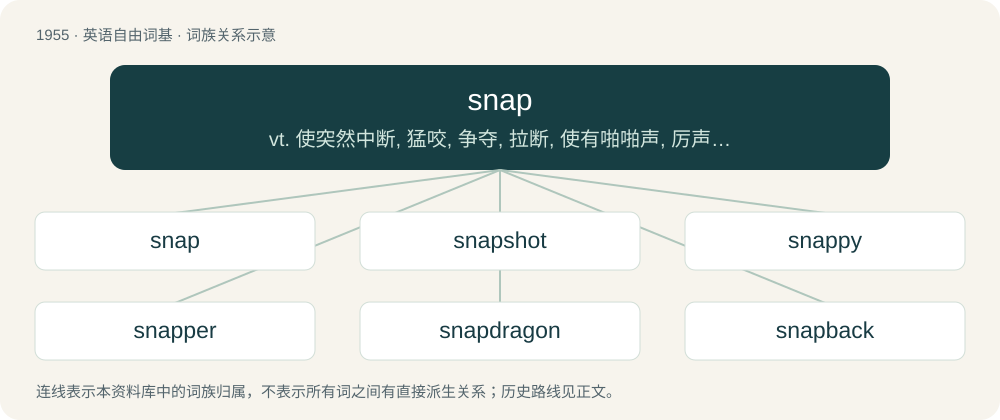

# 2070 · snap — vt. 使突然中断, 猛咬, 争夺, 拉断, 使有啪啪声, 厉声说, 突然射击, 用快照拍摄；vi. 咬, 扑, 抓, 折断, 劈啪地响, 厉声说, 砰然关上；n. 猛咬, 猛扑, 劈啪声, 申斥, 快照, 活力, 一般时期的寒冷天气, 揿钮

[总目录](../00_总目录_按常用程度.md)

**类型**：英语自由词基　｜　**来源语言**：见词源记录

## 核心含义与来源

- 核心含义：vt. 使突然中断, 猛咬, 争夺, 拉断, 使有啪啪声, 厉声说, 突然射击, 用快照拍摄；vi. 咬, 扑, 抓, 折断, 劈啪地响, 厉声说, 砰然关上；n. 猛咬, 猛扑, 劈啪声, 申斥, 快照, 活力, 一般时期的寒冷天气, 揿钮
- 英文含义：A quick breaking or cracking sound or the action of producing such a sound.
- 词形：snap

**来源记录 1**（名词；A quick breaking or cracking sound or the action of producing such a sound.）

From Dutch snappen (“to bite; seize”) or Low German snappen (“to bite; seize”), ultimately from Proto-West Germanic \*snappōn, from Proto-Germanic \*snappōną (“to snap; snatch; chatter”), intensive form of \*snapāną (”to snap; grab”, whence Old Norse snapa (“to get; scrounge”)), from Proto-Indo-European \*snop-; compare Lithuanian snãpas (“beak, bill”). (One alternative hypothesis links the Germanic words to \*snu-, an expressive root deriving words meaning “nose”, “snout”, “sniff” etc., but this is phonetically unsound.) In any case influenced by onomatopoeia; note expressions such as snip-snap, containing the formally unrelated snip. Cognate with West Frisian snappe (“to get; catch; snap”), German schnappen (“to grab”), Swedish snappa (“to snatch”). The verb is derived from the noun.

## 词族图

## 单词速览（常用到不常用）

| 单词 | 音标 | 释义 |
|---|---|---|
| [snap](#w-1) | /snæp/ | vt. 使突然中断, 猛咬, 争夺, 拉断, 使有啪啪声, 厉声说, 突然射击, 用快照拍摄；vi. 咬, 扑, 抓, 折断, 劈啪地响, 厉声说, 砰然关上；n. 猛咬, 猛扑, 劈啪声, 申斥, 快照, 活力, 一般时期的寒冷天气, 揿钮 |
| [snapshot](#w-2) | /ˈsnæpʃɒt/ | n. 快照, 抽点打印；\[计\] 瞬象; 抽点打印 |
| [snappy](#w-3) | /ˈsnæpi/ | a. 厉声说话的；生气勃勃的；时髦的；爽快的 |
| [snapper](#w-4) | 美 /ˈsnæpɚ/ | n. 咬人的狗, 厉声说话的人, 揿钮 |
| [snapdragon](#w-5) | 美 /ˈsnæpdɹæɡən/ | n. 金鱼草 |
| [snapback](#w-6) | /ˈsnæpˌbæk/ | n. 快速传球, 很快的恢复 |

## 逐词详解

### 1. snap

**词性**：名词　｜　**音标**：/snæp/

**中文释义**：vt. 使突然中断, 猛咬, 争夺, 拉断, 使有啪啪声, 厉声说, 突然射击, 用快照拍摄；vi. 咬, 扑, 抓, 折断, 劈啪地响, 厉声说, 砰然关上；n. 猛咬, 猛扑, 劈啪声, 申斥, 快照, 活力, 一般时期的寒冷天气, 揿钮

**英文义项**：A quick breaking or cracking sound or the action of producing such a sound. / A sudden break.

**词源与演化**：

From Dutch snappen (“to bite; seize”) or Low German snappen (“to bite; seize”), ultimately from Proto-West Germanic \*snappōn, from Proto-Germanic \*snappōną (“to snap; snatch; chatter”), intensive form of \*snapāną (”to snap; grab”, whence Old Norse snapa (“to get; scrounge”)), from Proto-Indo-European \*snop-; compare Lithuanian snãpas (“beak, bill”). (One alternative hypothesis links the Germanic words to \*snu-, an expressive root deriving words meaning “nose”, “snout”, “sniff” etc., but this is phonetically unsound.) In any case influenced by onomatopoeia; note expressions such as snip-snap, containing the formally unrelated snip. Cognate with West Frisian snappe (“to get; catch; snap”), German schnappen (“to grab”), Swedish snappa (“to snatch”). The verb is derived from the noun.

**例句**：

> We took a few snaps of the old church before moving on.

该用例对应义项：A photograph; a snapshot.

### 2. snapshot

**词性**：名词　｜　**音标**：/ˈsnæpʃɒt/

**中文释义**：n. 快照, 抽点打印；\[计\] 瞬象; 抽点打印

**英文义项**：A photograph, especially one taken quickly or in a sudden moment of opportunity. / A glimpse of something; a portrayal of something at a moment in time.

**构词拆分**：snap + shot

**词源与演化**：

From snap + shot.

**例句**：

> This game is so hard that I find myself taking a snapshot every few seconds in case I get killed.

该用例对应义项：A file or set of files captured at a particular time, often capable of being reloaded to restore the earlier state.

### 3. snappy

**词性**：形容词　｜　**音标**：/ˈsnæpi/

**中文释义**：a. 厉声说话的；生气勃勃的；时髦的；爽快的

**英文义项**：Rapid and without delay. / Irritable.

**构词拆分**：snap + -y

**词源与演化**：

From snap + -y.

**例句**：

> You're snappy this morning; did you not sleep well?

该用例对应义项：Irritable.

### 4. snapper

**词性**：名词　｜　**音标**：美 /ˈsnæpɚ/

**中文释义**：n. 咬人的狗, 厉声说话的人, 揿钮

**英文义项**：One who, or that which, snaps. / The fish Chrysophrys auratus, especially an adult of the species.

**构词拆分**：snap + -er

**词源与演化**：

From snap + -er.

**用法示例／搭配（非完整句）**：

> a snapper-up of bargains

该用例对应义项：One who, or that which, snaps.

### 5. snapdragon

**词性**：名词　｜　**音标**：美 /ˈsnæpdɹæɡən/

**中文释义**：n. 金鱼草

**英文义项**：Any plant of the genus Antirrhinum, with showy yellow, white or red flowers. / A game in which raisins are snatched from a vessel containing burning brandy, and eaten; the substance snatched and eaten during the playing of the game; the vessel used for the game.

**构词拆分**：snap + dragon

**词源与演化**：

(1570s) From snap + dragon, from a fancied resemblance, especially by playing children that the flower is a dragon that opens its "mouth" when squeezed on the sides. Compare for this sense the etymology of Dutch leeuwenbek (“snapdragon”, literally “lion's mouth”) and German Löwenmaul. An ancient name was Old English hundeshéafod (literally “dog's head”). For the parlour game sense, the 1704 Swift quotation is apparently the earliest appearance in print. Other animal-based names for the flower are common; compare Greek σκυλάκι (skyláki, literally “puppy”) and Finnish leijonankita (literally “lion's mouth”).

### 6. snapback

**词性**：名词　｜　**音标**：/ˈsnæpˌbæk/

**中文释义**：n. 快速传球, 很快的恢复

**英文义项**：The reimposition of an earlier and usually higher tariff. / The reimposition of previous sanctions.

**构词拆分**：snap + back

**词源与演化**：

From snap + back.
