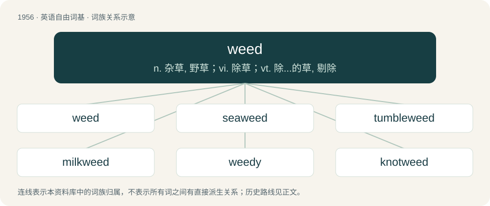

# 2071 · weed — n. 杂草, 野草；vi. 除草；vt. 除...的草, 剔除

[总目录](../00_总目录_按常用程度.md)

**类型**：英语自由词基　｜　**来源语言**：见词源记录

## 核心含义与来源

- 核心含义：n. 杂草, 野草；vi. 除草；vt. 除...的草, 剔除
- 英文含义：Any plant unwanted at the place where and at the time when it is growing.
- 词形：weed

**多个词源／构词路径**：同一拼写可能有不同来源；以下按词性和含义分别列出。

**来源记录 1**（名词；Any plant unwanted at the place where and at the time when it is growing.）

From Middle English weed, weod, from Old English wēod (“weed”), from Proto-West Germanic \*weud (“weed”). Cognate with Saterland Frisian Jood (“weed”), West Frisian wjûd (“weed”), Dutch wied (“unwanted plant, weed”), German Low German Weed (“weed”), Old High German wiota (“fern”). See also woad.

**来源记录 2**（动词；To remove unwanted vegetation from a cultivated area (especially grass).）

From Middle English weeden, weden, from Old English wēodian (“to weed”), from Proto-Germanic \*weudōną (“to uproot, weed”). Cognate with West Frisian wjûde, wjudde (“to weed”), Dutch wieden (“to weed”), German Low German weden (“to weed”).

**来源记录 3**（名词；A sudden illness or relapse, often attended with fever, which befalls those who are about to give birth, are giving birth, or have recently given birth or miscarried or aborted.）

From Scots weid, weed. The longer form weidinonfa, wytenonfa (Old Scots wedonynpha) is attested since the 1500s. Jamieson's Etymological Dictionary of the Scottish Language analyses the longer form as a compound meaning "onfa(ll) of a weed", whereas the Scottish National Dictionary/DSL considers the short form a derivative of the longer form, and derives its first element from Old English wēdan (“to be mad or delirious”), from wōd (“mad, enraged”).

## 词族图

## 单词速览（常用到不常用）

| 单词 | 音标 | 释义 |
|---|---|---|
| [weed](#w-1) | /wiːd/ | n. 杂草, 野草；vi. 除草；vt. 除...的草, 剔除 |
| [seaweed](#w-2) | 英 /ˈsiːwiːd/；美 /ˈsiwid/ | n. 海草, 海藻；\[医\] 海藻 |
| [tumbleweed](#w-3) | 英 /ˈtʌmbəlwiːd/；美 /ˈtʌmbəlˌwid/ | n. 风滚草 |
| [milkweed](#w-4) | /ˈmilkwiːd/ | n. 马利筋；\[医\] 马利筋属植物 |
| [weedy](#w-5) | /ˈwiːdi/ | a. 尽是杂草的, 似杂草的, 瘦弱的, 蔓生的 |
| [knotweed](#w-6) | /ˈnɔtwiːd/ | n. \[植\] 紫菀科植物, 蓼科杂草 |

## 逐词详解

### 1. weed

**词性**：名词　｜　**音标**：/wiːd/

**中文释义**：n. 杂草, 野草；vi. 除草；vt. 除...的草, 剔除

**英文义项**：Any plant unwanted at the place where and at the time when it is growing. / Cannabis.

**词源与演化**：

From Middle English weed, weod, from Old English wēod (“weed”), from Proto-West Germanic \*weud (“weed”). Cognate with Saterland Frisian Jood (“weed”), West Frisian wjûd (“weed”), Dutch wied (“unwanted plant, weed”), German Low German Weed (“weed”), Old High German wiota (“fern”). See also woad.

**例句**：

> If it isn't in a straight line or marked with a label, it's a weed.

该用例对应义项：Any plant unwanted at the place where and at the time when it is growing.

### 2. seaweed

**词性**：名词　｜　**音标**：英 /ˈsiːwiːd/；美 /ˈsiwid/

**中文释义**：n. 海草, 海藻；\[医\] 海藻

**英文义项**：Any of numerous marine algae, such as a kelp. / Any of various fresh water plants and algae.

**构词拆分**：sea + weed

**词源与演化**：

From sea + weed.

**例句**：

> Mary tasted seaweed for the first time and liked it.

### 3. tumbleweed

**词性**：名词　｜　**音标**：英 /ˈtʌmbəlwiːd/；美 /ˈtʌmbəlˌwid/

**中文释义**：n. 风滚草

**英文义项**：Any plant which habitually breaks away from its roots once dry, forming a light, rolling mass which is driven by the wind from place to place; as Russian thistle, wild indigo, witch grass, Amaranthus albus, etc. / Describing unwanted silence and inactivity. Often used of a situation when one makes a statement that is ignored or ill-received by one's audience, as the resultant silence is likened to that of a desolate desert with rolling tumbleweeds.

**构词拆分**：tumble + weed

**词源与演化**：

From tumble + weed.

**例句**：

> A tumbleweed rolled across the deserted road.

### 4. milkweed

**词性**：名词　｜　**音标**：/ˈmilkwiːd/

**中文释义**：n. 马利筋；\[医\] 马利筋属植物

**英文义项**：Principally of the genus Asclepias in order Gentianales, family Apocynaceae / Also of the genus Calotropis in order Gentianales, family Apocynaceae

**构词拆分**：milk + weed

**词源与演化**：

From milk + weed.

**例句**：

> We have milkweed growing in our backyard.

### 5. weedy

**词性**：形容词　｜　**音标**：/ˈwiːdi/

**中文释义**：a. 尽是杂草的, 似杂草的, 瘦弱的, 蔓生的

**英文义项**：Abounding with weeds. / Of, relating to or resembling weeds.

**构词拆分**：weed + -y

**词源与演化**：

From weed + -y.

**用法示例／搭配（非完整句）**：

> a weedy species

该用例对应义项：Characteristic of a plant that grows rapidly and spreads invasively, and which grows opportunistically in cracks of sidewalks and disturbed areas.

### 6. knotweed

**词性**：名词　｜　**音标**：/ˈnɔtwiːd/

**中文释义**：n. \[植\] 紫菀科植物, 蓼科杂草

**英文义项**：Any of several plants of the genus Polygonum, with jointed stems and inconspicuous flowers

**构词拆分**：knot + weed

**词源与演化**：

From knot + weed.
