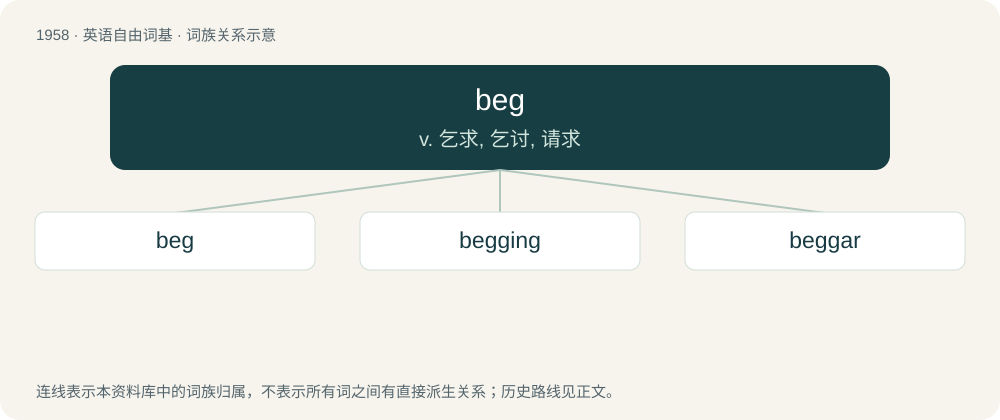

# 2073 · beg — v. 乞求, 乞讨, 请求

[总目录](../00_总目录_按常用程度.md)

**类型**：英语自由词基　｜　**来源语言**：见词源记录

## 核心含义与来源

- 核心含义：v. 乞求, 乞讨, 请求
- 英文含义：To request the help of someone, often in the form of money.
- 词形：beg

**来源记录 1**（动词；To request the help of someone, often in the form of money.）

Inherited from Middle English beggen, of uncertain origin. Possibly from Old English \*becgian, \*bedcian, syncopated forms of bedecian (“to beg”), itself of obscure origin. Possibly from Proto-West Germanic \*bedukōn, a frequentative verb derived from Proto-West Germanic \*bedu (“plea, petition, prayer”, whence English bead). Alternatively from Proto-West Germanic \*bedagō (“petitioner, requester, beggar”), an agent noun from the same source. Compare North Frisian bēdagi (“to pray”), Gothic 𐌱𐌹𐌳𐌰𐌲𐍅𐌰 (bidagwa, “beggar”). All ultimately from the root of English bid, which see for more. An alternative theory considers the verb a backformation from beggar and derives the latter from Old French begart (“kind of lay brother”).

## 词族图

## 单词速览（常用到不常用）

| 单词 | 音标 | 释义 |
|---|---|---|
| [beg](#w-1) | /ˈbɛɡ/ | v. 乞求, 乞讨, 请求 |
| [begging](#w-2) | /ˈbɛɡɪŋ/ | v. 乞讨, 乞求；行乞（beg的现在分词形式） |
| [beggar](#w-3) | 英 /ˈbɛɡə/；美 /ˈbɛɡɚ/ | n. 乞丐；vt. 使贫穷, 使成乞丐 |

## 逐词详解

### 1. beg

**词性**：动词　｜　**音标**：/ˈbɛɡ/

**中文释义**：v. 乞求, 乞讨, 请求

**英文义项**：To request the help of someone, often in the form of money. / To plead with someone for help, a favor, etc.; to entreat.

**词源与演化**：

Inherited from Middle English beggen, of uncertain origin. Possibly from Old English \*becgian, \*bedcian, syncopated forms of bedecian (“to beg”), itself of obscure origin. Possibly from Proto-West Germanic \*bedukōn, a frequentative verb derived from Proto-West Germanic \*bedu (“plea, petition, prayer”, whence English bead). Alternatively from Proto-West Germanic \*bedagō (“petitioner, requester, beggar”), an agent noun from the same source. Compare North Frisian bēdagi (“to pray”), Gothic 𐌱𐌹𐌳𐌰𐌲𐍅𐌰 (bidagwa, “beggar”). All ultimately from the root of English bid, which see for more. An alternative theory considers the verb a backformation from beggar and derives the latter from Old French begart (“kind of lay brother”).

**例句**：

> I beg your pardon. I didn’t mean to cause offence.

该用例对应义项：To plead with someone for help, a favor, etc.; to entreat.

### 2. begging

**词性**：名词　｜　**音标**：/ˈbɛɡɪŋ/

**中文释义**：v. 乞讨, 乞求；行乞（beg的现在分词形式）

**英文义项**：The act of one who begs. / Money or goods acquired by begging.

**构词拆分**：beg + -ing (gerund ending)

**词源与演化**：

From Middle English begging, beggyng, beggynge, equivalent to beg + -ing (gerund ending).

**例句**：

> A female beggar was begging with five or six children following along.

### 3. beggar

**词性**：名词　｜　**音标**：英 /ˈbɛɡə/；美 /ˈbɛɡɚ/

**中文释义**：n. 乞丐；vt. 使贫穷, 使成乞丐

**英文义项**：A person who begs. / A person suffering from extreme poverty.

**构词拆分**：beg + -ar

**词源与演化**：

From Middle English beggere, beggare, beggar (“beggar”), from Middle English beggen (“to beg”), equivalent to beg + -ar. Alternative etymology derives Middle English beggere, beggare, beggar from Old French begart, originally a member of the Beghards, a lay brotherhood of mendicants in the Low Countries, from Middle Dutch beggaert (“mendicant”), with pejorative suffix (see -ard); the order is said to be named after the priest Lambert le Bègue of Liège (French for “Lambert the Stammerer”).

**例句**：

> What does that silly beggar think he's doing?

该用例对应义项：A mean or wretched person; a scoundrel.
