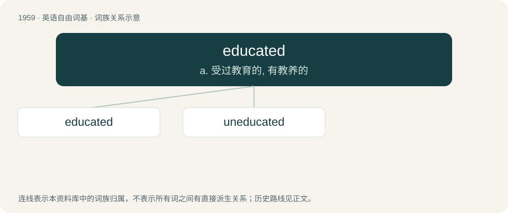

# 2074 · educated — a. 受过教育的, 有教养的

[总目录](../00_总目录_按常用程度.md)

**类型**：英语自由词基　｜　**来源语言**：见词源记录

## 核心含义与来源

- 核心含义：a. 受过教育的, 有教养的
- 英文含义：Having attained a level of higher education, such as a college degree.
- 词形：educated

**来源记录 1**（形容词；Having attained a level of higher education, such as a college degree.）

From educate + -ed.

## 词族图

## 单词速览（常用到不常用）

| 单词 | 音标 | 释义 |
|---|---|---|
| [educated](#w-1) | 英 /ˈɛd͡ʒəkeɪtɪd/；美 /ˈɛd͡ʒəkeɪtɪd/ | a. 受过教育的, 有教养的 |
| [uneducated](#w-2) | 英 /ʌnˈɛdjʊkeɪtɪd/；美 /ʌnˈɛd͡ʒəkeɪtɪd/ | a. 未受教育的, 无知的 |

## 逐词详解

### 1. educated

**词性**：形容词　｜　**音标**：英 /ˈɛd͡ʒəkeɪtɪd/；美 /ˈɛd͡ʒəkeɪtɪd/

**中文释义**：a. 受过教育的, 有教养的

**英文义项**：Having attained a level of higher education, such as a college degree. / Based on relevant information.

**构词拆分**：From educate + -ed.

**词源与演化**：

From educate + -ed.

**例句**：

> She cast an educated eye over the antiques.

该用例对应义项：Knowledgeable.

### 2. uneducated

**词性**：形容词　｜　**音标**：英 /ʌnˈɛdjʊkeɪtɪd/；美 /ʌnˈɛd͡ʒəkeɪtɪd/

**中文释义**：a. 未受教育的, 无知的

**英文义项**：Not educated.

**构词拆分**：un- + educated

**词源与演化**：

From un- + educated.

**例句**：

> An uneducated king ruins his people; prudent rulers make the city prosper.
