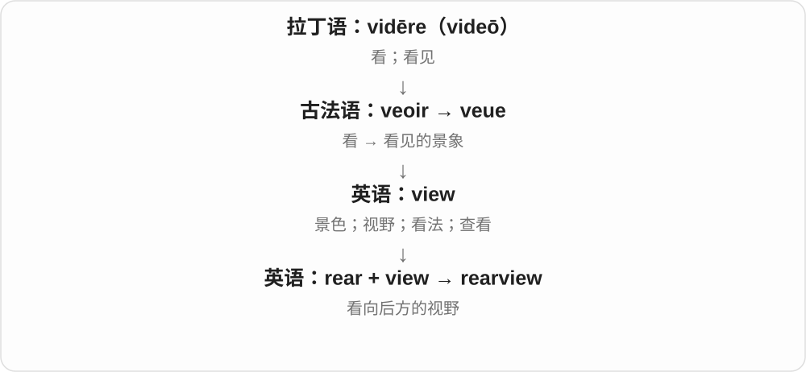

# 2075 · rear — 后部、向后，与养育、立起分源

[逐词精讲目录](../00_逐词精讲目录.md) · [总目录](../00_总目录_按常用程度.md)

## 核心词根与来源

同形词不能靠同一个方向硬串起来。位置、视线和饲养动作先分支，再接具体搭配。

**REAR：在后面，和养大、抬起来分开**

rear 后部 → rearward/rearview；rear 抚养、马立起则接古英语抬高词族。

- **后部、方向与视野**：rear · rearward · rearview

## 词形与演化规律

retrō → rere → 后部 rear；rear + -ward/view。另线 rǣran → rear 抚养、立起。

## 单词速览（按词族由简到繁）

同一基础词的相关扩展放在一起，先读基础形式，再读扩展；各组之间优先读常用的。具体词源关系见各词讲解。

| 单词 | 音标 | 核心意思 |
|---|---|---|
| [rear](#w-1) | 英 /rɪə/；美 /rɪr/ | 后部、后面的；养育、饲养；后腿直立〔后两义另一路〕 |
| [rearview](#w-2) | 英 /ˈrɪəvjuː/；美 /ˈrɪrvjuː/ | 后视的；向后看的视野 |
| [rearward](#w-3) | 英 /ˈrɪəwəd/；美 /ˈrɪrwərd/ | 向后的、朝后方；后部、后卫〔名词义〕 |

## 逐词讲解

### 1. rear — 后部、后面的；养育、饲养；后腿直立〔后两义另一路〕

**音标**：英 /rɪə/；美 /rɪr/

**先抓住这个画面**

the rear of a car 是车后部；rear children 是把孩子养大；a horse rears 是马前腿抬起、后腿站立。拼写一样，来源分两条。

**怎么拆**

后部义经法语 rere 远接拉丁 retrō；养育、抬起义继承古英语 rǣran，与 rise、raise 相关。不能解释成所有抚养都发生在身后。

**怎么变成今天的意思**

**拉丁 retrō → 法语 rere → 英语 rear**  
后面、向后 → 后部、后面的

↓

**另线古英语 rǣran → rear**  
使升起 → 抚养、养育；马等用后腿立起

at the rear 在后部，a rear window 后窗，rear cattle 养牛，rear children 抚养孩子，rear up 马等立起前身。

**常见搭配与例句**

at the rear；a rear window；rear cattle；rear up。

> The luggage was stored at the rear of the bus.

行李放在公交车后部。

> The family rears sheep on the hillside.

这家人在山坡上养羊。

> The horse reared when the gate slammed.

大门砰地关上时，马立起了前身。

**别混淆**

rear 抚养与 raise 在一些用法上接近，但 rear 后部是另一词源。horse reared 不能译马倒退了，它说前身立起。

### 2. rearview — 后视的；向后看的视野

**音标**：英 /ˈrɪəvjuː/；美 /ˈrɪrvjuː/

**先抓住这个画面**

rearview 让你看见身后，最熟悉的搭配是汽车里那块向后照的镜子。

**怎么拆**

rear（后方）+ view（视野）。

**怎么变成今天的意思**

常作定语修饰 mirror 或 camera。它只说明方向，不表示重新检查以前的决定。

**常见搭配与例句**

a rearview mirror；a rearview camera；rearview visibility。

> She checked the rearview mirror before slowing down.

减速前，她看了看后视镜。

> The rearview camera showed a bicycle behind the car.

后视摄像头显示车后有一辆自行车。

**别混淆**

rearview 向后看位置；review 是再看、审查，不是 rearview 的缩写。

### 3. rearward — 向后的、朝后方；后部、后卫〔名词义〕

**音标**：英 /ˈrɪəwəd/；美 /ˈrɪrwərd/

**先抓住这个画面**

rear 给位置，-ward 给方向；把视线或移动指向后面，就是 rearward。

**怎么拆**

rear 后部 + -ward 朝……方向。接后部那条法语、拉丁路线，不接养育动词；形容词、副词常见，名词后部等较书面。

**怎么变成今天的意思**

**拉丁 retrō → 法语 rere → 英语 rear**  
后面、向后 → 后部、后面的

↓

**rear + -ward → rearward**  
朝后方、后向的

rearward visibility 后方视野，a rearward movement 向后移动，move rearward 向后移动。rearward、rearwards 作方向副词有变体用法。

**常见搭配与例句**

rearward visibility；a rearward movement；move rearward。

> The mirror improves rearward visibility.

镜子改善了后方视野。

> The seat can slide rearward to give more legroom.

座椅可以往后滑，增加腿部空间。

**别混淆**

rearward 不等于 backward 在所有抽象义都互换；backward 还可能评价落后、发展迟缓，rearward 更常具体说后向。

## 这一组要分清什么

rear a child 是抚养；rear up 是马等立起前身；rearward 抽象义不完全等于 backward。

## 串起来练习

The rearview mirror gives the driver a rearward view.

后视镜让驾驶员能看到后方。
