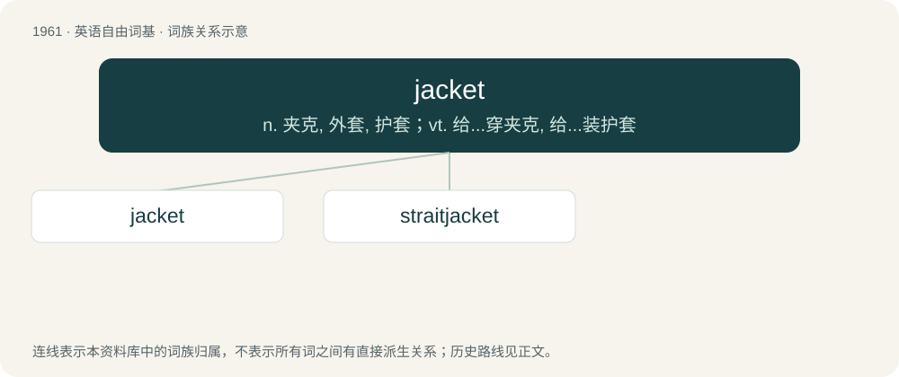

# 2077 · jacket — n. 夹克, 外套, 护套；vt. 给...穿夹克, 给...装护套

[总目录](../00_总目录_按常用程度.md)

**类型**：英语自由词基　｜　**来源语言**：见词源记录

## 核心含义与来源

- 核心含义：n. 夹克, 外套, 护套；vt. 给...穿夹克, 给...装护套
- 英文含义：A piece of clothing worn on the upper body outside a shirt or blouse, often waist length to thigh length.
- 词形：jacket

**来源记录 1**（名词；A piece of clothing worn on the upper body outside a shirt or blouse, often waist length to thigh length.）

From Middle French jacquet, diminutive of Old French jaque.

## 词族图

## 单词速览（常用到不常用）

| 单词 | 音标 | 释义 |
|---|---|---|
| [jacket](#w-1) | 英 /ˈd͡ʒæk.ɪt/；美 /ˈd͡ʒæk.ɪt/ | n. 夹克, 外套, 护套；vt. 给...穿夹克, 给...装护套 |
| [straitjacket](#w-2) | /ˈstɹeɪtˌd͡ʒækɪt/ | n. 紧身衣 |

## 逐词详解

### 1. jacket

**词性**：名词　｜　**音标**：英 /ˈd͡ʒæk.ɪt/；美 /ˈd͡ʒæk.ɪt/

**中文释义**：n. 夹克, 外套, 护套；vt. 给...穿夹克, 给...装护套

**英文义项**：A piece of clothing worn on the upper body outside a shirt or blouse, often waist length to thigh length. / A piece of a person's suit, beside trousers and, sometimes, waistcoat; coat (US).

**词源与演化**：

From Middle French jacquet, diminutive of Old French jaque.

**例句**：

> He's hoping to earn his jacket this year.

该用例对应义项：A letter jacket.

### 2. straitjacket

**词性**：名词　｜　**音标**：/ˈstɹeɪtˌd͡ʒækɪt/

**中文释义**：n. 紧身衣

**英文义项**：A jacketlike garment with very long sleeves which can be secured in place, thus preventing the wearer from moving their arms; often used in psychiatric hospitals to prevent patients from injuring themselves or others. / Any situation seen as confining or restricting.

**构词拆分**：strait + jacket

**词源与演化**：

From strait (“restrictive”) + jacket.

**用法示例／搭配（非完整句）**：

> our ever-increasing bureaucratic straitjacket of regulations

该用例对应义项：Any situation seen as confining or restricting.
