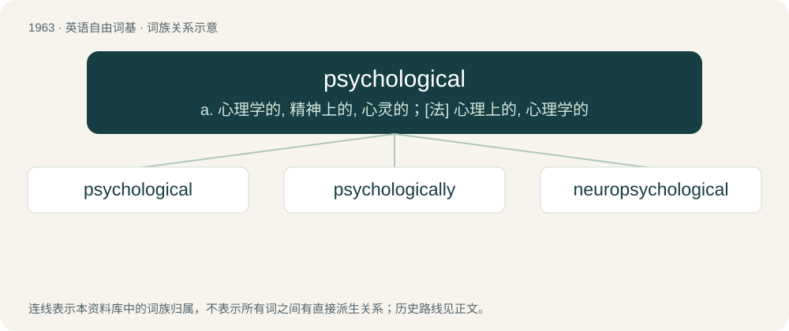

# 2078 · psychological — a. 心理学的, 精神上的, 心灵的；\[法\] 心理上的, 心理学的

[总目录](../00_总目录_按常用程度.md)

**类型**：英语自由词基　｜　**来源语言**：见词源记录

## 核心含义与来源

- 核心含义：a. 心理学的, 精神上的, 心灵的；\[法\] 心理上的, 心理学的
- 英文含义：Of or pertaining to psychology.
- 词形：psychological

**来源记录 1**（形容词；Of or pertaining to psychology.）

From psychology + -ical.

## 词族图

## 单词速览（常用到不常用）

| 单词 | 音标 | 释义 |
|---|---|---|
| [psychological](#w-1) | 英 /ˌsaɪ.kəˈlɒd͡ʒ.ɪ.kl̩/；美 /ˌsaɪ.kəˈlɑː.d͡ʒɪ.kl̩/ | a. 心理学的, 精神上的, 心灵的；\[法\] 心理上的, 心理学的 |
| [psychologically](#w-2) | /,psaikəˈlɔdʒikəli/ | adv. 心理上, 从心理学角度 |
| [neuropsychological](#w-3) |  | 神经心理学 |

## 逐词详解

### 1. psychological

**词性**：形容词　｜　**音标**：英 /ˌsaɪ.kəˈlɒd͡ʒ.ɪ.kl̩/；美 /ˌsaɪ.kəˈlɑː.d͡ʒɪ.kl̩/

**中文释义**：a. 心理学的, 精神上的, 心灵的；\[法\] 心理上的, 心理学的

**英文义项**：Of or pertaining to psychology. / Relating to the mind and behavior or to the mental, emotional, and behavioral characteristics pertaining to a specified person, group, or activity.

**构词拆分**：psychology + -ical

**词源与演化**：

From psychology + -ical.

**例句**：

> Prices seem to have stopped rising, having hit the psychological ceiling of just under 100 dollars.

该用例对应义项：Without an objective, or reasonably logical foundation.

### 2. psychologically

**词性**：副词　｜　**音标**：/,psaikəˈlɔdʒikəli/

**中文释义**：adv. 心理上, 从心理学角度

**英文义项**：In a psychological sense. / Employing psychology.

**构词拆分**：psychological + -ly

**词源与演化**：

From psychological + -ly.

**例句**：

> The patient's behaviour was interpreted psychologically.

该用例对应义项：Employing psychology.

### 3. neuropsychological

**词性**：形容词

**中文释义**：神经心理学

**英文义项**：Of or pertaining to neuropsychology, the relation or combination of brain and mind.

**构词拆分**：neuro- + psychological；neuropsychology + -ical

**词源与演化**：

From neuro- + psychological or neuropsychology + -ical.
