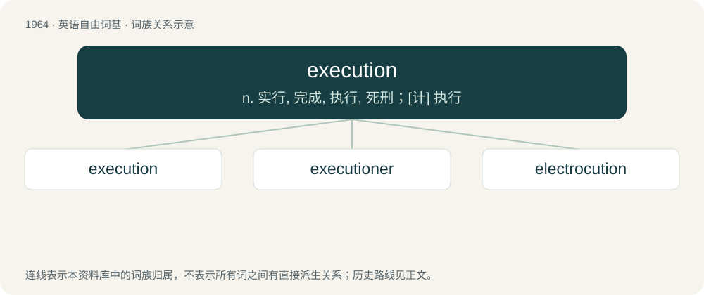

# 2079 · execution — n. 实行, 完成, 执行, 死刑；\[计\] 执行

[总目录](../00_总目录_按常用程度.md)

**类型**：英语自由词基　｜　**来源语言**：见词源记录

## 核心含义与来源

- 核心含义：n. 实行, 完成, 执行, 死刑；\[计\] 执行
- 英文含义：The act, manner or style of executing (actions, maneuvers, performances).
- 词形：execution

**来源记录 1**（名词；The act, manner or style of executing (actions, maneuvers, performances).）

From Old French execution (c.1360), from Latin exsecutiō, an agent noun from exsequor (“to follow out”), from ex (“out”) + sequor (“follow”). Equivalent to execute + -ion.

## 词族图

## 单词速览（常用到不常用）

| 单词 | 音标 | 释义 |
|---|---|---|
| [execution](#w-1) | /ˌɛk.sɪˈkjuː.ʃən/ | n. 实行, 完成, 执行, 死刑；\[计\] 执行 |
| [executioner](#w-2) | 英 /ˌɛksəˈkjuːʃənə/；美 /ˌɛksəˈkjuʃənɚ/ | n. 刽子手；\[法\] 死刑执行人, 刽子手, 行刑者 |
| [electrocution](#w-3) | /ɪˌlɛktɹəˈkjuːʃən/ | n. 电刑, 电死；\[医\] 触电死 |

## 逐词详解

### 1. execution

**词性**：名词　｜　**音标**：/ˌɛk.sɪˈkjuː.ʃən/

**中文释义**：n. 实行, 完成, 执行, 死刑；\[计\] 执行

**英文义项**：The act, manner or style of executing (actions, maneuvers, performances). / The state of being accomplished.

**构词拆分**：execute + -ion

**词源与演化**：

From Old French execution (c.1360), from Latin exsecutiō, an agent noun from exsequor (“to follow out”), from ex (“out”) + sequor (“follow”). Equivalent to execute + -ion.

**例句**：

> The entire machine slowed down during the execution of the virus checker.

该用例对应义项：The carrying out of an instruction, program or program segment by a computer.

### 2. executioner

**词性**：名词　｜　**音标**：英 /ˌɛksəˈkjuːʃənə/；美 /ˌɛksəˈkjuʃənɚ/

**中文释义**：n. 刽子手；\[法\] 死刑执行人, 刽子手, 行刑者

**英文义项**：An official person who carries out the capital punishment of a criminal. / A hit man, especially being in some organization.

**构词拆分**：execution + -er

**词源与演化**：

From execution + -er.

**例句**：

> Moved, he sees Priam extending his helpless hands to his son's executioner.

### 3. electrocution

**词性**：名词　｜　**音标**：/ɪˌlɛktɹəˈkjuːʃən/

**中文释义**：n. 电刑, 电死；\[医\] 触电死

**英文义项**：Deliberate execution by electric shock, usually involving an electric chair. / The accidental death or suicide by electric shock.

**构词拆分**：electro- + execution

**词源与演化**：

Blend of electro- + execution. By surface analysis, electrocute + -ion. Coined in the US around 1888, in relation to the introduction of the electric chair (see quotes).

**例句**：

> The faulty wiring caused the unfortunate worker’s accidental electrocution.

该用例对应义项：The accidental death or suicide by electric shock.
