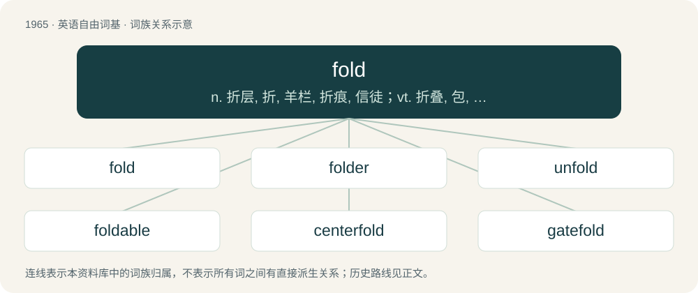

# 2080 · fold — n. 折层, 折, 羊栏, 折痕, 信徒；vt. 折叠, 包, 合拢, 交迭；vi. 折叠起来, 彻底失败

[总目录](../00_总目录_按常用程度.md)

**类型**：英语自由词基　｜　**来源语言**：见词源记录

## 核心含义与来源

- 核心含义：n. 折层, 折, 羊栏, 折痕, 信徒；vt. 折叠, 包, 合拢, 交迭；vi. 折叠起来, 彻底失败
- 英文含义：To bend (any thin material, such as paper) over so that it comes in contact with itself.
- 词形：fold

**多个词源／构词路径**：同一拼写可能有不同来源；以下按词性和含义分别列出。

**来源记录 1**（动词；To bend (any thin material, such as paper) over so that it comes in contact with itself.）

The verb is from Middle English folden, from Old English fealdan, from Proto-West Germanic \*falþan, from Proto-Germanic \*falþaną (“to fold”), from Proto-Indo-European \*pel- (“to fold”). Cognate with Dutch vouwen, German falten. The noun is from Middle English folde, falde, itself derived from the verb.

**来源记录 2**（名词；A pen or enclosure for sheep or other domestic animals.）

The noun is from Middle English fold, fald, from Old English fald, falæd, falod (“fold, stall, stable, cattle-pen”), from Proto-West Germanic \*falud, from Proto-Germanic \*faludaz (“enclosure”). Akin to Scots fald, fauld (“an enclosure for livestock”), Dutch vaalt (“dung heap”), Middle Low German valt, vālt (“an inclosed space, a yard”), Danish fold (“pen for herbivorous livestock”), Swedish fålla (“corral, pen, pound”). The verb is from Late Middle English fooldyn, itself derived from the noun.

**来源记录 3**（名词；The Earth; earth; land; country.）

From Middle English folde, from Old English folde (“earth, land, country, district, region, territory, ground, soil, clay”), from Proto-Germanic \*fuldǭ, \*fuldō (“earth, ground; field; the world”). Cognate with Old Norse fold (“earth, land, field”), Norwegian and Icelandic fold (“land, earth, meadow”).

## 词族图

## 单词速览（常用到不常用）

| 单词 | 音标 | 释义 |
|---|---|---|
| [fold](#w-1) | 英 /ˈfəʊld/；美 /foʊld/ | n. 折层, 折, 羊栏, 折痕, 信徒；vt. 折叠, 包, 合拢, 交迭；vi. 折叠起来, 彻底失败 |
| [folder](#w-2) | 英 /ˈfəʊldə/；美 /ˈfoʊldɚ/ | n. 文件夹, 折纸机, 折叠式书本, 卷宗；\[计\] 文件夹 |
| [unfold](#w-3) | 英 /ʌnˈfəʊld/；美 /ʌnˈfoʊld/ | vt. 展开, 打开, 披露, 开展, 挑明；vi. 伸展, 开花, 呈现 |
| [foldable](#w-4) |  | \[计\] 可全并的 |
| [centerfold](#w-5) | 英 /ˈsɛntəfəʊld/；美 /ˈsɛntɚfoʊld/ | n. （杂志的）中间插页, 裸体照片插页 |
| [gatefold](#w-6) | /ˈgeitfəuld/ | n. 大张折叠插页 |

## 逐词详解

### 1. fold

**词性**：动词　｜　**音标**：英 /ˈfəʊld/；美 /foʊld/

**中文释义**：n. 折层, 折, 羊栏, 折痕, 信徒；vt. 折叠, 包, 合拢, 交迭；vi. 折叠起来, 彻底失败

**英文义项**：To bend (any thin material, such as paper) over so that it comes in contact with itself. / To make the proper arrangement (in a thin material) by bending.

**词源与演化**：

The verb is from Middle English folden, from Old English fealdan, from Proto-West Germanic \*falþan, from Proto-Germanic \*falþaną (“to fold”), from Proto-Indo-European \*pel- (“to fold”). Cognate with Dutch vouwen, German falten. The noun is from Middle English folde, falde, itself derived from the verb.

**例句**：

> He kept saying it was my fault, but when I brought up Sausalito, he folded.

该用例对应义项：To give way on a point or in an argument.

### 2. folder

**词性**：名词　｜　**音标**：英 /ˈfəʊldə/；美 /ˈfoʊldɚ/

**中文释义**：n. 文件夹, 折纸机, 折叠式书本, 卷宗；\[计\] 文件夹

**英文义项**：An organizer that papers are kept in, usually with an index tab, to be stored as a single unit in a filing cabinet. / A virtual container in a computer's file system, in which files and other folders may be stored. The files and subfolders in a folder are usually related.

**构词拆分**：fold + -er

**词源与演化**：

From fold + -er.

**例句**：

> My essays are in the folder named "Schoolwork".

该用例对应义项：A virtual container in a computer's file system, in which files and other folders may be stored. The files and subfolders in a folder are usually related.

### 3. unfold

**词性**：动词　｜　**音标**：英 /ʌnˈfəʊld/；美 /ʌnˈfoʊld/

**中文释义**：vt. 展开, 打开, 披露, 开展, 挑明；vi. 伸展, 开花, 呈现

**英文义项**：To undo a folding. / To become unfolded.

**构词拆分**：un- + fold

**词源与演化**：

From Middle English unfolden, from Old English unfealdan (“to unfold”), equivalent to un- + fold.

**例句**：

> to unfold a map; to unfold a tablecloth; She unpacks the new dress and unfolds it carefully.

该用例对应义项：To undo a folding.

### 4. foldable

**词性**：形容词

**中文释义**：\[计\] 可全并的

**英文义项**：That can be folded.

**构词拆分**：fold + -able

**词源与演化**：

From fold + -able.

**例句**：

> Have you ever seen a foldable bike?

### 5. centerfold

**词性**：名词　｜　**音标**：英 /ˈsɛntəfəʊld/；美 /ˈsɛntɚfoʊld/

**中文释义**：n. （杂志的）中间插页, 裸体照片插页

**英文义项**：The single larger sheet of paper that forms the middle two pages of a magazine or other publication, folded so as to open wider than a standard page spread. / A large photograph printed on this sheet, typically in the form of a nude, or provocatively dressed, sexually attractive woman or man.

**构词拆分**：center + fold

**词源与演化**：

From center + fold.

### 6. gatefold

**词性**：名词　｜　**音标**：/ˈgeitfəuld/

**中文释义**：n. 大张折叠插页

**英文义项**：A document folding method that uses two parallel folds to create six panels; the left and right panels are half the width of the center panels and fold inward to meet in the middle without overlapping.

**构词拆分**：gate + fold

**词源与演化**：

From gate + fold.
