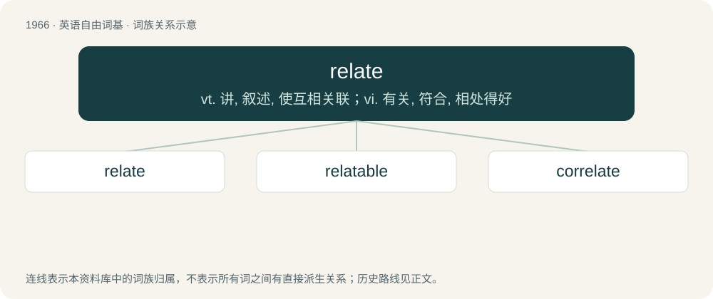

# 2081 · relate — vt. 讲, 叙述, 使互相关联；vi. 有关, 符合, 相处得好

[总目录](../00_总目录_按常用程度.md)

**类型**：英语自由词基　｜　**来源语言**：见词源记录

## 核心含义与来源

- 核心含义：vt. 讲, 叙述, 使互相关联；vi. 有关, 符合, 相处得好
- 英文含义：To tell in a descriptive way.
- 词形：relate

**来源记录 1**（动词；To tell in a descriptive way.）

From Latin relātus, perfect passive participle of referō (“carry back; report”), see -ate (verb-forming suffix). Doublet of refer. See also infer, collate and confer, delate and defer, as well as prefer and prelate among others.

## 词族图

## 单词速览（常用到不常用）

| 单词 | 音标 | 释义 |
|---|---|---|
| [relate](#w-1) | 英 /ɹɪˈleɪt/ | vt. 讲, 叙述, 使互相关联；vi. 有关, 符合, 相处得好 |
| [relatable](#w-2) |  | 有关系的(relate的形容词形式) |
| [correlate](#w-3) | 英 /ˈkɒɹəleɪt/；美 /ˈkɔɹəleɪt/ | n. 有相互关系的东西, 相关物；vt. 使有相互关系；vi. 相关 |

## 逐词详解

### 1. relate

**词性**：动词　｜　**音标**：英 /ɹɪˈleɪt/

**中文释义**：vt. 讲, 叙述, 使互相关联；vi. 有关, 符合, 相处得好

**英文义项**：To tell in a descriptive way. / To be relevant specifically to.

**词源与演化**：

From Latin relātus, perfect passive participle of referō (“carry back; report”), see -ate (verb-forming suffix). Doublet of refer. See also infer, collate and confer, delate and defer, as well as prefer and prelate among others.

**例句**：

> The patterns on the screen relate to the pitch and volume of the music being played.

该用例对应义项：To have a connection.

### 2. relatable

**词性**：形容词

**中文释义**：有关系的(relate的形容词形式)

**英文义项**：Able to be related to something else; connected with. / Able to be related to on a personal level.

**构词拆分**：relate + -able

**词源与演化**：

From relate + -able.

**例句**：

> The characters in the play are very warm and relatable.

该用例对应义项：Able to be related to on a personal level.

### 3. correlate

**词性**：动词　｜　**音标**：英 /ˈkɒɹəleɪt/；美 /ˈkɔɹəleɪt/

**中文释义**：n. 有相互关系的东西, 相关物；vt. 使有相互关系；vi. 相关

**英文义项**：To compare things and bring them into a relation having corresponding characteristics. / To be related by a correlation; to be correlated.

**构词拆分**：From cor- + relate.

**词源与演化**：

From cor- + relate.

**例句**：

> I cannot correlate these two pieces of information.

该用例对应义项：bring into a mutual, complementary, or reciprocal relation
