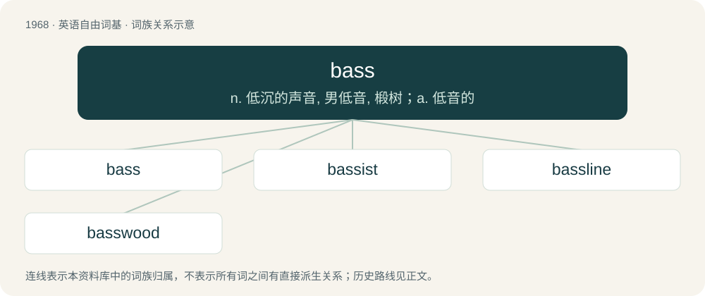

# 2083 · bass — n. 低沉的声音, 男低音, 椴树；a. 低音的

[总目录](../00_总目录_按常用程度.md)

**类型**：英语自由词基　｜　**来源语言**：见词源记录

## 核心含义与来源

- 核心含义：n. 低沉的声音, 男低音, 椴树；a. 低音的
- 英文含义：Of sound, a voice or an instrument, low in pitch or frequency.
- 词形：bass

**多个词源／构词路径**：同一拼写可能有不同来源；以下按词性和含义分别列出。

**来源记录 1**（形容词；Of sound, a voice or an instrument, low in pitch or frequency.）

A respelling of base under the influence of Italian basso (“low”).

**来源记录 2**（名词；The perch; any of various marine and freshwater fish resembling the perch, all within the order of Perciformes.）

From Middle English bace, bas, alteration of bars, from Old English bærs (“a fish, perch”), from Proto-West Germanic \*bars, from Proto-Germanic \*barsaz (“perch”, literally “prickly”), from Proto-Indo-European \*bʰórsos (“prickle, thorn, scale”). Cognate with Dutch baars (“perch, bass”), German Barsch (“perch”). More at barse.

**来源记录 3**（名词；The fibrous inner bark of the linden or lime tree, used for making mats.）

A corruption of bast.

## 词族图

## 单词速览（常用到不常用）

| 单词 | 音标 | 释义 |
|---|---|---|
| [bass](#w-1) | /beɪs/ | n. 低沉的声音, 男低音, 椴树；a. 低音的 |
| [bassist](#w-2) | 英 /ˈbeɪs.ɪst/ | n. 低音提琴手 |
| [bassline](#w-3) | /ˈbeɪsˌlaɪn/ | 【英文】The relatively low-pitched instrumental part of a piece of popular music. |
| [basswood](#w-4) | /ˈbæswʊd/ | n. 椴木；\[化\] 椴树 |

## 逐词详解

### 1. bass

**词性**：形容词　｜　**音标**：/beɪs/

**中文释义**：n. 低沉的声音, 男低音, 椴树；a. 低音的

**英文义项**：Of sound, a voice or an instrument, low in pitch or frequency.

**词源与演化**：

A respelling of base under the influence of Italian basso (“low”).

**例句**：

> The giant spoke in a deep, bass, rumbling voice that shook me to my boots.

该用例对应义项：Of sound, a voice or an instrument, low in pitch or frequency.

### 2. bassist

**词性**：名词　｜　**音标**：英 /ˈbeɪs.ɪst/

**中文释义**：n. 低音提琴手

**英文义项**：A musician who plays a bass instrument, especially the bass guitar.

**构词拆分**：bass + -ist

**词源与演化**：

From bass + -ist.

**例句**：

> The drummer and bassist are often called the rhythm section, sometimes joined by a rhythm guitarist.

### 3. bassline

**词性**：名词　｜　**音标**：/ˈbeɪsˌlaɪn/

**英文义项**：The relatively low-pitched instrumental part of a piece of popular music. / A music genre, closely related to UK garage, that originated in South Yorkshire and the West Midlands in the early 2000s, having a four-on-the-floor rhythm and a strong emphasis on bass, with chopped-up vocal samples and a pop music aesthetic.

**构词拆分**：bass + line

**词源与演化**：

From bass + line.

### 4. basswood

**词性**：名词　｜　**音标**：/ˈbæswʊd/

**中文释义**：n. 椴木；\[化\] 椴树

**英文义项**：Any of several trees of the genus Tilia; the lindens, especially Tilia americana, the American basswood.

**构词拆分**：bass (“fibrous inner bark”) + wood

**词源与演化**：

From bass (“fibrous inner bark”) + wood.
