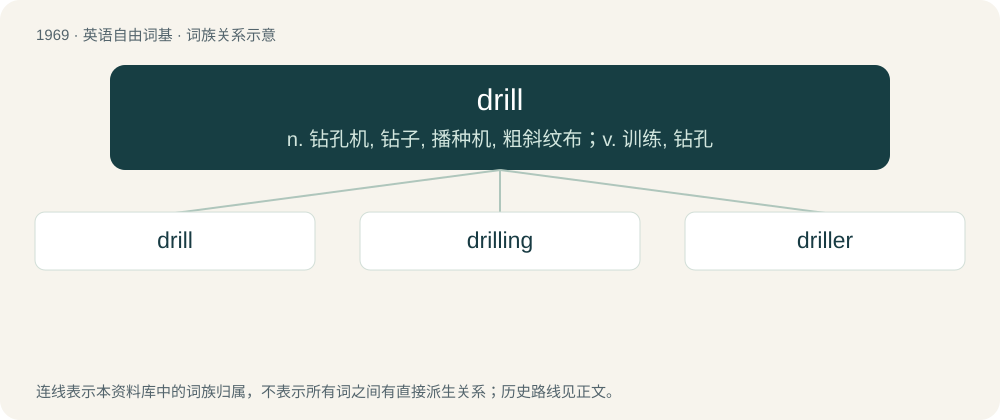

# 2084 · drill — n. 钻孔机, 钻子, 播种机, 粗斜纹布；v. 训练, 钻孔

[总目录](../00_总目录_按常用程度.md)

**类型**：英语自由词基　｜　**来源语言**：见词源记录

## 核心含义与来源

- 核心含义：n. 钻孔机, 钻子, 播种机, 粗斜纹布；v. 训练, 钻孔
- 英文含义：To create (a hole) by removing material with a drill (tool).
- 词形：drill

**多个词源／构词路径**：同一拼写可能有不同来源；以下按词性和含义分别列出。

**来源记录 1**（动词；To create (a hole) by removing material with a drill (tool).）

From Middle Dutch drillen (“bore, move in a circle”).

**来源记录 2**（名词；An agricultural implement for making holes for sowing seed, and sometimes so formed as to contain seeds and drop them into the hole made.）

Perhaps the same as Etymology 3; compare German Rille which can also mean "small furrow".

**来源记录 3**（动词；To cause to flow in drills or rills or by trickling; to drain by trickling.）

Uncertain. Compare the same sense of trill, and German trillen, drillen. Attestation predates Etymology 1.

**来源记录 4**（名词；An Old World monkey of West Africa, Mandrillus leucophaeus, similar in appearance to the mandrill, but lacking the colorful face.）

\] Source unknown. Probably of African origin; compare mandrill.

**来源记录 5**（名词；A strong, durable cotton fabric with a strong bias (diagonal) in the weave.）

From German Drillich (“denim, canvas, drill”).

## 词族图

## 单词速览（常用到不常用）

| 单词 | 音标 | 释义 |
|---|---|---|
| [drill](#w-1) | /dɹɪl/ | n. 钻孔机, 钻子, 播种机, 粗斜纹布；v. 训练, 钻孔 |
| [drilling](#w-2) | /ˈdɹɪlɪŋ/ | n. 演练；\[医\] 钻 |
| [driller](#w-3) | 美 /ˈdɹɪlɚ/ | n. 操练员, 钻床, 钻机, 钻探工 |

## 逐词详解

### 1. drill

**词性**：动词　｜　**音标**：/dɹɪl/

**中文释义**：n. 钻孔机, 钻子, 播种机, 粗斜纹布；v. 训练, 钻孔

**英文义项**：To create (a hole) by removing material with a drill (tool). / To practice, especially in (or as in) a military context.

**词源与演化**：

From Middle Dutch drillen (“bore, move in a circle”).

**例句**：

> The instructor drilled into us the importance of reading the instructions.

该用例对应义项：To repeat an idea frequently in order to encourage someone to remember it.

### 2. drilling

**词性**：名词　｜　**音标**：/ˈdɹɪlɪŋ/

**中文释义**：n. 演练；\[医\] 钻

**英文义项**：Making holes in objects. / Performing drills (exercises).

**构词拆分**：From drill + -ing.

**词源与演化**：

From drill + -ing.

**例句**：

> Tom used a wall scanner before drilling a hole in the wall.

### 3. driller

**词性**：名词　｜　**音标**：美 /ˈdɹɪlɚ/

**中文释义**：n. 操练员, 钻床, 钻机, 钻探工

**英文义项**：One who drills. / A person in charge of a drilling rig.

**构词拆分**：drill + -er

**词源与演化**：

From drill (verb) + -er.
