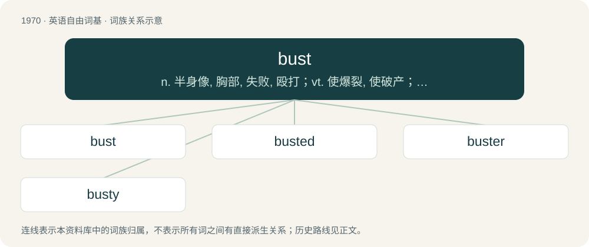

# 2087 · bust — n. 半身像, 胸部, 失败, 殴打；vt. 使爆裂, 使破产；vi. 爆裂, 破产

[总目录](../00_总目录_按常用程度.md)

**类型**：英语自由词基　｜　**来源语言**：见词源记录

## 核心含义与来源

- 核心含义：n. 半身像, 胸部, 失败, 殴打；vt. 使爆裂, 使破产；vi. 爆裂, 破产
- 英文含义：To break.
- 词形：bust

**多个词源／构词路径**：同一拼写可能有不同来源；以下按词性和含义分别列出。

**来源记录 1**（动词；To break.）

From Middle English busten, a variant of bursten, bresten (“to burst”). Compare Low German basten, a variant of barsten (“to burst”). Cognate with burst and bost.

**来源记录 2**（名词；A sculptural portrayal of a person's head and shoulders.）

Borrowed from French buste, from Italian busto (“torso, upper body”), assumed to stem from Latin bustum (“funeral monument, tomb," originally "funeral pyre, place where corpses are burned”). Perhaps shortened from Latin ambustum, neuter of ambustus (“scorched”), past participle of ambūrō (“burn all over, scorch”), from ambi- (“around”) + ūrō (“to burn”). Compare Old Norse beysti.

## 词族图

## 单词速览（常用到不常用）

| 单词 | 音标 | 释义 |
|---|---|---|
| [bust](#w-1) | 英 /bʌst/ | n. 半身像, 胸部, 失败, 殴打；vt. 使爆裂, 使破产；vi. 爆裂, 破产 |
| [busted](#w-2) | /ˈbʌs.tɪd/ | 【英文】Broke; having no money. |
| [buster](#w-3) | /ˈbʌstə/ | n. 庞然大物, 非凡的人, 闹饮, 驯马人, 小家伙, 小鬼, 炸弹, 巨型炸弹 |
| [busty](#w-4) | /ˈbʌsti/ | a. 大胸脯的, 胸部丰满的 |

## 逐词详解

### 1. bust

**词性**：动词　｜　**音标**：英 /bʌst/

**中文释义**：n. 半身像, 胸部, 失败, 殴打；vt. 使爆裂, 使破产；vi. 爆裂, 破产

**英文义项**：To break. / To arrest (someone or a group of people) for a crime.

**词源与演化**：

From Middle English busten, a variant of bursten, bresten (“to burst”). Compare Low German basten, a variant of barsten (“to burst”). Cognate with burst and bost.

**例句**：

> Aaron got busted by the feds for leaking confidential government documents on Reddit.

该用例对应义项：To arrest (someone or a group of people) for a crime.

### 2. busted

**词性**：形容词　｜　**音标**：/ˈbʌs.tɪd/

**英文义项**：Broke; having no money. / Caught in the act of doing something one shouldn't do.

**构词拆分**：bust + -ed

**词源与演化**：

From bust + -ed. See bust (Etymology 1).

**例句**：

> I saw you take that cookie from the cookie jar! You're busted!

该用例对应义项：Caught in the act of doing something one shouldn't do.

### 3. buster

**词性**：名词　｜　**音标**：/ˈbʌstə/

**中文释义**：n. 庞然大物, 非凡的人, 闹饮, 驯马人, 小家伙, 小鬼, 炸弹, 巨型炸弹

**英文义项**：Someone who or something that bursts, breaks, or destroys a specified thing. / Forming compounds denoting a team, weapon, or device specialized in the destruction of the first element.

**构词拆分**：bust + -er

**词源与演化**：

Originally a dialectal variant of burster; later influenced by bust + -er. The combining form of the term has appeared from the early 20th century but been especially prolific during three periods: in the 1930s, owing to the success of the radio series Gang Busters; in the 1940s, owing to its appearance as military slang; and in the 1980s, owing to the success of the movie Ghostbusters.

**例句**：

> Buster Keaton was one of Hollywood’s greatest silent comics.

### 4. busty

**词性**：形容词　｜　**音标**：/ˈbʌsti/

**中文释义**：a. 大胸脯的, 胸部丰满的

**英文义项**：Having large breasts.

**构词拆分**：bust + -y

**词源与演化**：

From bust (“breast”) + -y.

**例句**：

> I could see a busty blonde at the end of the boardwalk.

该用例对应义项：Having large breasts.
