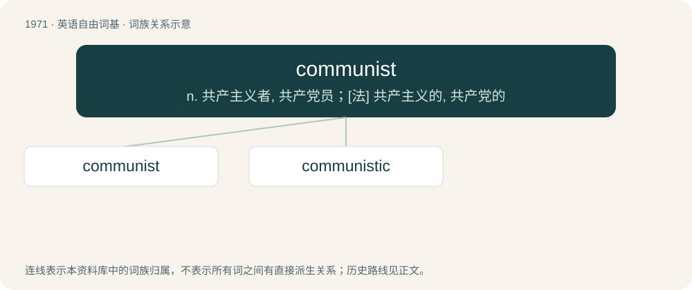

# 2088 · communist — n. 共产主义者, 共产党员；\[法\] 共产主义的, 共产党的

[总目录](../00_总目录_按常用程度.md)

**类型**：英语自由词基　｜　**来源语言**：见词源记录

## 核心含义与来源

- 核心含义：n. 共产主义者, 共产党员；\[法\] 共产主义的, 共产党的
- 英文含义：Of, relating to, supporting, or advocating communism.
- 词形：communist

**来源记录 1**（形容词；Of, relating to, supporting, or advocating communism.）

From French communiste, from commun (“common, communal”) + -iste (“-ist”). By surface analysis, commune + -ist.

## 词族图

## 单词速览（常用到不常用）

| 单词 | 音标 | 释义 |
|---|---|---|
| [communist](#w-1) | 英 /ˈkɒm.jʊ.nɪst/；美 /ˈkɑ.mjə.nɪst/ | n. 共产主义者, 共产党员；\[法\] 共产主义的, 共产党的 |
| [communistic](#w-2) | /.kɒmjuˈnistik/ | a. 共产主义的, 共产主义者的 |

## 逐词详解

### 1. communist

**词性**：形容词　｜　**音标**：英 /ˈkɒm.jʊ.nɪst/；美 /ˈkɑ.mjə.nɪst/

**中文释义**：n. 共产主义者, 共产党员；\[法\] 共产主义的, 共产党的

**英文义项**：Of, relating to, supporting, or advocating communism.

**词源与演化**：

From French communiste, from commun (“common, communal”) + -iste (“-ist”). By surface analysis, commune + -ist.

**例句**：

> The Communist Renaissance began in the latter half of the 21st century.

### 2. communistic

**词性**：形容词　｜　**音标**：/.kɒmjuˈnistik/

**中文释义**：a. 共产主义的, 共产主义者的

**英文义项**：Characteristic of communism. / Living or having their nests in common.

**构词拆分**：communist + -ic

**词源与演化**：

From communist + -ic.

**用法示例／搭配（非完整句）**：

> communistic birds

该用例对应义项：Living or having their nests in common.
