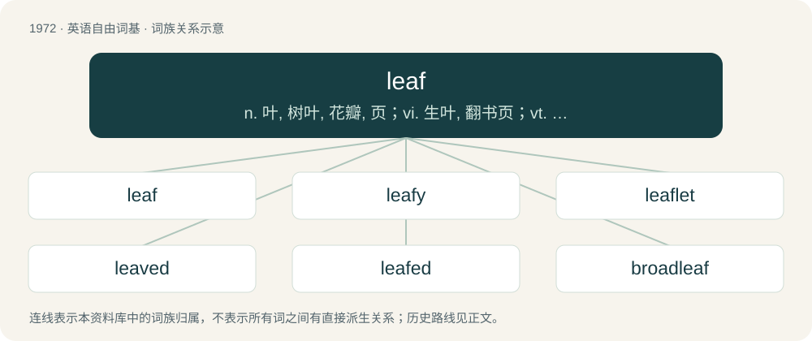

# 2089 · leaf — n. 叶, 树叶, 花瓣, 页；vi. 生叶, 翻书页；vt. 在...上长叶, 翻...的页

[总目录](../00_总目录_按常用程度.md)

**类型**：英语自由词基　｜　**来源语言**：见词源记录

## 核心含义与来源

- 核心含义：n. 叶, 树叶, 花瓣, 页；vi. 生叶, 翻书页；vt. 在...上长叶, 翻...的页
- 英文含义：The usually green and flat organ that represents the most prominent feature of most vegetative plants.
- 词形：leaf

**来源记录 1**（名词；The usually green and flat organ that represents the most prominent feature of most vegetative plants.）

From Middle English lef, leef, from Old English lēaf, from Proto-West Germanic \*laub, from Proto-Germanic \*laubą (“leaf”), from Proto-Indo-European \*lowbʰ-o-m, from \*lewbʰ- (“to cut off”). Cognates Cognate with Scots leaf (“leaf”), Yola laafe (“leaf”), North Frisian luuf (“leaf”), Saterland Frisian Loof (“leaf”), West Frisian leaf (“leaf”), Cimbrian loap (“leaf”), Dutch loof (“foliage”), German Laub (“leaves”), German Low German Loov (“leaf”), Luxembourgish Laf (“foliage, leaves”), Mòcheno lap (“leaf”), Vilamovian łaub, łaup, łojp (“leaf”), Danish and Norwegian Bokmål løv (“leaf”), Faroese leyv (“leaf”), Icelandic lauf (“leaf”), Norwegian Nynorsk lauv (“leaf”), Swedish löv (“leaf”), Gothic 𐌻𐌰𐌿𐍆𐍃 (laufs, “leaf”); also Irish luibh (“herb, plant”), Latin liber (“bast; book”), Albanian labë (“rind”), Lithuanian lúobas (“bark; bast”), Polish łub (“bark”), Russian луб (lub, “bast”). (Internet slang: Canadian): In reference to the maple leaf as national symbol.

## 词族图

## 单词速览（常用到不常用）

| 单词 | 音标 | 释义 |
|---|---|---|
| [leaf](#w-1) | 英 /liːf/；美 /lif/ | n. 叶, 树叶, 花瓣, 页；vi. 生叶, 翻书页；vt. 在...上长叶, 翻...的页 |
| [leafy](#w-2) | /ˈliːfi/ | a. 叶茂盛的, 多叶的, 叶状的 |
| [leaflet](#w-3) | /ˈliːflɪt/ | n. 小叶, 传单；\[医\] 小叶 |
| [leaved](#w-4) | /liːvd/ | a. 有叶的 |
| [leafed](#w-5) | /liːft/ | a. 有叶的 |
| [broadleaf](#w-6) | /ˈbrɒːdliːf/ | n. 阔烟叶 |
| [leafless](#w-7) | /ˈliːflis/ | a. 无叶的 |
| [cloverleaf](#w-8) | 英 /ˈkləʊvəliːf/；美 /ˈkloʊvɚliːf/ | n. 四叶苜蓿形的立体道路交叉点 |

## 逐词详解

### 1. leaf

**词性**：名词　｜　**音标**：英 /liːf/；美 /lif/

**中文释义**：n. 叶, 树叶, 花瓣, 页；vi. 生叶, 翻书页；vt. 在...上长叶, 翻...的页

**英文义项**：The usually green and flat organ that represents the most prominent feature of most vegetative plants. / A foliage leaf or any of the many and often considerably different structures it can specialise into.

**词源与演化**：

From Middle English lef, leef, from Old English lēaf, from Proto-West Germanic \*laub, from Proto-Germanic \*laubą (“leaf”), from Proto-Indo-European \*lowbʰ-o-m, from \*lewbʰ- (“to cut off”). Cognates Cognate with Scots leaf (“leaf”), Yola laafe (“leaf”), North Frisian luuf (“leaf”), Saterland Frisian Loof (“leaf”), West Frisian leaf (“leaf”), Cimbrian loap (“leaf”), Dutch loof (“foliage”), German Laub (“leaves”), German Low German Loov (“leaf”), Luxembourgish Laf (“foliage, leaves”), Mòcheno lap (“leaf”), Vilamovian łaub, łaup, łojp (“leaf”), Danish and Norwegian Bokmål løv (“leaf”), Faroese leyv (“leaf”), Icelandic lauf (“leaf”), Norwegian Nynorsk lauv (“leaf”), Swedish löv (“leaf”), Gothic 𐌻𐌰𐌿𐍆𐍃 (laufs, “leaf”); also Irish luibh (“herb, plant”), Latin liber (“bast; book”), Albanian labë (“rind”), Lithuanian lúobas (“bark; bast”), Polish łub (“bark”), Russian луб (lub, “bast”). (Internet slang: Canadian): In reference to the maple leaf as national symbol.

**例句**：

> The train car has one single-leaf and two double-leaf doors per side.

该用例对应义项：A moveable panel, e.g. of a bridge or door, originally one that hinged but now also applied to other forms of movement.

### 2. leafy

**词性**：形容词　｜　**音标**：/ˈliːfi/

**中文释义**：a. 叶茂盛的, 多叶的, 叶状的

**英文义项**：Covered with leaves. / Containing much foliage.

**构词拆分**：leaf + -y

**词源与演化**：

From leaf + -y.

**例句**：

> They live in a beautiful house in a leafy suburb.

该用例对应义项：Wealthy, middle- or upper-class.

### 3. leaflet

**词性**：名词　｜　**音标**：/ˈliːflɪt/

**中文释义**：n. 小叶, 传单；\[医\] 小叶

**英文义项**：One of the components of a compound leaf. / A small plant leaf.

**构词拆分**：leaf + -let

**词源与演化**：

From leaf + -let.

**例句**：

> The new leaflets at the end of the branch were a lighter shade of green than the mature leaves.

该用例对应义项：A small plant leaf.

### 4. leaved

**词性**：形容词　｜　**音标**：/liːvd/

**中文释义**：a. 有叶的

**英文义项**：Having a leaf, leaves or folds.

**构词拆分**：leaf + -ed

**词源与演化**：

From Middle English leuued, levyd, equivalent to leaf + -ed.

### 5. leafed

**词性**：形容词　｜　**音标**：/liːft/

**中文释义**：a. 有叶的

**英文义项**：Having a leaf or leaves (of the specified kind).

**构词拆分**：leaf + -ed

**词源与演化**：

From leaf + -ed (having).

**例句**：

> A fully leafed tree.

该用例对应义项：having leaves or leaves as specified; often used in combination

### 6. broadleaf

**词性**：形容词　｜　**音标**：/ˈbrɒːdliːf/

**中文释义**：n. 阔烟叶

**英文义项**：Pertaining to trees with relatively broad, flat leaves as opposed to needles, or woodlands made up of such trees. / Used in the name of a plant or tree: having especially broad leaves.

**构词拆分**：broad + leaf

**词源与演化**：

From broad + leaf.

**例句**：

> As you travel farther south, you begin to see more broadleaf evergreens in the forests.

### 7. leafless

**词性**：形容词　｜　**音标**：/ˈliːflis/

**中文释义**：a. 无叶的

**英文义项**：Of plants or trees, without leaves.

**构词拆分**：leaf + -less

**词源与演化**：

From earlier leaveless, from Middle English leveles, equivalent to leaf + -less.

**例句**：

> In winter the leafless trees look cold.

该用例对应义项：Of plants or trees, without leaves.

### 8. cloverleaf

**词性**：形容词　｜　**音标**：英 /ˈkləʊvəliːf/；美 /ˈkloʊvɚliːf/

**中文释义**：n. 四叶苜蓿形的立体道路交叉点

**英文义项**：In the form of the leaf of a clover plant; cloverleafed.

**构词拆分**：clover + leaf

**词源与演化**：

From clover + leaf.

**用法示例／搭配（非完整句）**：

> a fancy cloverleaf motif

该用例对应义项：In the form of the leaf of a clover plant; cloverleafed.
