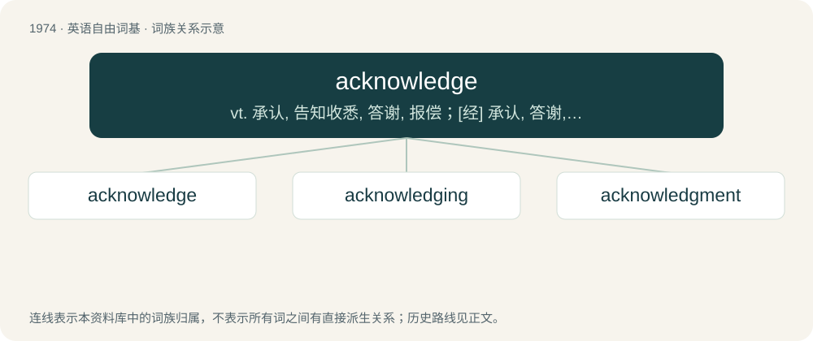

# 2091 · acknowledge — vt. 承认, 告知收悉, 答谢, 报偿；\[经\] 承认, 答谢, 收到的通知

[总目录](../00_总目录_按常用程度.md)

**类型**：英语自由词基　｜　**来源语言**：见词源记录

## 核心含义与来源

- 核心含义：vt. 承认, 告知收悉, 答谢, 报偿；\[经\] 承认, 答谢, 收到的通知
- 英文含义：To admit the knowledge of; to recognize as a fact or truth; to declare one's belief in.
- 词形：acknowledge

**来源记录 1**（动词；To admit the knowledge of; to recognize as a fact or truth; to declare one's belief in.）

Recorded since 1553, a blend of Middle English aknowen (“to recognize, acknowledge”) and knowlechen (“to discover, reveal, acknowledge”). The former verb is from Old English oncnāwan, ācnāwan (“to know, recognize, acknowledge”), from on + cnāwan (“to know”). The latter is derived from the noun at hand in knowledge. For the formation compare Latin agnōscō and Russian призна́ть (priznátʹ), with cognate roots. The /k/-sound was preserved by being redistributed to the preceding syllable: /əˈkn-/ &gt; /əkˈn-/. The -c- was inserted accordingly to reflect this pronunciation more clearly.

## 词族图

## 单词速览（常用到不常用）

| 单词 | 音标 | 释义 |
|---|---|---|
| [acknowledge](#w-1) | 英 /əkˈnɒl.ɪd͡ʒ/；美 /əkˈnɑ.lɪd͡ʒ/ | vt. 承认, 告知收悉, 答谢, 报偿；\[经\] 承认, 答谢, 收到的通知 |
| [acknowledging](#w-2) |  | n. 确认；答谢顾客 |
| [acknowledgment](#w-3) | 英 /əkˈnɒl.ɪd͡ʒ.mənt/；美 /əkˈnɑ.lɪd͡ʒ.mənt/ | n. 承认, 答谢, 认可, 谢礼, 收到的通知, 收到的回音, 谢意；\[计\] 肯定, 确认认可 |

## 逐词详解

### 1. acknowledge

**词性**：动词　｜　**音标**：英 /əkˈnɒl.ɪd͡ʒ/；美 /əkˈnɑ.lɪd͡ʒ/

**中文释义**：vt. 承认, 告知收悉, 答谢, 报偿；\[经\] 承认, 答谢, 收到的通知

**英文义项**：To admit the knowledge of; to recognize as a fact or truth; to declare one's belief in. / To own or recognize in a particular quality, character or relationship; to admit the claims or authority of; to give recognition to.

**词源与演化**：

Recorded since 1553, a blend of Middle English aknowen (“to recognize, acknowledge”) and knowlechen (“to discover, reveal, acknowledge”). The former verb is from Old English oncnāwan, ācnāwan (“to know, recognize, acknowledge”), from on + cnāwan (“to know”). The latter is derived from the noun at hand in knowledge. For the formation compare Latin agnōscō and Russian призна́ть (priznátʹ), with cognate roots. The /k/-sound was preserved by being redistributed to the preceding syllable: /əˈkn-/ &gt; /əkˈn-/. The -c- was inserted accordingly to reflect this pronunciation more clearly.

**例句**：

> This is to acknowledge your kind invitation to participate in the upcoming debate.

该用例对应义项：To report (the receipt of a message to its sender).

### 2. acknowledging

**词性**：形容词

**中文释义**：n. 确认；答谢顾客

**英文义项**：That acknowledges, in various sense; (especially) that notices or recognises someone or something.

**构词拆分**：From acknowledge + -ing.

**词源与演化**：

From acknowledge + -ing.

**例句**：

> Acknowledging my progress motivates me to keep setting new goals for myself.

### 3. acknowledgment

**词性**：名词　｜　**音标**：英 /əkˈnɒl.ɪd͡ʒ.mənt/；美 /əkˈnɑ.lɪd͡ʒ.mənt/

**中文释义**：n. 承认, 答谢, 认可, 谢礼, 收到的通知, 收到的回音, 谢意；\[计\] 肯定, 确认认可

**英文义项**：The act of acknowledging / The act of recognizing in a particular character or relationship; recognition of existence, authority, truth, or genuineness.

**构词拆分**：acknowledge + -ment

**词源与演化**：

From acknowledge + -ment.

**例句**：

> He just grunted in acknowledgment of my greeting.

该用例对应义项：The act of recognizing in a particular character or relationship; recognition of existence, authority, truth, or genuineness.
