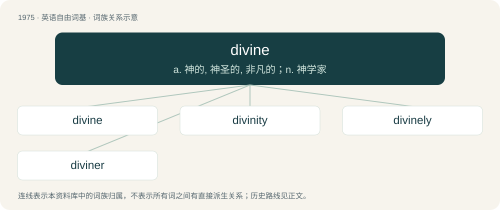

# 2092 · divine — a. 神的, 神圣的, 非凡的；n. 神学家

[总目录](../00_总目录_按常用程度.md)

**类型**：英语自由词基　｜　**来源语言**：见词源记录

## 核心含义与来源

- 核心含义：a. 神的, 神圣的, 非凡的；n. 神学家
- 英文含义：Of or pertaining to a god.
- 词形：divine

**多个词源／构词路径**：同一拼写可能有不同来源；以下按词性和含义分别列出。

**来源记录 1**（形容词；Of or pertaining to a god.）

From Old French divin, from Latin dīvīnus (“of a god”), from divus (“god”). Displaced native Old English godcund.

**来源记录 2**（动词；To foretell (something), especially by the use of divination.）

Replaced Middle English devine, devin from Middle French deviner, from Latin dīvīnō.

## 词族图

## 单词速览（常用到不常用）

| 单词 | 音标 | 释义 |
|---|---|---|
| [divine](#w-1) | /dɪˈvaɪn/ | a. 神的, 神圣的, 非凡的；n. 神学家 |
| [divinity](#w-2) | 英 /dɪˈvɪnɪti/；美 /dɪˈvɪnɪti/ | n. 神, 神性 |
| [divinely](#w-3) | /diˈvainli/ | adv. 象神一样地, 凭神的力量, 极度地 |
| [diviner](#w-4) | 英 /dɪˈvaɪnə(ɹ)/；美 /dɪˈvaɪnɚ/ | n. 占卜者, 推测者, 预言者 |

## 逐词详解

### 1. divine

**词性**：形容词　｜　**音标**：/dɪˈvaɪn/

**中文释义**：a. 神的, 神圣的, 非凡的；n. 神学家

**英文义项**：Of or pertaining to a god. / Eternal, holy, or otherwise godlike.

**词源与演化**：

From Old French divin, from Latin dīvīnus (“of a god”), from divus (“god”). Displaced native Old English godcund.

**用法示例／搭配（非完整句）**：

> divine existence

该用例对应义项：Of or pertaining to a god.

### 2. divinity

**词性**：名词　｜　**音标**：英 /dɪˈvɪnɪti/；美 /dɪˈvɪnɪti/

**中文释义**：n. 神, 神性

**英文义项**：The state, position, or fact of being a god or God. / Synonym of deity.

**构词拆分**：divine + -ity

**词源与演化**：

From Old French divinité, from Latin divinitas. Composed of divine + -ity. Displaced native Old English godcundnes.

**例句**：

> I studied divinity at Harvard Divinity School.

该用例对应义项：The study of religion or religions.

### 3. divinely

**词性**：副词　｜　**音标**：/diˈvainli/

**中文释义**：adv. 象神一样地, 凭神的力量, 极度地

**英文义项**：In a divine manner.

**构词拆分**：divine + -ly

**词源与演化**：

From divine + -ly.

**例句**：

> The divinely appointed means of rescue from temporal existence.

该用例对应义项：by divine means

### 4. diviner

**词性**：名词　｜　**音标**：英 /dɪˈvaɪnə(ɹ)/；美 /dɪˈvaɪnɚ/

**中文释义**：n. 占卜者, 推测者, 预言者

**英文义项**：One who foretells the future. / One who divines or conjectures.

**构词拆分**：divine + -er

**词源与演化**：

From Middle English divinour, from Latin dīvīnātor (“diviner; fortune-teller; soothsayer”), from dīvīnāre (“to foresee, to foretell”). Doublet of divinator. Equivalent to divine + -er.

**例句**：

> The Ying Yang diviner may not predict his own fate.
