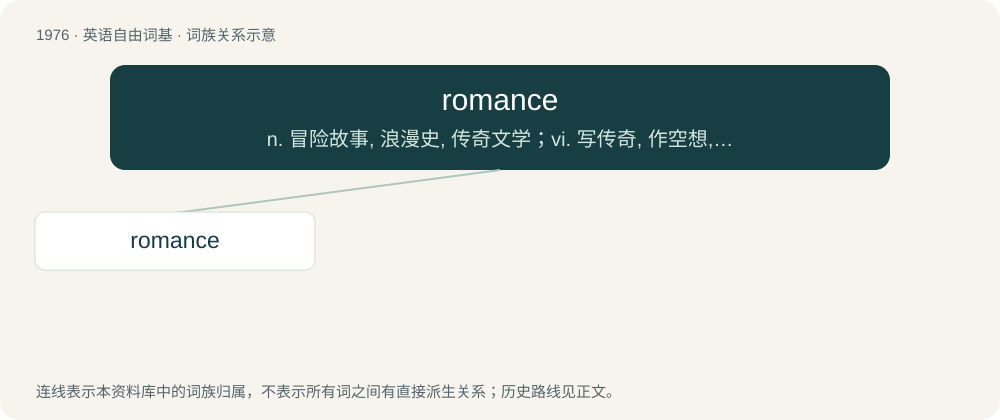

# 2093 · romance — n. 冒险故事, 浪漫史, 传奇文学；vi. 写传奇, 作空想, 虚构

[总目录](../00_总目录_按常用程度.md)

**类型**：英语自由词基　｜　**来源语言**：见词源记录

## 核心含义与来源

- 核心含义：n. 冒险故事, 浪漫史, 传奇文学；vi. 写传奇, 作空想, 虚构
- 英文含义：An intimate relationship between two people; a love affair.
- 词形：romance

**来源记录 1**（名词；An intimate relationship between two people; a love affair.）

From Middle English romauns, roumance, borrowed from Anglo-Norman and Old French romanz, romans (the vernacular language of France, as opposed to Latin), from Medieval Latin rōmānicē, Vulgar Latin rōmānicē (“in the Roman language”, adverb), from Latin rōmānicus (“roman”, adjective) from rōmānus (“a Roman”). Doublet of Romansch.

## 词族图

## 单词速览（常用到不常用）

| 单词 | 音标 | 释义 |
|---|---|---|
| [romance](#w-1) | 英 /rə(ʊ)ˈman(t)s/；美 /ˈroʊˌmæn(t)s/ | n. 冒险故事, 浪漫史, 传奇文学；vi. 写传奇, 作空想, 虚构 |

## 逐词详解

### 1. romance

**词性**：名词　｜　**音标**：英 /rə(ʊ)ˈman(t)s/；美 /ˈroʊˌmæn(t)s/

**中文释义**：n. 冒险故事, 浪漫史, 传奇文学；vi. 写传奇, 作空想, 虚构

**英文义项**：An intimate relationship between two people; a love affair. / A strong obsession or attachment for something or someone.

**词源与演化**：

From Middle English romauns, roumance, borrowed from Anglo-Norman and Old French romanz, romans (the vernacular language of France, as opposed to Latin), from Medieval Latin rōmānicē, Vulgar Latin rōmānicē (“in the Roman language”, adverb), from Latin rōmānicus (“roman”, adjective) from rōmānus (“a Roman”). Doublet of Romansch.

**例句**：

> She was so full of romance she would forget what she was supposed to be doing.

该用例对应义项：A dreamy, imaginative habit of mind; a disposition to ignore what is real.
